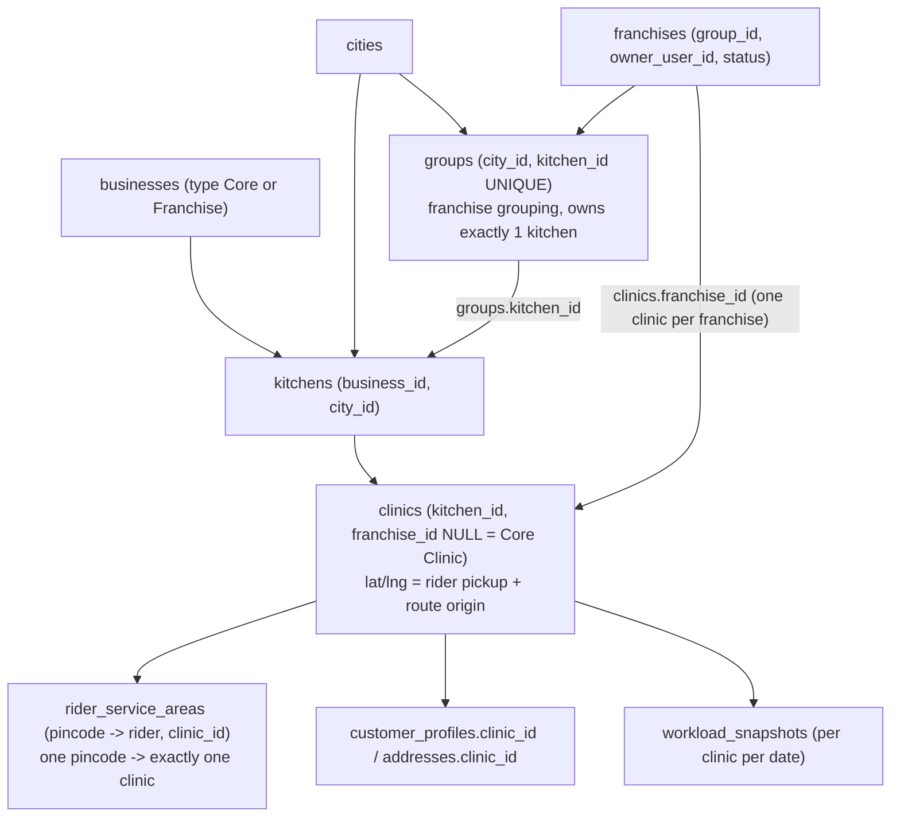
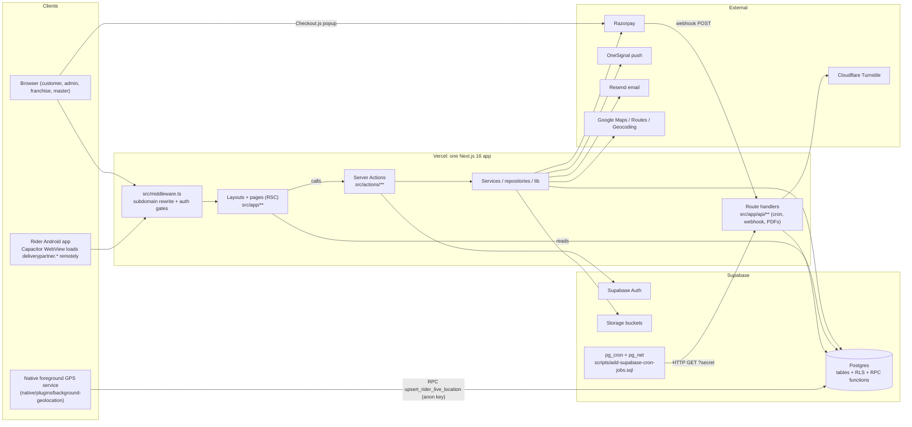
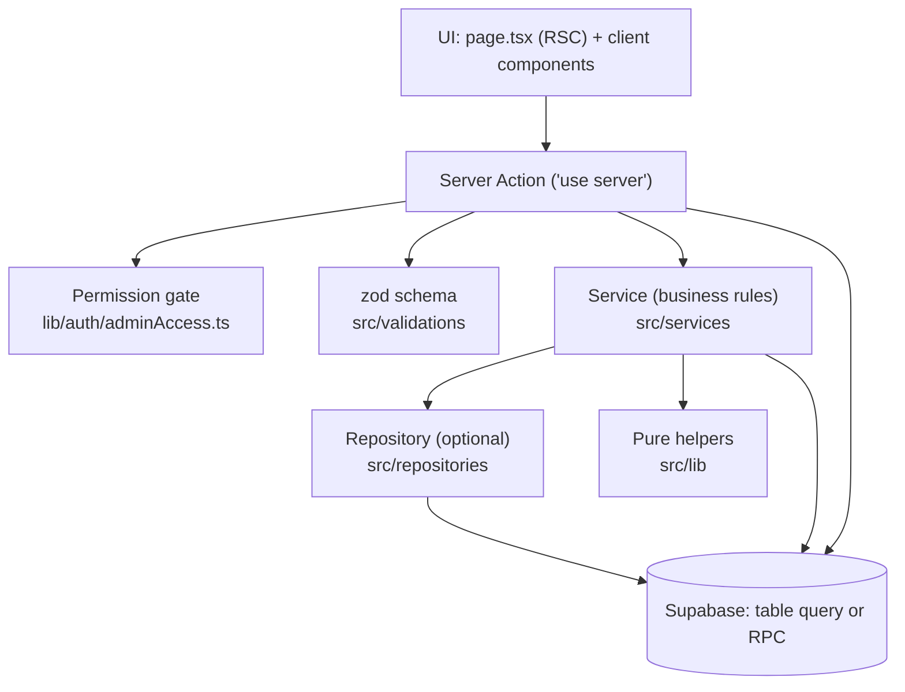

# 01 — The Big Picture

## 1. What the product is

ArogyaDiet is a health-food business in Hyderabad that sells three things, and this codebase runs all of them:

| Product line (`subscriptions.customer_category`) | What the customer buys | Daily operation |
|---|---|---|
| **MEAL** | A meal subscription (for example 30 delivery days). Customer can pause days, change meal type per day, change address per day. | Every evening the system creates tomorrow's delivery orders; at night it assigns riders and builds routes; riders deliver in the morning. |
| **KIT** | A diet kit shipped by courier. The customer logs food, weight and activity daily for the kit period; a dietitian watches. | No riders. Courier shipping info, daily self-logs, auto-expiry, PDF report. |
| **ACCOMMODATION** | A wellness stay at a clinic (nightly billing, extensions, add-on services). | Stay starts/ends via a nightly cron, daily health logs, invoices, health report PDF. |

There are also **shop products** (add-on items like oils and powders). A MEAL customer buys them in the app and they ride along with the next meal delivery.

The business has two kinds of operators:
- **Core business**: ArogyaDiet's own kitchens and clinics (Hyderabad).
- **Franchises**: partner operators in other cities who run their own customers, riders and stock, using the same software but seeing only their own data.

## 2. The five portals

One Next.js app, deployed once on Vercel, serves five different websites. The subdomain decides which one you get (`src/middleware.ts`, the `portals` map).

| Subdomain | Internal folder | Who logs in (`roles.code`) | Login method | Built for |
|---|---|---|---|---|
| `customer.*` (and any `*.vercel.app` preview) | `src/app/customer` | `CUSTOMER` | Mobile + 6-digit PIN | Phone-first responsive |
| `deliverypartner.*` | `src/app/rider` | `RIDER` | Email + password | Android app (Capacitor WebView) |
| `admin.*` | `src/app/admin` | `ADMIN` (with access levels, incl. dietitian) | Email + password | Desktop operations |
| `franchies.*` (spelled this way in code) | `src/app/franchise` | `FRANCHISE_ADMIN` | Email + password | Franchise operations |
| `master.*` | `src/app/master` | `MASTER_ADMIN` | Email + password | Super-admin, BI, hierarchy |

The browser never sees `/admin/...` in the URL. Middleware **rewrites** (serves a different internal path without changing the address bar) `admin.arogyadiet.com/customers` to `/admin/customers`.

## 3. Tenancy model (who owns what data)

**Multi-tenancy** means one database serves several independent customers of the software ("tenants") and each must only see its own rows. Here a tenant is a franchise. The core business is "tenant NULL".

The rule used everywhere: **`franchise_id IS NULL` = core business; `franchise_id = <uuid>` = that franchise.** Tables such as `customer_profiles`, `subscriptions`, `delivery_orders`, `delivery_batches`, `rider_profiles`, `rider_service_areas`, `payments`, `addon_orders` carry a `franchise_id` column (`scripts/add-franchise-id-columns.sql`).

On top of that sits the **clinic hierarchy** (`scripts/create-clinic-hierarchy-tables.sql`):

Why clinics matter: a customer's address pincode resolves to a clinic. The clinic is stamped on each delivery order when it is created (`delivery_orders.clinic_id`), and the dispatch engine routes each clinic separately using the clinic's coordinates as the route start. A clinic never stores `business_id`; it is derived through its kitchen.

Two switches control franchise behaviour:
- `FRANCHISE_FEATURES_ENABLED` env var (`src/lib/franchise/constants.ts`). Only the exact string `"true"` turns it on. When off, all franchise branches are inert.
- Franchise RLS policies exist in SQL but are switched on/off by separate scripts (`enable-franchise-rls.sql` / `disable-franchise-rls.sql`). Whether they are on in production is **UNVERIFIED**; the app code does not depend on them (see `06`).

## 4. End-to-end architecture

How to read it:
1. Every page request goes through middleware first. API routes skip middleware's auth logic.
2. Pages are Server Components that read from Supabase on the server and pass plain data to client components.
3. Client components call Server Actions to change data. Actions validate, check permission, then write (often through a service and sometimes an RPC).
4. Time-based work (orders, dispatch, stays, kits) is triggered by Supabase pg_cron making HTTP calls to `/api/cron/*` on the admin domain.
5. Rider GPS is uploaded by native Android code directly to a Postgres function, not through Next.js.

## 5. The layering inside the app

In practice the layering is not strict. Many actions query Supabase directly. Big multi-table writes that must be all-or-nothing are pushed into Postgres functions (RPCs). Details in `08`.

## 6. Tech stack (from `package.json`)

| Area | Choice |
|---|---|
| Framework | Next.js 16.2.6 App Router, React 19.2.4, TypeScript 5 |
| Data | Supabase (`@supabase/supabase-js` 2.106, `@supabase/ssr` 0.10) |
| UI | Tailwind 4, shadcn/Radix, lucide icons, sonner toasts, recharts |
| Forms | react-hook-form + zod 4 |
| State | zustand 5 (carts), TanStack Query 5 (some client fetching), TanStack Table |
| Payments | `razorpay` Node SDK + Checkout.js on the client |
| Push / email | `@onesignal/node-onesignal`, `resend` |
| Maps | `@react-google-maps/api`, `@googlemaps/js-api-loader`, Google Routes REST |
| Documents | `@react-pdf/renderer` (PDF), `xlsx` (Excel), `qrcode`, `html2canvas` |
| Mobile | Capacitor 8 (`@capacitor/core`, `@capacitor/app`, geolocation, keep-awake), local plugin `file:./native/plugins/background-geolocation` |
| Auth extras | `bcryptjs` (PIN hashing) |
| Tests | vitest 4, fast-check (property tests), Testing Library, jsdom, axe-core |

## 7. Things the old docs say that are no longer true

These were checked against the current tree:
- `AI_CONTEXT/PROJECT_OVERVIEW.md` says Next.js 15 and only 4 portals. Code: Next 16, 5 portals.
- `AI_CONTEXT/ARCHITECTURE.md` mentions `src/modules/*`. That folder does not exist.
- `architecture-analysis` lists a duplicate `admin/(main)/inventory` tree, `/api/temp-fix-schema`, `admin/(main)/test-routing` and `master/subscription`. None exist now. Admin inventory lives only in `src/app/admin/inventory/` with its own layout.
- `architecture-analysis` says `runDailyPipeline` is the live pipeline. In code it is only called by tests; the cron routes call the steps directly (see `10`).
- `docs/system-rules.md` names the master role `MASTER`; code uses `MASTER_ADMIN`.
- `AI_CONTEXT/BUSINESS_RULES.md` says payout = Haversine × 1.3 × system rate. Current code uses Google Routes distance first, Haversine fallback, and a per-clinic rate from `RateConfigService` (default ₹16/km constant `DEFAULT_RIDER_PAYOUT_RATE_PER_KM`).

## 8. One sentence per portal for interviews

- **Customer**: "A mobile-first portal where a subscriber logs in with mobile + PIN, manages a meal calendar with a 5 PM cutoff, buys add-ons with Razorpay, and tracks the rider live."
- **Rider**: "A Capacitor Android shell around the web rider portal, with a native foreground service that keeps uploading GPS even when the phone is locked."
- **Admin**: "The operations control room: onboarding, subscriptions, dispatch, inventory, finance — gated per section by an access-level and per-group manage/view permissions."
- **Franchise**: "A tenant-scoped copy of the admin tools, filtered by `franchise_id`, with its own users, riders, pincodes and stock received from the central kitchen."
- **Master**: "Super-admin: builds the business → city → group → kitchen → clinic → franchise hierarchy, sets rates, provisions franchise users, resolves disputes, and views BI."
