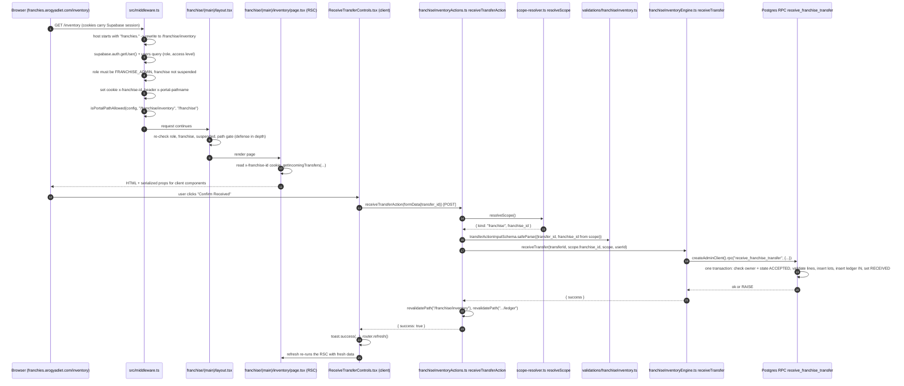
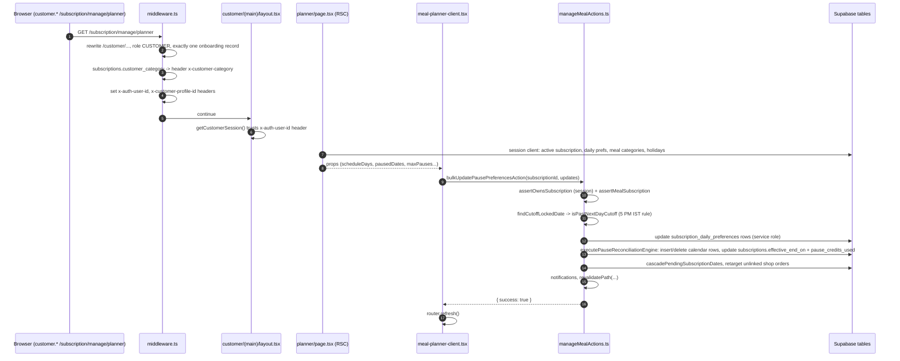

# 04 — The Life of a Request

This doc follows one real click from the browser to the database and back, file by file. Then it shows a second, simpler example from the customer portal, because the two portals use slightly different patterns.

Terms first:
- **Middleware**: code that runs before any page, for every matching request (`src/middleware.ts`). Think of it as a router guard that runs on the server.
- **Rewrite**: the server serves a different internal path while the browser URL stays the same.
- **Layout**: `layout.tsx` wraps all pages under its folder; it runs on the server before the page.
- **RSC**: React Server Component. Runs on the server, can `await` the database, sends rendered output to the browser.
- **Client component**: file with `"use client"`. Runs in the browser, has state and event handlers.
- **Server Action**: a function in a `"use server"` file. Calling it from a client component sends a POST to the same URL with an action id; Next.js runs the function on the server and returns the result.
- **RPC**: "remote procedure call". In Supabase this means calling a Postgres function with `supabase.rpc("name", args)`.
- **SECURITY DEFINER**: a Postgres function that runs with the privileges of the user who created it (usually the owner), not the caller.

---

## Example A — Franchise operator clicks "Confirm Received" on a stock transfer

Business context: the central kitchen dispatched stock to a franchise. The franchise accepted it, the goods arrived, and the operator now confirms receipt. This must create stock lots in the franchise inventory and a ledger row, all-or-nothing.

### Hop by hop

1. **Browser → Vercel.** The URL is `https://franchies.arogyadiet.com/inventory`. The Supabase session lives in cookies set at login (`@supabase/ssr` manages them).

2. **Middleware, subdomain step** (`src/middleware.ts`, `middleware()`):
   - Early exits: `/api/*`, `/sandbox`, OneSignal worker files, `/architecture` skip everything below.
   - The `portals` map turns `franchies` into `/franchise`. A `*.vercel.app` host is forced to `customer`.
   - If the flag `FRANCHISE_FEATURES_ENABLED` is on and the host has an unknown subdomain, redirect to `/unauthorized`.
   - `NextResponse.rewrite` to `/franchise/inventory`.

3. **Middleware, session step.** It builds its own `createServerClient` bound to the request cookies (it cannot use `src/lib/supabase/server.ts` because that relies on `next/headers`). `auth.getUser()` validates the JWT with Supabase (a network call, not just a cookie decode). If Supabase rotates the token, `setAll` writes new cookies on the response. Then **one** query: `users` with `admin_access_level, admin_operations_access, roles(code), customer_profiles!customer_profiles_user_id_fkey(...)`. The `!fkey` hint is needed because `customer_profiles` has two foreign keys to `users`.

4. **Middleware, gate step** (for `franchies`):
   - Role must be `FRANCHISE_ADMIN`, else `/unauthorized`.
   - Second query: `users.franchise_id`; no franchise → `/unauthorized`.
   - Third query: `franchises.status, owner_user_id`; `suspended` → `/unauthorized`.
   - Sets an `httpOnly` cookie `x-franchise-id` and the internal header `x-portal-pathname`.
   - Owner override: if `franchises.owner_user_id === users.id`, the user is treated as full access (`inventory_operations`).
   - `isPortalPathAllowed(config, "/franchise/inventory", "/franchise")` (`src/lib/auth/adminAccessCore.ts`) maps the path onto the admin path `/admin/inventory`, classifies it as the **inventory** area, and allows it only for levels `inventory` or `inventory_operations`. Denied users go to `landingRouteFor(level)`.

5. **Layout** (`src/app/franchise/(main)/layout.tsx`): repeats the role, franchise, suspended and path checks with its own SSR client, using the `x-portal-pathname` header. Why repeat? Middleware is the fast first gate, but layouts are the last code before the page renders; if a future middleware change or matcher gap skips a path, the layout still blocks. It also builds the navbar with the user's allowed groups.

6. **Page (RSC)** (`src/app/franchise/(main)/inventory/page.tsx`): reads `x-franchise-id` from cookies, calls `getFranchiseInventoryCatalog` and `getIncomingTransfers` from `src/services/franchiseInventoryEngine.ts`, maps rows into the shape the shared `InventoryDashboard` component expects, and renders `IncomingTransfersPanel` (client) with the transfers as props. `export const revalidate = 0` makes the page always dynamic.

7. **Client component** (`_components/ReceiveTransferControls.tsx`): on click, builds a `FormData` with only `transfer_id` and calls `receiveTransferAction` inside `startTransition` (so the button can show a spinner via `isPending`).

8. **Server Action** (`src/actions/franchise-actions/franchiseInventoryActions.ts`, `receiveTransferAction`):
   - `resolveScope()` (`src/lib/auth/scope-resolver.ts`) re-derives who the caller is from the session. It never trusts a franchise id from the client.
   - zod: `transferActionInputSchema.safeParse({ transfer_id, franchise_id: scope.franchise_id })`. On failure it returns `{ success: false, error, field }` instead of throwing.
   - Looks up the internal `users.id` for the audit column.

9. **Service** (`receiveTransfer` in `franchiseInventoryEngine.ts`): calls `createAdminClient().rpc("receive_franchise_transfer", { p_transfer_id, p_franchise_id, p_acted_by })`.

10. **Database** (`scripts/create-receive-franchise-transfer-rpc.sql`): a `plpgsql` function, `SECURITY DEFINER`. A function body runs in **one transaction**: it checks the transfer belongs to this franchise and is `ACCEPTED`, validates every line (quantity integer 1..1,000,000, batch number, expiry, product is a finished good), inserts `franchise_inventory_lots`, writes the `franchise_inventory_ledger` IN row, sets state `RECEIVED`. If anything fails it `RAISE`s and Postgres rolls back everything. If already `RECEIVED` it returns as a no-op (idempotent).

11. **Back up**: the action calls `revalidatePath` for the inventory and ledger routes (drops cached render output for those paths), returns `{ success: true }`. The client shows a toast and calls `router.refresh()`, which re-runs the RSC tree for the current URL and merges fresh output without a full reload.

### Why it is built this way
- **Atomic work in Postgres**: four writes that must succeed together. Doing them as four `supabase-js` calls from Node would leave half-written data on a crash. A function body is a transaction for free.
- **Service-role client + app-level check**: the action proves tenancy (`resolveScope`) and the RPC re-checks `dest_franchise_id = p_franchise_id`. RLS is not relied on.
- **Never trust the client's franchise id**: the client only sends the transfer id.

---

## Example B — Customer pauses a delivery day

Differences from Example A, and why they matter in an interview:
- **Identity handoff by header**: middleware already validated the user, so it sets `x-auth-user-id` and `x-customer-profile-id` on the internal rewritten request. `getCustomerSession()` (`src/lib/customer/get-session.ts`, wrapped in React `cache()`) trusts those headers and skips a second `auth.getUser()`. The Supabase client it returns is still built from the cookies, so RLS still uses the real JWT. These headers are set on the rewrite request, not on the browser-visible response.
- **No zod here**: validation is hand-written (`assertOwnsSubscription`, `assertMealSubscription`, cutoff check). The action takes typed arguments, not `FormData`.
- **Not atomic**: the pause "reconciliation engine" is a sequence of separate queries (update, count, insert missing days, delete extra days, update subscription). A failure halfway can leave the calendar and `pause_credits_used` out of sync. That is why `repairOverLimitPauseCredits` exists and the planner page calls it when it detects over-limit data.
- **Service role after ownership check**: ownership is checked with the session client, then writes use a module-level service-role client.

---

## The generic chain (what to say in an interview)

```mermaid
flowchart LR
  A["Browser"] --> B["middleware.ts<br/>rewrite + session refresh + role gate"]
  B --> C["(main)/layout.tsx<br/>re-check role, build nav"]
  C --> D["page.tsx RSC<br/>server reads via Supabase"]
  D --> E["client component<br/>props only"]
  E -->|"Server Action POST"| F["action: auth/scope gate"]
  F --> G["zod safeParse (where used)"]
  G --> H["service: business rules"]
  H --> I["repository or direct query"]
  I --> J["Postgres: table or RPC<br/>(RLS for session client,<br/>bypassed for service role)"]
  J --> K["return {success, data|error}"]
  K --> L["revalidatePath + router.refresh"]
```

Gotchas worth remembering:
- API routes (`/api/*`) skip middleware auth entirely. Each route must check auth itself. Some do not (see `16`).
- Server Actions are public HTTP endpoints. Every action must check the caller. Hiding a button is not access control.
- `revalidatePath("/franchise/inventory")` uses the internal (rewritten) path. Some actions revalidate both `/dashboard` and `/rider/dashboard` to be safe.
