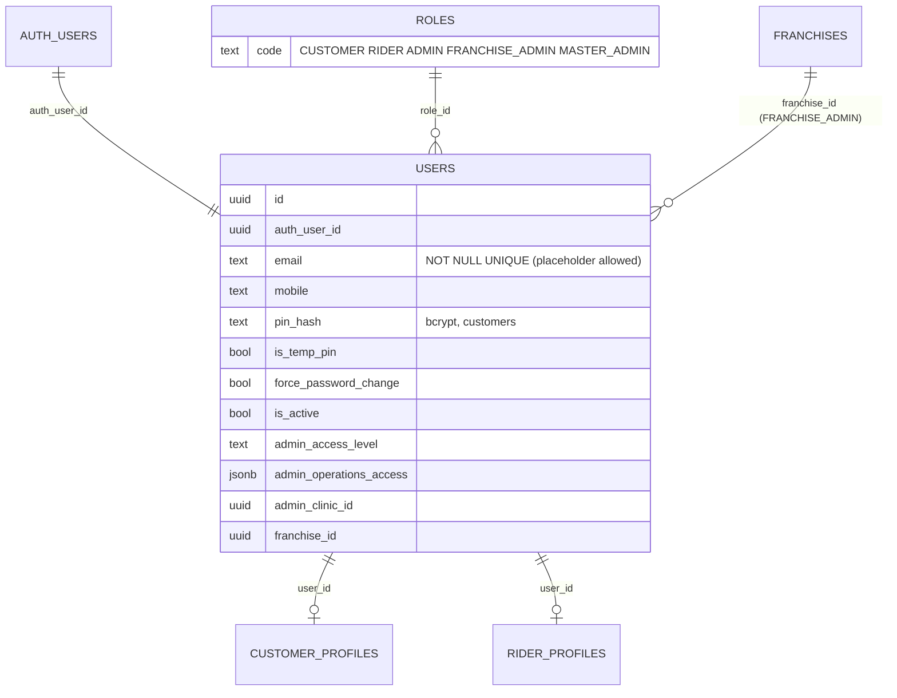
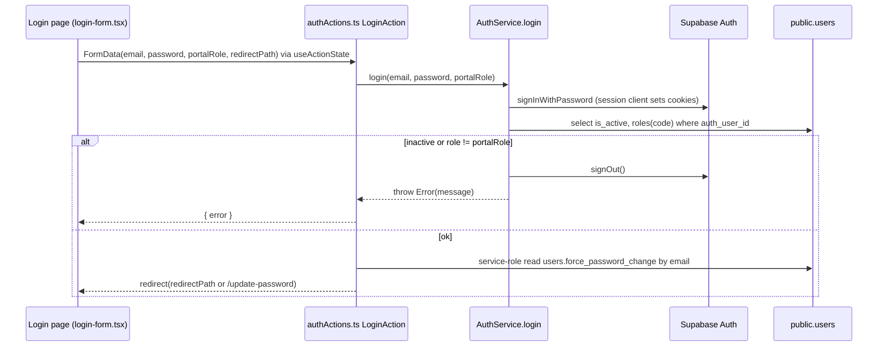
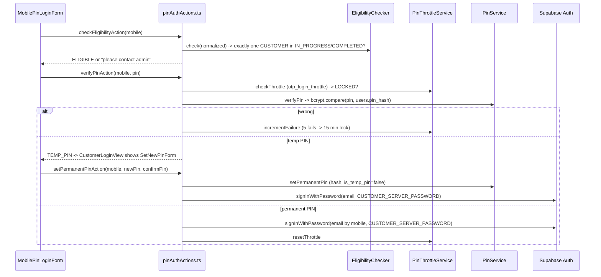

# 05 — Authentication and the "Single Login" Subdomain Model

Terms:
- **Authentication (authN)**: proving who you are (login).
- **Authorization (authZ)**: deciding what you may do (roles, access levels). Covered in `06`.
- **Supabase Auth**: a hosted auth service. It stores identities in the `auth.users` table (separate schema from your app tables) and issues a **JWT** (JSON Web Token: a signed string with the user id and expiry).
- **Session cookie**: `@supabase/ssr` stores the access token and refresh token in cookies so server code can read them on every request.
- **`public.users`**: the app's own user table. It links to Supabase Auth via `users.auth_user_id` and to a role via `users.role_id → roles.code`.

## 1. One identity model for all portals

Every person, whatever the portal, is one Supabase Auth user plus one `public.users` row with exactly one role. The portal you may enter is decided by the role (middleware, see `06`).

## 2. What "single login" means here

There are two meanings people use; be precise in an interview:

1. **One login implementation shared by four portals.** Admin, rider, franchise and master login pages all render the same form (`src/shared/components/forms/login-form.tsx`, or `RiderLoginForm.tsx` for the rider look) and call the same Server Action `LoginAction` (`src/actions/authActions.ts`). Each page passes a hidden `portalRole` (`ADMIN`, `RIDER`, `FRANCHISE_ADMIN`, `MASTER_ADMIN`). `AuthService.login()` signs in, loads `users.is_active` and `roles.code`, and **signs the user out again** if the role does not match the portal. The customer portal is the exception: it uses mobile + PIN.

2. **One session per subdomain, not across subdomains.** The Supabase cookie options in this repo never set a `domain` attribute (`src/lib/supabase/server.ts`, middleware, layouts). Cookies without `domain` are "host-only": a cookie set on `admin.arogyadiet.com` is not sent to `franchies.arogyadiet.com`. So logging into one portal does not log you into another. When middleware bounces a `FRANCHISE_ADMIN` from `admin.*` to `franchies.*` (`franchiseRootUrl()`), the user lands on the franchise login. Assumption: the production deployment does not override cookie domain elsewhere — **UNVERIFIED** outside the repo (e.g. Supabase dashboard settings do not control this; app code does).

Why that design: each portal is a separate trust zone. A shared cookie on `.arogyadiet.com` would let one stolen session work across every portal.

## 3. Login flows per portal

### 3.1 Staff portals (admin, rider, franchise, master): email + password

Details:
- `useActionState(LoginAction, null)` gives the form `state` (error) and `isPending` without writing fetch code.
- `force_password_change` is read with a service-role client "to bypass cookie delay": the new session cookie is not yet readable in the same request.
- `redirect()` in a Server Action throws a special Next.js error that the framework turns into navigation, so it must be called outside `try/catch` (the code does this correctly).
- After login, middleware sends `/` and `/login` to `landingRouteFor(level)` (inventory-only admins land on `/inventory`, dietitians on `/customers`, everyone else on `/dashboard`).

### 3.2 Customer portal: mobile + 6-digit PIN

Customers cannot sign up themselves. Admin or franchise staff onboard them (`OnboardingService.ts`), which:
1. Generates a **placeholder email** if the customer has none: `m<mobile>@placeholder.arogyadiet.internal` (`src/lib/onboarding/testEmail.ts`), flagged `is_test_email = true` so the UI hides it.
2. Creates the Supabase Auth user with `auth.admin.createUser({ email, password: CUSTOMER_SERVER_PASSWORD, phone, ... })`. Every customer shares the same server-side password, which is never shown to anyone.
3. Calls the `onboard_customer` RPC to write all DB rows in one transaction. If the RPC fails, the code deletes the auth user it just created. This is a **compensating action**: the auth service and Postgres cannot share a transaction, so the code undoes step 2 manually.
4. Stores a temporary PIN hash (`users.pin_hash`, `is_temp_pin = true`).

The login screen (`src/app/customer/(auth)/login/page.tsx` → `CustomerLoginView.tsx`):

Why this design: customers in India log in with a phone number; SMS OTP costs money and is slow. A PIN gives a fast login while reusing Supabase's normal password session, so middleware and RLS did not need to change (`.kiro/specs/customer-pin-auth/design.md`).

Security notes you must know (details and fixes in `16`):
- `setPermanentPinAction` takes only `mobile, newPin, confirmPin`. It does not check that the account currently has `is_temp_pin = true` or that this caller just proved the temp PIN. Because Server Actions are callable by direct POST, this looks like an account-takeover path. Status: found by code reading; confirm with a test.
- The middleware has an `isTempPin` guard, but the variable is declared `null` and never assigned, so the guard never fires.
- All customers share `CUSTOMER_SERVER_PASSWORD`. Anyone who learns it can sign in as any customer by email through Supabase directly. Keep it only in server env.
- `PinService` uses bcrypt cost 10 and constant-time compare; PINs are never logged.

### 3.3 OTP login (built, not mounted)

`src/actions/mobileAuthActions.ts` (marked `@deprecated` at the top), `src/services/OtpLoginService.ts`, `src/shared/components/customer/MobileOtpLoginForm.tsx`, `src/lib/otp/otpPolicy.ts`, `src/repositories/otpThrottleRepository.ts`. It uses Supabase phone OTP with cooldown/resend limits stored in `otp_login_throttle`. No page imports `MobileOtpLoginForm`; the PIN spec superseded it. The throttle table is now reused by `PinThrottleService`.

### 3.4 Password recovery (staff portals)

1. `forgotPasswordAction` builds `https://<current host>/api/auth/recovery` and calls `supabase.auth.resetPasswordForEmail(email, { redirectTo })`.
2. The email link lands on `src/app/api/auth/recovery/route.ts`, which supports both the PKCE `code` flow (`exchangeCodeForSession`) and the `token_hash` flow (`verifyOtp({ type: "recovery" })`), then redirects to `/update-password`.
3. `updatePasswordAction` updates the password and clears `force_password_change`.
4. `changePasswordAction` (logged-in) re-verifies the current password and then `signOut({ scope: "others" })` to kill other devices.

Using the host header keeps the user on the same subdomain, so the recovery session cookie is set for the right portal.

### 3.5 OAuth

`src/app/api/auth/callback/route.ts` no longer exchanges codes: it redirects to `/login`. The Google button code still exists in `login-form.tsx` but pages pass `socialLogin={false}`.

## 4. How a session is checked on each request

| Where | How | File |
|---|---|---|
| Middleware | Own `createServerClient` on request cookies → `auth.getUser()` (server-verified, can refresh tokens and write new cookies) | `src/middleware.ts` |
| Customer layout/pages | `getCustomerSession()` trusts `x-auth-user-id` header set by middleware; falls back to `auth.getUser()` | `src/lib/customer/get-session.ts` |
| Rider layout/pages | `getCachedRiderAuth()` with React `cache()` so layout + page share one lookup | `src/lib/supabase/cached-auth.ts` |
| Admin/franchise/master layouts | Fresh SSR client + `auth.getUser()` + `users` query | each `(main)/layout.tsx` |
| Actions | `createClient()` from `src/lib/supabase/server.ts` → `auth.getUser()` | most actions |
| API routes | Each route calls `auth.getUser()` itself (PDF routes) or checks a secret (cron) or HMAC (webhook) | `src/app/api/**` |

`getUser()` vs `getSession()`: `getUser()` asks Supabase to validate the token, `getSession()` only decodes the cookie. The code consistently uses `getUser()` on the server, which is the safe choice.

## 5. Native rider app and auth

The rider APK is a Capacitor WebView that loads `deliverypartner.arogyadiet.com` remotely (per `.kiro/steering/rider-gps-tracking.md`). Cookies persist inside the WebView, so riders stay logged in across app restarts. The native GPS service does **not** use the rider's session: it calls the `upsert_rider_live_location` RPC with the public anon key (see `11`).

## 6. Interview questions on auth

1. **Why does the customer portal not use the shared login form?** Different user base (mobile-first, no email), and the spec required no signup link, no Google button and no email field.
2. **How does a PIN create a Supabase session?** After bcrypt verification, the server calls `signInWithPassword` with the customer's (possibly placeholder) email and a server-only shared password, using the SSR client so cookies are set on the response.
3. **What stops brute-forcing a 6-digit PIN?** `PinThrottleService`: 5 failures → 15-minute lock per mobile in `otp_login_throttle`. Follow-up: it is per mobile, not per IP, so an attacker can spread attempts across many mobiles; a per-IP limit or CAPTCHA would help.
4. **Why `getUser()` in middleware even though it costs a network call?** It validates the JWT against Supabase and refreshes expired tokens; trusting a decoded cookie would accept a revoked session.
5. **Why does a franchise admin need to log in twice when redirected from admin?** Cookies are host-only per subdomain.

## 7. Trace it yourself
1. `src/app/customer/(auth)/login/CustomerLoginView.tsx`
2. `src/shared/components/customer/MobilePinLoginForm.tsx`
3. `src/actions/pinAuthActions.ts`
4. `src/services/EligibilityChecker.ts` → `src/repositories/customerOnboardingRepository.ts` (`findCustomerByMobile`)
5. `src/services/PinService.ts`, `src/services/PinThrottleService.ts`
6. `src/middleware.ts` customer branch (search `currentSubdomain === "customer"`)
7. `src/lib/customer/get-session.ts`
