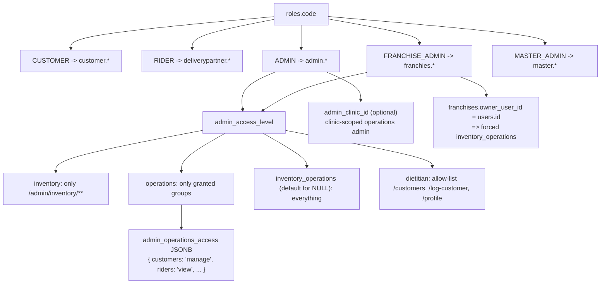
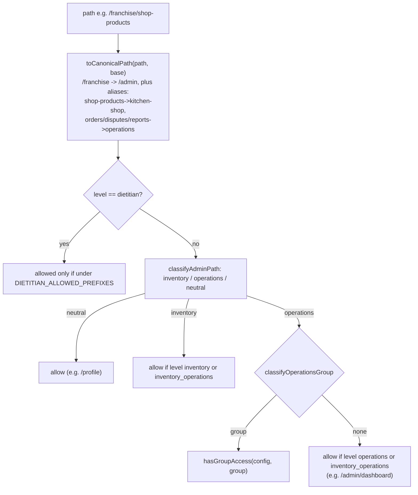
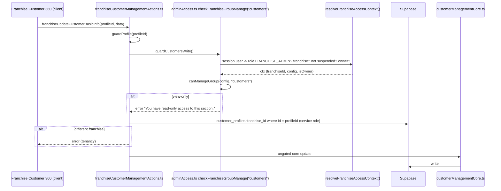

# 06 — RBAC and Multi-Tenancy

Terms:
- **RBAC** (role-based access control): permissions come from the user's role, not from the individual.
- **Access level**: a sub-type of the `ADMIN` (and `FRANCHISE_ADMIN`) role stored in `users.admin_access_level`.
- **Operations group**: a section of the admin portal (customers, subscriptions, riders, operations, franchises, shop_products). Each can be granted as `manage` (read + write) or `view` (read only), stored in `users.admin_operations_access` (JSONB).
- **Tenant**: an isolated customer of the software. Here: a franchise. `franchise_id IS NULL` means the core business.
- **RLS** (Row Level Security): Postgres rules attached to a table that filter rows per request based on who is asking. Front-end analogy: a `.filter()` that the database applies to every query automatically and that the caller cannot skip.
- **Service-role client**: a Supabase client created with the secret service-role key (`createAdminClient()` in `src/lib/supabase/admin.ts`). It **bypasses RLS completely**. Anything using it must enforce permissions in code.

## 1. The permission model in one picture

Source of truth: `src/lib/auth/adminAccessCore.ts`.
- `ADMIN_ACCESS_LEVELS = ["inventory","operations","inventory_operations","dietitian"]`, `DEFAULT_ACCESS_LEVEL = "inventory_operations"`. A NULL or unknown DB value becomes full access. This was chosen for backward compatibility: existing admins kept working when the column was added.
- `OPERATIONS_GROUPS` (6) and `FRANCHISE_OPERATIONS_GROUPS` (5, no `franchises`).
- `GROUP_ROUTE_PREFIX`: `customers → /admin/customers`, `subscriptions → /admin/subscriptions`, `riders → /admin/riders`, `operations → /admin/operations`, `franchises → /admin/franchises`, `shop_products → /admin/kitchen-shop`.
- `resolveAccessConfiguration(rawLevel, rawGroups)`: lenient read (drops bad entries, never throws). `validateOperationsAccessInput`: strict write (rejects empty/unknown).
- `hasGroupAccess(config, group)` = view or manage; `canManageGroup` = manage only.
- `isPortalPathAllowed(config, path, base)` is the path gate used by middleware and layouts.

Dietitians are not a separate role. A dietitian is an `ADMIN` (core) or `FRANCHISE_ADMIN` (franchise) user whose level is `dietitian`. They get no group at all; an allow-list decides what they can open. Extra data rule: a dietitian may only read customers linked to them (`customer_profiles.dietitian_id`), enforced in SQL by `dietitian_can_read_customer()` (`scripts/create-dietitian-management-rls.sql`) and in code by `src/lib/dietitian/scope.ts` and `franchiseCustomerScope.ts`.

## 2. How the path gate decides

The aliases (`FRANCHISE_PATH_ALIASES`) fixed a real bug documented in the file: `/franchise/shop-products`, `/orders`, `/disputes`, `/reports` used to classify as "neutral" and were open to every franchise user.

## 3. Where each check lives (the layers)

| Layer | File + function | What it checks | Fails to |
|---|---|---|---|
| 1. Middleware | `src/middleware.ts` | Role ↔ subdomain; customer: exactly one onboarding record in `IN_PROGRESS`/`COMPLETED`, category route table; admin: `isPortalPathAllowed(config, path, "/admin")`; franchise: has franchise, not suspended, owner override, `isPortalPathAllowed(..., "/franchise")` | `/login`, `/unauthorized`, `landingRouteFor(level)`, or `/dashboard?msg=category-unavailable` |
| 2. Layout | `admin/(main)/layout.tsx`: role `ADMIN`, level has `operations` (dietitian exempt). `admin/inventory/layout.tsx`: `canAccess(level,"inventory")`. `franchise/(main)/layout.tsx`: same as middleware using `x-portal-pathname`. `master/(main)/layout.tsx`: `MASTER_ADMIN`. `customer/(main)/layout.tsx`: session. `customer/(main)/shop/layout.tsx`: category. | Same rules, second time | `redirect(...)` |
| 3. Page guard | `guardAdminGroup(group)`, `guardCustomersWorkspace()`, `guardAdminPage(area)`, `guardDietitianPage()`, `guardFranchiseGroupAccess(group)`, `guardFranchiseCustomersWorkspace()` in `src/lib/auth/adminAccess.ts` | Group/area for that page; returns config so the page can render read-only | `redirect` |
| 4. Server Action | `checkGroupManage(group)` / `assertGroupManage` / `assertGroupAccess` (admin); `checkFranchiseGroupManage(group)` / `checkFranchiseCustomersRead()` (franchise); `resolveScope()` (tenancy); per-action ownership helpers (`assertOwnsSubscription`, `guardProfile`, `guardAuthUser`, `guardEmail`) | Permission **and** tenancy of the target row | `{ success:false, error:"You have read-only access…" }` |
| 5. Database | RLS policies (session client only), RPC internal checks (e.g. `receive_franchise_transfer` compares `dest_franchise_id`), triggers (e.g. `enforce_admin_clinic_is_core()`) | Row ownership | SQL error |

### Why the layers are duplicated
- **Middleware** is fast and central but runs before rendering and can be bypassed by matcher gaps, and it never runs for `/api`. Next.js docs recommend not relying on it alone.
- **Layouts** do not re-run on client-side navigation between sibling pages in the same layout (layouts are preserved), so they cannot be the only check either.
- **Server Actions are public POST endpoints.** A user can call any action id they find in the JS bundle. `adminAccess.ts` documents a concrete case: `Customer360Dashboard` is shared, so admin customer action ids end up in the franchise bundle. The `roleCode !== "ADMIN"` rejection inside `assertGroupManage` is what stops a franchise user from calling admin actions on core customers.
- **Permission ≠ tenancy.** `checkFranchiseGroupManage("customers")` proves "this user may edit customers"; `guardProfile(profileId)` proves "this customer belongs to this user's franchise". Both are required.

## 4. Tenancy: how `franchise_id` gets resolved and stamped

| Step | Code | Notes |
|---|---|---|
| Feature flag | `src/lib/franchise/constants.ts` `FRANCHISE_FEATURES_ENABLED` | Exactly `"true"` to enable. When off, `resolveFranchiseContext()` returns `null`, `stampFranchiseId()` returns `null`, and `resolveScope()` returns `unresolved`. |
| Who am I? | `src/lib/franchise/context.ts` `resolveFranchiseContext()` | ADMIN/MASTER_ADMIN → `franchise_id: null`, not scoped. FRANCHISE_ADMIN → their `users.franchise_id`. RIDER/CUSTOMER → their own `franchise_id` (null = core). |
| Scope | `src/lib/auth/scope-resolver.ts` `resolveScope()` | Returns `full_network`, `franchise(f)`, `core`, or error. Pure helpers `scopePermits`/`applyScope` in `scope-predicate.ts`. |
| Stamping on insert | `src/lib/franchise/stamping.ts` `stampFranchiseId`, `applyFranchiseStamp`, `validateFranchiseWriteAccess`; `server-stamp.ts` `getStampFranchiseId()` | FRANCHISE_ADMIN writes always get their own franchise id; any payload value is ignored. |
| Propagation to pages | middleware sets cookie `x-franchise-id` (httpOnly) | Many franchise pages read it and query with `createAdminClient()` + `.eq("franchise_id", id)`. Newer pages (customers) use `guardFranchiseCustomersWorkspace()` instead, which re-derives it from the session (the code comments call the cookie read "ad-hoc"). |
| Derived stamps | `generateDailyOrders` copies `subscriptions.franchise_id` onto `delivery_orders`; `commitRiderBatch` stamps `delivery_batches.franchise_id` | Core rows stay NULL. |

## 5. RLS vs service role — the honest picture

What exists in SQL:
- `scripts/create-franchise-rls-policies.sql` creates policies on 17 tables using `is_global_role()` and `current_franchise_id()`, which read the Postgres settings `app.role` and `app.franchise_id`.
- `set_franchise_context(p_role, p_franchise_id)` sets those with `set_config(..., true)`.
- `enable-franchise-rls.sql` / `disable-franchise-rls.sql` turn them on/off per table.
- Separate older policies use `auth.uid()` (e.g. `is_own_rider_profile`, users self-service in `supabase/migrations/20250608150000_users_self_service_rls.sql`, dietitian policies).

What the code says about it (`src/middleware.ts` comment block "[Req 18.7 — DB scope binding]"):
- `set_config(..., true)` is **transaction-local**. Over PostgREST each request is its own transaction, so a context set by one `rpc()` call does not apply to the next `.from()` query. The franchise RLS policies therefore cannot be driven reliably from the app this way.
- `set_franchise_context` trusts the role passed in by the caller.

Practical consequence: **tenant isolation is enforced in application code** (scope resolution + explicit `franchise_id` filters + RPC checks), mostly through the service-role client. Whether franchise RLS is enabled in production is **UNVERIFIED**. If it were enabled with no context set, a session client query would match `franchise_id IS NULL AND current_franchise_id() IS NULL`, i.e. show core rows and hide franchise rows — another reason the app avoids depending on it.

Where the session (RLS-bound) client is used: customer pages and actions (`getCustomerSession`, `shop-actions.ts`), rider pages and `setRiderOnlineAction`, layouts' role lookups, middleware. Where the service-role client is used: admin/franchise/master actions and pages, cron, webhook, PIN services, routing engine.

## 6. Customer category gate (product-line RBAC)

`src/middleware.ts` resolves `customer_category` from the newest ACTIVE/PENDING subscription (KIT fallback for expired kits) and:
- sets header `x-customer-category` for the sidebar,
- denies MEAL customers the KIT/ACCOMMODATION routes listed in `CUSTOMER_CATEGORY_ROUTES` (`/kit-tracker`, `/kit-history`, `/stay-tracker`, `/stay-history`, `/health-report`, `/addon-services`).
Only MEAL is enforced (`CATEGORY_ENFORCED_FOR = ["MEAL"]`) to avoid locking out an ACCOMMODATION customer whose stay ended. Actions repeat the check (`assertMealSubscription` in `manageMealActions.ts`).

## 7. Clinic-scoped admins

An `operations` admin with `users.admin_clinic_id` set is a **clinic-scoped admin**. `isClinicScoped`, `validateClinicScopeAssignment`, `resolveReadableClinicId` (pure, in `adminAccessCore.ts`) and `assertClinicScope`/`checkClinicScope` (in `adminAccess.ts`) confine shop-product and clinic-ledger reads to that one core clinic. Only groups `customers, subscriptions, riders, shop_products` may be granted with a clinic scope. The DB trigger `enforce_admin_clinic_is_core()` (`scripts/add-admin-clinic-id-to-users.sql`) forbids pointing it at a franchise clinic. `getCurrentAdminContext()` degrades gracefully if that column is missing (Postgres error 42703) instead of denying all admins.

## 8. Franchise permission check — full trace

## 9. Interview questions

1. **"Where is authorization enforced?"** Five places: middleware, layout, page guard, action gate, DB (RPC checks / RLS). The action layer is the one that must never be skipped.
2. **"Why is NULL access level full access? Isn't that unsafe?"** Backward compatibility when the column was introduced. Risk: a new admin created without a level gets everything. Mitigation: the master UI always sets a level; a DB default or NOT NULL constraint would close it.
3. **"How do you stop franchise A seeing franchise B?"** Server-side scope from the session (never the client), explicit `franchise_id` filters, RPC ownership checks, and `guardProfile`-style tenancy checks on writes.
4. **"Why not just use RLS?"** It was designed (policies exist) but session-variable based RLS does not survive PostgREST's per-request transactions, and the heavy admin work needs cross-tenant reads anyway. A JWT-claim based policy (`auth.jwt() ->> 'franchise_id'`) would be the robust way to do it.
5. **"What is the owner override?"** `franchises.owner_user_id === users.id` forces full access for the franchise owner regardless of their stored level.

## 10. Trace it yourself
1. `src/lib/auth/adminAccessCore.ts` (read top to bottom once)
2. `src/middleware.ts` admin and franchies branches
3. `src/app/franchise/(main)/layout.tsx`
4. `src/lib/auth/adminAccess.ts` `resolveFranchiseAccessContext`, `checkFranchiseGroupManage`
5. `src/actions/franchise-actions/franchiseCustomerManagementActions.ts` `guardProfile`
6. `src/lib/franchise/context.ts`, `stamping.ts`, `src/lib/auth/scope-resolver.ts`
7. `scripts/create-franchise-rls-policies.sql` (first 100 lines)
