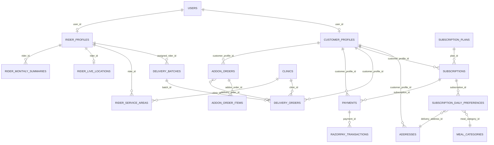
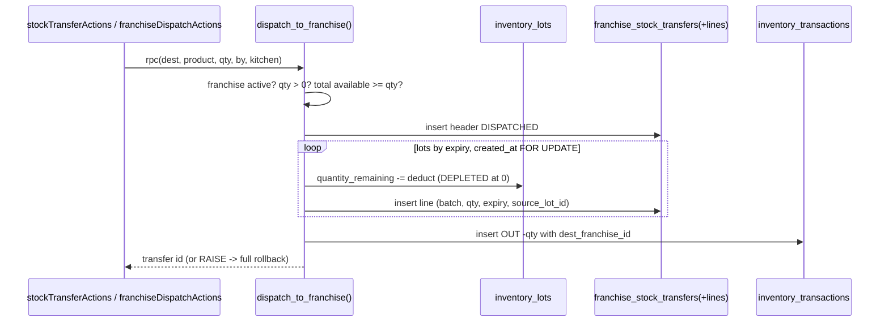

# 07 — Databases for a Front-End Developer (using this schema)

This doc teaches the database ideas you need, using ArogyaDiet's real tables, then walks through each domain. Sources: `scripts/*.sql`, `supabase/migrations/*.sql`, and the queries in `src/`. The base tables that predate `scripts/` (users, subscriptions, delivery_orders…) have no CREATE TABLE in the repo; their columns below are taken from how the code reads and writes them. Treat exact types of those older tables as **UNVERIFIED**.

---

## Part 1 — The primer

### 1.1 Table, row, column
A table is like a typed array of objects where every object has the same keys. `subscriptions` is an array of subscription objects; a row is one subscription; a column is one key (`status`, `starts_on`). Unlike a JS array, the database enforces the types and rules on every write.

### 1.2 Primary key and foreign key
- **Primary key (PK)**: the unique id of a row. Almost every table here uses `id uuid DEFAULT gen_random_uuid()`. Front-end analogy: the `key` prop in a list.
- **Foreign key (FK)**: a column that must contain the PK of another table. `subscriptions.customer_profile_id → customer_profiles.id`. The database refuses an insert that points at a non-existent row. Analogy: a TypeScript type that only accepts ids that actually exist.

Real chain: `auth.users.id ← users.auth_user_id`, `users.id ← customer_profiles.user_id`, `customer_profiles.id ← subscriptions.customer_profile_id`, `subscriptions.id ← subscription_daily_preferences.subscription_id`.

### 1.3 Constraints (rules the DB enforces)
Examples you can point to:
- `UNIQUE`: `groups.kitchen_id UNIQUE` → a kitchen belongs to at most one group (`scripts/create-groups-table.sql`). `uq_service_area_pincode` → one pincode maps to exactly one clinic (`create-clinic-hierarchy-tables.sql`).
- `CHECK`: `businesses.type IN ('Core','Franchise')`; lat/lng range checks on clinics; `rider_monthly_summaries.status IN ('GENERATED','PAID')`.
- `NOT NULL`: `users.email` is NOT NULL + UNIQUE, which is why customers without email get a placeholder email.

### 1.4 Joins (and how Supabase writes them)
A join combines rows of two tables that match on a key. In supabase-js you write a join as a nested select:

```ts
// src/middleware.ts — one query, three tables
supabase.from("users")
  .select("admin_access_level, roles(code), customer_profiles!customer_profiles_user_id_fkey(id, onboarding_status)")
  .eq("auth_user_id", user.id).single();
```
`roles(code)` follows the FK `users.role_id → roles.id`. The `!customer_profiles_user_id_fkey` part names which FK to follow, because `customer_profiles` has two FKs to `users` (`user_id` and `dietitian_id`). Without the hint PostgREST returns error PGRST201 (ambiguous). Supabase returns a to-one relation as an object or a one-element array, which is why the code keeps doing `Array.isArray(roles) ? roles[0] : roles`.

`subscriptions!inner(status, franchise_id)` in `generateDailyOrders` is an **inner join**: preference rows without a matching subscription are dropped, and the filter `.eq("subscriptions.status","ACTIVE")` filters the parent.

### 1.5 Indexes
An index is a sorted lookup structure, like a `Map` keyed by a column, so the DB does not scan every row. Examples: `idx_groups_city`, `idx_razorpay_transactions_franchise`, `scripts/add-customer-profile-id-indexes.sql`. Rule of thumb: index columns you filter or join by often (`customer_profile_id`, `delivery_date`, `franchise_id`). Cost: every insert/update also updates the index.

### 1.6 Transactions
A transaction groups several writes so they all succeed or all fail (**atomic**). Front-end analogy: an optimistic update that you fully roll back on error, except the DB guarantees it even if the server crashes mid-way.

Important fact for this codebase: **each supabase-js call is its own transaction.** Five `.insert()` calls in a Server Action are five separate transactions. If the third fails, the first two stay. The only way to get one transaction from supabase-js is to call a Postgres function (RPC); a `plpgsql` function body always runs in a single transaction.

Compare two real flows:
- `scripts/create-onboard-customer-rpc.sql` → `onboard_customer(payload)` inserts users, customer_profiles, subscriptions, payments, addresses in one transaction. Safe.
- `src/actions/checkoutActions.ts` `activateSubscription` inserts payments, subscriptions, updates payments, inserts razorpay_transactions, inserts daily preferences, updates coupons — separately. A failure halfway leaves partial data. Not safe (see `16`).

### 1.7 Row Level Security (RLS)
RLS attaches a `USING (...)` condition to a table per operation. When the session client (anon key + user JWT) queries the table, Postgres silently adds that condition. `auth.uid()` inside a policy returns the logged-in user's Supabase id.

Example (shape from `create-franchise-rls-policies.sql`):
```sql
CREATE POLICY franchise_select_subscriptions ON public.subscriptions
  FOR SELECT USING (
    is_global_role()
    OR (franchise_id = current_franchise_id())
    OR (franchise_id IS NULL AND current_franchise_id() IS NULL)
  );
```
Key facts:
- Policies do nothing until `ALTER TABLE ... ENABLE ROW LEVEL SECURITY`.
- RLS enabled with **no** policies = nobody (except service role) can read. `otp_login_throttle` is set up exactly this way so only server code can touch it (`PinThrottleService.ts` header).
- The **service role bypasses RLS**. All `createAdminClient()` queries ignore policies.

### 1.8 Postgres functions (RPCs) and SECURITY DEFINER
A function is server-side code stored in the DB. `supabase.rpc("dispatch_to_franchise", {...})` calls it over HTTP (PostgREST). Two security modes:
- `SECURITY INVOKER` (default): runs with the caller's rights; RLS applies.
- `SECURITY DEFINER`: runs with the owner's rights; RLS is effectively bypassed inside. Always pair it with `SET search_path = public` so a caller cannot trick it with a fake table in another schema. The scripts here do that (e.g. `create-dispatch-to-franchise-rpc.sql`, `create-rider-live-location-upsert-rpc.sql`).

**Who can call a function?** Postgres grants `EXECUTE` on new functions to `PUBLIC` by default, and Supabase exposes `public` schema functions through the API to the `anon` and `authenticated` roles. Only 4 scripts in `scripts/` contain `GRANT EXECUTE`/`REVOKE` and none revoke execute on the big write RPCs (`onboard_customer`, `dispatch_to_franchise`, `receive_franchise_transfer`…). Unless execute was revoked directly in the database, a holder of the public anon key could call them. Status **UNVERIFIED** — check with `SELECT proname, proacl FROM pg_proc WHERE proname IN (...)`. This is listed in `16`.

### 1.9 Triggers
A trigger is a function the DB runs automatically before/after a write. Analogy: a `useEffect` on a table. Example `scripts/create-kit-received-date-lock-trigger.sql`:
```sql
CREATE TRIGGER trg_subscriptions_kit_received_date_lock
  BEFORE UPDATE OF kit_received_date ON public.subscriptions
  FOR EACH ROW EXECUTE FUNCTION public.kit_received_date_lock_guard();
```
Once a KIT daily log exists, changing `kit_received_date` raises error 23514. Other triggers: KIT tracker sync and category guards (`create-kit-tracker-sync-trigger.sql`, `create-kit-tracker-category-guard-triggers.sql`), `enforce_admin_clinic_is_core()`, and a trigger in `create-clinic-product-ledger-table.sql` that blocks UPDATE/DELETE on the ledger even for the service role (because REVOKE alone does not stop the service role).

### 1.10 Migrations
A migration is a script that changes the schema. Here they are plain SQL files run by hand in the Supabase SQL editor, in an order noted in each file's header ("ORDERING: This script MUST run AFTER…"). Every script is written to be **additive and idempotent**: `CREATE TABLE IF NOT EXISTS`, `ADD COLUMN IF NOT EXISTS`, `CREATE OR REPLACE FUNCTION`, `DROP POLICY IF EXISTS` then `CREATE POLICY`, plus a commented rollback section. There is no migration runner or applied-migrations table in the repo, so "which scripts ran in production" is **UNVERIFIED**. The code defends against this in places, e.g. `getCurrentAdminContext()` retries without `admin_clinic_id` if Postgres returns 42703 (unknown column).

### 1.11 Enums and JSONB
- Enums show up as `USER-DEFINED` types (`inventory_lot_status`, franchise `status`) or as `CHECK IN (...)`.
- JSONB stores a JSON object in one column. `users.admin_operations_access` (group → manage/view), `health_logs.parameters`, `workload_snapshots.shop_product_counts`. Easy to evolve, but the DB does not validate its shape, so the app validates (`resolveAccessConfiguration`).

---


## Part 2 — Domain walkthrough

### 2.1 Overview ER diagram (core relations)



### 2.2 Domain by domain

For each: key tables, who writes them, an example query, and "why an RPC (or not)".

**Identity** — `roles`, `users`, `customer_profiles`, `rider_profiles`, `otp_login_throttle`.
- Written by onboarding (`onboard_customer` RPC), staff creation actions (`auth.admin.createUser` + insert), PIN services.
- Example (middleware): `users` + `roles(code)` + `customer_profiles(...)` by `auth_user_id`.
- Why RPC for onboarding: five tables must appear together or not at all.

**Subscriptions (MEAL)** — `subscription_plans`, `subscriptions` (`status` PENDING/ACTIVE/…, `starts_on`, `ends_on`, `effective_end_on`, `total_days`, `pause_credits_total`, `pause_credits_used`, `customer_category`, charge/discount columns), `subscription_daily_preferences` (one row per calendar day: `preference_date`, `meal_category_id`, `delivery_address_id`, `is_paused`, `pause_credit_used`).
- The calendar table is the heart of MEAL. Pausing a day does not delete it; it flips `is_paused` and the reconciliation engine adds a new day at the end so the customer still gets `total_days` deliveries. `effective_end_on` moves accordingly.
- Example: `.from("subscription_daily_preferences").select("preference_date, is_paused, meal_categories(code)").eq("subscription_id", id)` (planner page).
- Why NOT an RPC today: historical; the logic is in `manageMealActions.ts`. Interview answer: "it should be one, because it touches many rows and must keep `pause_credits_used` equal to the count of paused rows".
- Payment lifecycle functions: `scripts/create-subscription-payment-lifecycle.sql`, `create-subscription-early-closure-recalculation.sql` (recalculation of tenure on early closure; commit message "subscription recaculate - not tested").

**Delivery** — `delivery_orders` (`delivery_date`, `status`, `batch_id`, `assigned_rider_id`, `route_sequence`, `payout_amount`, `clinic_id`, `franchise_id`), `delivery_batches` (`assigned_rider_id`, `delivery_date`, `total_distance_km`, `expected_payout`, `status`, `clinic_id`), `delivery_status_logs`, `workload_snapshots`, `automation_logs`.
- Order statuses seen in code: `ORDER_CREATED`, `MEAL_PREPARED`, `ASSIGNED`, `PACKED`, `OUT_FOR_DELIVERY`, `IN_TRANSIT`, `DELIVERED`, `FAILED`, `CANCELLED`, `PENDING_FAILURE_APPROVAL` (`supabase/migrations/20250602140000_add_pending_failure_approval_status.sql`, `src/lib/delivery/orderStatuses.ts`).
- Idempotency of order creation is done in JS: load existing `customer_profile_id:meal_category_id` keys for the date and skip them. A UNIQUE constraint on `(customer_profile_id, delivery_date, meal_category_id)` would make it race-proof; its existence is **UNVERIFIED**.

**Routing & riders** — `rider_service_areas` (pincode → rider, `clinic_id`, `franchise_id`), `fixed_rider_assignments` (customer → rider override), `rider_live_locations` (one row per rider, upserted), `rider_monthly_summaries`, `rider_payouts`, `rider_payout_adjustments`, `rate_configs` (+ audit).
- Example: dispatch builds `Map(pincode → rider_id)` from `rider_service_areas` filtered by `clinic_id`.
- Why RPC for live location: the native app has no user session; a narrow `SECURITY DEFINER` function that only upserts lat/lng after validating ranges and rider existence is safer than opening the table to anon.
- `move_pincode` RPC moves a pincode between riders/clinics atomically.

**Payments** — `payments` (`invoice_type` SUBSCRIPTION/ADDON/ACCOMMODATION_*, `status`, `amount`, `base_amount`, `tax_amount`, `discount_amount`, `delivery_charge`, `amount_paid`/`balance_due` for partial payments), `razorpay_transactions` (gateway audit).
- Note the inconsistent status values: subscription checkout writes `SUCCESS`, shop and webhook write `PAID`, onboarding RPC writes `PAID`. Reports must handle both.

**Shop** — `products`, `addon_orders` (`status` PENDING/PAID…, `fulfillment_status`, `target_delivery_date`, `delivery_order_id`, `clinic_id`, `franchise_id`, `placed_by`), `addon_order_items`, `clinic_product_settings` (per-clinic stock + visibility), `clinic_product_ledger` (append-only), `franchise_product_settings`.
- RPCs: `clinic_shop_apply_sale` (check-and-decrement clinic stock + ledger), `clinic_shop_stock_in`, `decrement_franchise_product_stock` (returns false if insufficient — atomic compare-and-decrement), `place_assisted_addon_order`, `verify_clinic_stock_ledger_parity`.
- Why RPC: "check stock then decrement" in two JS calls is a race (two buyers both see stock 1). One SQL statement or a locked function prevents overselling.

**KIT** — `kit_products`, KIT columns on `subscriptions` (received date, tracker end, etc.), `kit_daily_logs`, `kit_shipping_info`, report cache. Triggers lock the received date and sync tracker fields.

**Accommodation** — `stay_entries`, `stay_payment_transactions`, `stay_extension_history`, `stay_recalculation_history`, `customer_health_logs`, `admin_health_logs`, `addon_service_requests` (`scripts/create-accommodation-tables.sql`, `create-stay-*.sql`). Recalculation and payment lifecycle are SQL functions because they rewrite billing rows together.

**Dietitian** — `health_logs`, `health_log_audit_entries`, `report_cards`; `customer_profiles.dietitian_id`. Policies use `current_dietitian()` and `dietitian_can_read_customer(profile_id)` (both SECURITY DEFINER to avoid recursive RLS, granted to `authenticated, service_role`).

**Central inventory** — `inventory_products`, `inventory_lots` (FIFO by `expiry_date`, `created_at`; `status` ACTIVE/DEPLETED), `inventory_transactions` (IN, OUT, SENT_TO_MFG, RECEIVED_FROM_MFG, EXPIRED), `manufacturing_orders/outputs/batches`, `manufacturing_product_mappings`.

**Franchise inventory** — `franchise_stock_transfers` (DISPATCHED → ACCEPTED/REJECTED → RECEIVED) + `_lines`, `franchise_inventories`, `franchise_inventory_lots`, `franchise_inventory_ledger`, `franchise_warehouses(+_stock)`, `stock_transfers`. All movements go through RPCs (`dispatch_to_franchise`, `accept/reject_franchise_transfer`, `receive_franchise_transfer`, `record_franchise_stock_out`, `franchise_shop_stock_in`, `transfer_stock`).

**Hierarchy & tenancy** — `businesses`, `cities`, `groups`, `kitchens`, `clinics`, `franchises`, `franchise_pincode_requests`, `franchise_agreement_documents`, `franchise_disputes`, `holidays`. RPCs `create_group_with_kitchen`, `delete_group_with_kitchen`, `move_franchise_to_group`, `provision_franchise_inventory`.

**Support** — `notifications` (`supabase/migrations/20250605130000_notifications_table.sql` + RLS), `system_settings`, `admin_activity_logs` (via `logAdminAction`), `app_download_throttle`.

### 2.3 FIFO lots and ledgers, explained

- A **lot** is one batch of stock with its own quantity, cost and expiry. Selling "10 units" means taking from several lots.
- **FIFO** (first in, first out) here means "earliest expiry first, then oldest". `dispatch_to_franchise` loops `ORDER BY expiry_date ASC, created_at ASC FOR UPDATE`, deducts `LEAST(remaining, lot.quantity_remaining)`, and marks a lot `DEPLETED` at zero. `FOR UPDATE` locks those rows so two dispatches cannot consume the same units.
- A **ledger** is an append-only list of every movement (like a bank statement). Current stock can be recomputed by summing it, and `verify_clinic_stock_ledger_parity` checks that the stored stock equals the ledger sum. The clinic ledger blocks UPDATE/DELETE with a trigger so history cannot be rewritten.



### 2.4 "Why is this an RPC and not a normal query?" — the checklist

Use an RPC when at least one is true:
1. Several tables must change together (onboarding, receive transfer, stay recalculation).
2. You must read-then-write without a race (stock decrement, FIFO depletion with `FOR UPDATE`).
3. A caller without a session needs one narrow write (native GPS upsert).
4. The rule must hold for every client, not only this Next.js app (stock never negative).

Use a normal query when it is a single-row read/write that RLS or one `.eq()` can scope.

### 2.5 Example queries to practise reading

```ts
// Tomorrow's orders to create (orderGeneration.ts)
from("subscription_daily_preferences")
  .select("customer_profile_id, meal_category_id, delivery_address_id, preference_date, subscriptions!inner(status, franchise_id)")
  .eq("preference_date", targetDate).eq("is_paused", false).eq("subscriptions.status", "ACTIVE");

// Orders for a clinic scope that still need routing (routeEngine.ts dispatchScope)
from("delivery_orders")
  .select("id, customer_profile_id, delivery_address_id, addresses!delivery_address_id(id, pincode, lat, lng, city, state)")
  .eq("delivery_date", d).eq("status", "ORDER_CREATED").is("batch_id", null).eq("clinic_id", clinicId);

// Count without fetching rows (planner page)
from("subscription_daily_preferences").select("*", { count: "exact", head: true })
  .eq("subscription_id", id).eq("is_paused", true);
```
`head: true` means "return only the count", like `array.filter(...).length` without transferring the array.

### 2.6 Front-end ↔ DB analogies

| DB idea | Front-end analogy |
|---|---|
| FK | A prop typed as an id union of existing items |
| Transaction | Batch state update that either fully applies or is rolled back |
| RLS | A global selector that every component's data passes through, which the component cannot remove |
| Trigger | `useEffect` that runs on every write to a table |
| Index | A memoized `Map` for lookups |
| RPC | A server action that lives inside the database |
| SECURITY DEFINER | Running code with admin privileges after your own permission check |
| JSONB column | Storing a JSON blob in `localStorage`: flexible, unvalidated |

## Trace it yourself
1. `scripts/create-groups-table.sql` — read one complete migration.
2. `scripts/create-dispatch-to-franchise-rpc.sql` — follow the FIFO loop.
3. `scripts/create-franchise-rls-policies.sql` — one table's four policies.
4. `scripts/create-kit-received-date-lock-trigger.sql`.
5. `src/actions/system-actions/orderGeneration.ts` — the inner join query.
6. Compare `scripts/create-onboard-customer-rpc.sql` with `checkoutActions.ts activateSubscription` and explain which is atomic.
