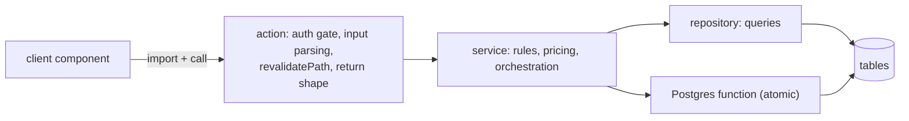
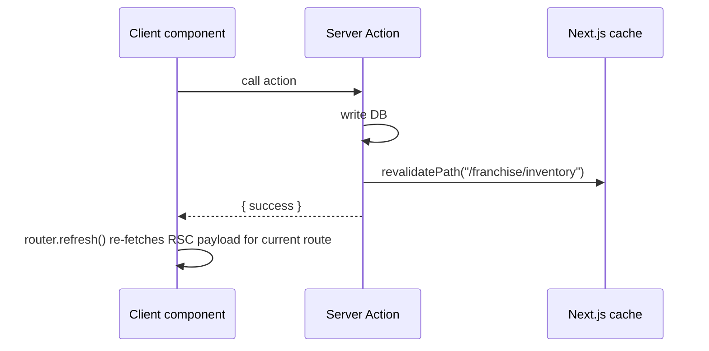

# 08 — Server Actions, Services and Repositories

Terms:
- **Server Action**: async function in a `"use server"` file. Next.js gives each exported function an id; client code that imports it gets a stub that POSTs to the server. **Every exported function in a `"use server"` file is a public endpoint once it is referenced from client code** — treat it like an API route.
- **Service**: a plain server module with business rules (no `"use server"`). Not directly callable from the browser.
- **Repository**: a module that only talks to the database (queries, no business rules).
- **Service-role (SR)**: the action uses `createAdminClient()` and bypasses RLS.

## 1. The intended layering and why

Why it exists:
- **Security boundary in one place**: the action is the HTTP edge, so it owns authentication, permission (group manage/view) and tenancy.
- **Reuse across portals**: services and "core" modules are shared by admin, franchise and master wrappers that each apply their own gate. Example: `src/services/customerManagementCore.ts` (ungated) is wrapped by admin `customerActions.ts` (`checkGroupManage`) and franchise `franchiseCustomerManagementActions.ts` (`checkFranchiseGroupManage` + `guardProfile`).
- **Testability**: pure helpers in `src/lib` (cutoff, pricing, FIFO, access rules) have property tests without a database.

Reality: the layering is partial. Many actions query Supabase directly; repositories exist only for onboarding, stays, KIT, dietitian, clinic, franchise and a few others. Very large actions (`onboardingActions.ts` 34 KB, `adminSubscriptionActions.ts` 37 KB, `shop-actions.ts` 37 KB) mix all layers.

## 2. Conventions you will see

| Convention | Where / example |
|---|---|
| File naming `*Actions.ts`, grouped by portal folder | `admin-actions/`, `franchise-actions/`, `master-actions/`, `rider-actions/`, `dietitian-actions/`, `system-actions/` |
| Return shape `{ success: true, data? }` / `{ success: false, error, field? }` | `ActionResult<T>` in `src/types/franchise.ts`; most actions follow it. Login uses `{ error }` + `redirect`. PIN uses `{ outcome: "OK" | "INVALID" | ... }` discriminated unions. |
| Never throw to the client | actions wrap in `try/catch` and return `error` strings. Gates return `{ ok:false, error }` (`checkGroupManage`) or throw typed errors (`GroupAccessDeniedError`) for internal use. |
| Validation | zod `safeParse` in ~40 action files (inventory, franchise, stays, disputes, master hierarchy). Hand-written checks elsewhere (meal planner, checkout). |
| Tenancy | `resolveScope()` (franchise/master), `getCurrentAdminContext()` (admin), `assertOwns*`/`guard*` helpers for row ownership. Never trust a client franchise id. |
| Caching | No `unstable_cache`/`"use cache"` found in actions. Pages use `export const revalidate = 0` (always dynamic). Mutations call `revalidatePath(...)`; clients call `router.refresh()`. |
| Notifications | after a write, `notifyAdmins(...)` / `sendNotificationToUser(...)` from `src/lib/notifications.ts`. |
| Audit | `logAdminAction(action, entity, id, details)` from `src/lib/logger.ts` on admin/system writes. |
| Shared constants not in `"use server"` files | a `"use server"` file may only export async functions; exporting an array broke the whole bundle once (documented in `adminAccessCore.ts` near `FRANCHISE_USER_ACCESS_LEVELS`). |

## 3. Action → service → table/RPC map

Legend: SR = uses service-role client; Gate = permission helper found in the file. "—" means no shared helper was found by search; some of those files have local checks (e.g. `assertMasterAdmin`), others appear to have none (flagged ⚠ — verify before relying on it).

### Customer-facing (root `src/actions/`)
| Action file | SR | Services | Main tables / RPCs | Gate |
|---|---|---|---|---|
| `pinAuthActions.ts` | yes | EligibilityChecker, PinService, PinThrottleService | users, otp_login_throttle; Supabase Auth | eligibility + throttle (⚠ `setPermanentPinAction`) |
| `authActions.ts` | yes | AuthService | Supabase Auth, users | role check in `AuthService.login` |
| `checkoutActions.ts` | yes | DeliveryChargeService, SubscriptionPaymentService | subscription_plans, coupons, payments, subscriptions, subscription_daily_preferences, razorpay_transactions, subscription_events; Razorpay API | ⚠ trusts `checkoutData.customerProfileId` |
| `shop-actions.ts` | no (session) | — | addon_orders, addon_order_items, payments, razorpay_transactions; RPC `decrement_franchise_product_stock`, `clinic_shop_apply_sale` | session user → own profile |
| `manageMealActions.ts` | yes | — | subscription_daily_preferences, subscriptions, addon_orders | `assertOwnsSubscription`, `assertMealSubscription`, cutoff (⚠ exported helpers `cascadePendingSubscriptionDates`, `repairOverLimitPauseCredits` have no gate) |
| `kitLifecycleActions.ts`, `kitTrackerActions.ts` | no | KitLifecycleService | subscriptions (KIT cols), kit_daily_logs | session + zod |
| `stayActions.ts`, `stayPaymentActions.ts`, `stayInvoiceActions.ts`, `accommodationOnboardingActions.ts` | mixed | AccommodationService, AccommodationPaymentHostService, AssignmentService, PinService | stay_* tables, payments | `getCurrentAdminContext` for admin paths |
| `addonServiceActions.ts` | yes | — | addon_service_requests | `checkGroupManage` (admin side) |
| `profileCompletionActions.ts` | no | OnboardingService | users, customer_profiles | session |
| `addressActions.ts`, `pincodeActions.ts` | mixed | — | addresses, rider_service_areas | session |

### Admin (`admin-actions/`)
| Action file | Services | Tables / RPCs | Gate |
|---|---|---|---|
| `onboardingActions.ts` | OnboardingService, PinService | RPC `onboard_customer`; Supabase Auth admin | `checkGroupManage`, `assertGroupAccess` |
| `customerActions.ts` | customerManagementCore, addonOrderCore, AssignmentService, emailService | users, customer_profiles, addresses | `checkGroupManage` |
| `adminSubscriptionActions.ts`, `subscriptionActions.ts`, `adminLifecycleActions.ts`, `adminMealActions.ts` | SubscriptionPaymentService, emailService | subscriptions, daily prefs, payments | `checkGroupManage` |
| `subscriptionPaymentActions.ts`, `partialPaymentActions.ts` | SubscriptionPaymentService, AccommodationService | payments, payment ledger functions | `checkGroupManage` / `guardCustomersWorkspace` |
| `routingActions.ts`, `fixedAssignmentActions.ts`, `serviceAreaActions.ts`, `riderActions.ts`, `riderClinicActions.ts`, `liveTrackingActions.ts`, `operationsActions.ts` | RateConfigService | delivery_orders, delivery_batches, rider_*; RPC `move_pincode_and_reassign` | `checkGroupManage` |
| `systemActions.ts` | — | via `generateDailyOrders`, `executeAutomatedDispatch`, addon_orders | `checkGroupManage("operations")` for manual (⚠ `runProductLinkingAction` gated only when `source==="manual"`) |
| `inventoryActions.ts`, `clinicShopInventoryActions.ts`, `franchiseProductActions.ts` | inventoryEngine | inventory_*, clinic_product_* | `checkWarehouseAccess`, `checkClinicScope` |
| `assistedOrderActions.ts` | AssistedOrderService | RPC `place_assisted_addon_order` | `checkGroupManage`, `checkClinicScope` |
| `kitLifecycleActions.ts`, `kitCustomerShippingActions.ts`, `shippingActions.ts` | KitLifecycleService | subscriptions, kit_shipping_info | `assertGroupAccess` |
| `franchiseDispatchActions.ts` | franchiseInventoryEngine | RPC `dispatch_to_franchise` | `getCurrentAdminContext` |
| `franchiseUserActions.ts` | — | users, Supabase Auth admin | local `assertCallerIsMasterAdmin` |
| `financeActions.ts`, `financePayoutActions.ts` | emailService | rider_monthly_summaries, rider_payout_adjustments, system_settings | ⚠ only `getUser()` in some functions, none in others |
| `adminPinActions.ts` | PinService | users.pin_hash | ⚠ none |
| `routingSandboxActions.ts`, `workloadActions.ts`, `conflictActions.ts`, `kitProductActions.ts`, `packageImageActions.ts`, `franchiseKitchenActions.ts`, `franchiseActions.ts` | — | various | ⚠ none found by search |

### Franchise (`franchise-actions/`)
| Action file | Services | Gate |
|---|---|---|
| `franchiseInventoryActions.ts` | franchiseInventoryEngine (RPCs accept/reject/receive/stock-out/shop-stock-in) | `resolveScope` + zod |
| `franchiseCustomerManagementActions.ts` | customerManagementCore, customerCouponCore | `checkFranchiseGroupManage` + `guardProfile/AuthUser/Email` |
| `franchiseShopOrderActions.ts` | addonOrderCore | `checkFranchiseGroupManage` + `guardOrder` |
| `franchiseSubscriptionActions.ts` | SubscriptionPaymentService, emailService | `guardSubscription` |
| `franchiseOperationsActions.ts` | — | local `assertOrderInFranchise`, `assertBatchInFranchise`, … |
| `franchiseDietitianActivityActions.ts`, `franchiseDietitianAssignmentActions.ts` | CadenceService, DietitianReportService, AssignmentService | `guardFranchiseGroupAccess`, `checkFranchiseGroupManage` |
| `franchisePartialPaymentActions.ts` | SubscriptionPaymentService, AccommodationService | `checkFranchiseCustomersRead` |
| `franchiseDisputeActions.ts` | — | `resolveScope` |
| `franchiseAssistedOrderActions.ts` | AssistedOrderService | (gate inside service — UNVERIFIED) |
| `franchiseRiderActions.ts`, `franchiseServiceAreaActions.ts`, `franchisePincodeRequestActions.ts`, `franchiseMarketingActions.ts`, `franchiseCustomerActions.ts` | — | ⚠ none found by search (may read franchise id from session internally — verify) |

### Master (`master-actions/`)
| Action file | Tables / RPCs | Gate |
|---|---|---|
| `groupActions.ts` | RPC `create_group_with_kitchen`, `delete_group_with_kitchen` | `resolveScope` |
| `franchiseActions.ts` | RPC `move_franchise_to_group`, `provision_franchise_inventory` | `resolveScope` |
| `stockTransferActions.ts` | RPC `transfer_stock` | `resolveScope` |
| `clinicWiringActions.ts` | RPC `move_pincode_and_reassign` | `resolveScope` |
| `businessActions.ts`, `kitchenActions.ts`, `rateConfigActions.ts`, `franchiseAdminActions.ts` | hierarchy tables, rate_configs | local `assertCallerCan*` / `assertMasterAdmin` |
| `franchiseUserActions.ts`, `cityActions.ts`, `disputeActions.ts` | users, cities, franchise_disputes | `resolveScope` |
| `adminActions.ts` | users + Supabase Auth admin (create/update/delete ADMIN users) | ⚠ none found |
| `bi*Actions.ts`, `dashboardActions.ts`, `*ReportActions.ts`, `logActions.ts`, `notificationSettingsActions.ts` | read-only aggregates, system_settings | ⚠ none found (reads; still sensitive business data) |
| `dietitianActions.ts`, `dietitianActivityActions.ts` | DietitianAccountService, CadenceService | (inside service — UNVERIFIED) |

### System and rider
| File | What | Gate |
|---|---|---|
| `system-actions/orderGeneration.ts` (`"use server"`) | inserts delivery_orders | none (called from cron route + `systemActions`) |
| `system-actions/routeEngine.ts` (plain module) | delivery_batches, delivery_orders, addresses, delivery_status_logs | none (server-only callers) |
| `system-actions/dailyPipeline.ts` (`"use server"`) | orchestrator, tests only | none |
| `rider-actions/shiftActions.ts` | rider_profiles.is_online (session client → RLS) | session |
| `rider-actions/routeActions.ts` | delivery_orders/batches status, proof | session (RLS) |

Important nuance about ⚠ entries: an exported Server Action is only callable if Next.js generated an id for it, which happens when the module is imported by client code. Files imported only by server code may not be exposed. The safe engineering rule is still "gate every exported action", which is the fix proposed in `16`.

## 4. Revalidation and data refresh

- `revalidatePath` marks cached output for that path as stale; with `revalidate = 0` pages are dynamic anyway, so in practice `router.refresh()` does the visible work.
- Path strings are inconsistent: some actions revalidate the rewritten path (`/rider/dashboard`), others the public one (`/dashboard`); `setRiderOnlineAction` revalidates both to be safe.

## 5. Interview questions
1. **"Why Server Actions instead of REST endpoints?"** Type-safe calls with no fetch boilerplate, progressive forms (`useActionState`), colocated with the UI; but each one is still a public POST endpoint and needs its own auth.
2. **"Where do you put business logic?"** In services and pure `lib` helpers so admin and franchise share it; permission stays in the thin action wrapper.
3. **"How do you return errors?"** Typed result objects, never thrown errors across the boundary, so the client can show a toast and field errors (`field` from zod issue path).
4. **"How do you keep the UI fresh after a mutation?"** `revalidatePath` + `router.refresh()`; no client cache invalidation needed except for the few TanStack Query screens.

## 6. Trace it yourself
1. `src/actions/franchise-actions/franchiseInventoryActions.ts` (clean example: scope → zod → service → RPC)
2. `src/services/customerManagementCore.ts` then both wrappers (`admin-actions/customerActions.ts`, `franchise-actions/franchiseCustomerManagementActions.ts`)
3. `src/actions/admin-actions/systemActions.ts` (gate placement problem)
4. `src/lib/auth/adminAccess.ts` `checkGroupManage`
