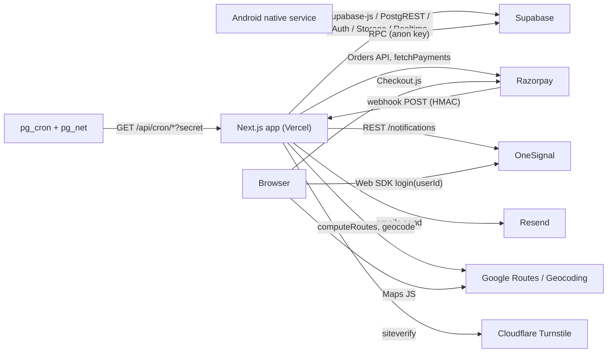

# 09 — External Integrations

Each section: what it is used for, where it is called, the request/response path, and how errors and retries are handled. Environment variables are named only; values live in `.env.local` / Vercel settings and must never be copied.

Env vars referenced in `src/` (from a search of `process.env.*`): `NEXT_PUBLIC_SUPABASE_URL`, `NEXT_PUBLIC_SUPABASE_ANON_KEY`, `SUPABASE_SERVICE_ROLE_KEY`, `CUSTOMER_SERVER_PASSWORD`, `CRON_SECRET`, `FRANCHISE_FEATURES_ENABLED`, `NEXT_PUBLIC_RAZORPAY_KEY_ID`, `RAZORPAY_KEY_ID`, `RAZORPAY_KEY_SECRET`, `RAZORPAY_WEBHOOK_SECRET`, `NEXT_PUBLIC_ONESIGNAL_APP_ID`, `NEXT_PUBLIC_ONESIGNAL_SAFARI_ID`, `NEXT_PUBLIC_ONESIGNAL_ALLOWED_HOSTNAMES`, `ONESIGNAL_REST_API_KEY`, `RESEND_API_KEY`, `RESEND_FROM_EMAIL`, `GOOGLE_MAPS_API_KEY`, `NEXT_PUBLIC_GOOGLE_MAPS_API_KEY`, `NEXT_PUBLIC_TURNSTILE_SITE_KEY`, `TURNSTILE_SECRET_KEY`, `NEXT_PUBLIC_APP_URL`, `NEXT_PUBLIC_APP_DOWNLOAD_BASE_URL`, `RIDER_AUTO_OFF_DUTY_GRACE_MINUTES`, `RIDER_HEARTBEAT_STALE_MINUTES`, `NEXT_PUBLIC_PERF_TIMING`, `NEXT_PUBLIC_STARTUP_TRACE(_ID)`, `NODE_ENV`.

Rule of thumb: `NEXT_PUBLIC_*` values are compiled into browser JavaScript (public). Everything else is server-only.

---

## 1. Razorpay (payments)

| Item | Detail |
|---|---|
| SDK | `razorpay` Node SDK (server) + Checkout.js loaded from `https://checkout.razorpay.com/v1/checkout.js` (client) |
| Server clients | module-level `new Razorpay({ key_id, key_secret })` in `src/actions/checkoutActions.ts` and `src/actions/shop-actions.ts` |
| Flow A — subscription | `createRazorpayOrderAction` → `orders.create(amount paise, notes.checkout_type=SUBSCRIPTION)` → Checkout.js → `verifyAndActivateSubscriptionAction` (HMAC of `order_id|payment_id` with `RAZORPAY_KEY_SECRET`) or `checkAndReconcileSubscriptionPaymentAction` (`orders.fetchPayments(orderId)`, status captured/authorized) → `activateSubscription` |
| Flow B — shop (ADDON) | `createAddonCheckoutOrder` creates DB rows first, then `orders.create(notes: { payment_id, checkout_type: "ADDON" })` → `verifyAddonPayment` or `checkAndReconcileAddonPaymentAction` |
| Webhook | `POST /api/webhooks/razorpay`: raw body → `HMAC_SHA256(rawBody, RAZORPAY_WEBHOOK_SECRET)` must equal `x-razorpay-signature`; handles `payment.captured` and `order.paid`; ignores non-ADDON |
| Idempotency | Webhook: `razorpay_transactions.razorpay_payment_id` exists → 200; payment already PAID → 200. Subscription reconcile: `razorpay_transactions.razorpay_order_id` exists → `alreadyProcessed`. Subscription verify path: none. |
| Errors / retry | Webhook returns 500 on DB write failure (Razorpay redelivers failed webhooks), 400 on bad signature/JSON, 200 on ignore. Actions catch and return `{ success: false, error }`; client shows errors; Android resume triggers reconciliation. |
| Gaps | No webhook for subscriptions; non-constant-time signature compare; webhook skips clinic stock RPC. |

Why the raw body matters: HMAC must be computed over the exact bytes Razorpay sent, so the route reads `request.text()` before `JSON.parse`.

## 2. Supabase

| Feature | Where | Notes |
|---|---|---|
| Postgres via PostgREST | everywhere (`.from()`, `.rpc()`) | three clients: `lib/supabase/server.ts` (RLS, cookies), `client.ts` (browser), `admin.ts` (service role) |
| Auth | `AuthService.ts`, `pinAuthActions.ts`, `authActions.ts`, `auth.admin.createUser/deleteUser/updateUserById` in staff creation, `/api/auth/recovery` | cookie sessions via `@supabase/ssr` |
| Storage buckets (from code constants) | `inventory-product`, `purchase-orders` (`src/lib/inventory/product-schema.ts`), `franchise-dispatch-images` (`franchiseDispatchActions.ts`, `packageImageActions.ts`, `FallbackAutomationService.ts`), `franchise-documents` (`agreementDocActions.ts`), `app-releases` (`src/lib/appDistribution/storage.ts`), `product-images`, `avatars`, `medical_records` (profile completion) | signed URLs for private files (agreement docs, medical docs, APKs); `next.config.ts` allows public images from the project's storage host. Bucket policies are not in repo SQL except `supabase/migrations/20250607120000_inventory_product_storage_bucket.sql`. |
| Realtime | `src/shared/components/customer/LiveTrackingMap.tsx` (`postgres_changes` on `rider_live_locations`) | requires the table in the realtime publication (UNVERIFIED) |
| pg_cron + pg_net | `scripts/add-supabase-cron-jobs.sql` | see `10` |
| Errors | each call returns `{ data, error }`; code checks `error` and returns result objects; 42703 (missing column) handled in `getCurrentAdminContext` | |

## 3. OneSignal (push)

- Client: `src/shared/components/notifications/OneSignalProvider.tsx` loads the Web SDK, calls `OneSignal.login(users.id)`; worker files `/OneSignalSDKWorker.js`, `/OneSignalSDKUpdaterWorker.js` are excluded from middleware. In the rider WebView, native FCM delivery is used (`docs/rider-mobile-native-integration.md`).
- Server: `src/lib/onesignal/server.ts sendPushToExternalUserIds(userIds, payload)` → `POST https://api.onesignal.com/notifications` with `Authorization: Basic <REST key>`, `include_aliases.external_id`, `target_channel: "push"`, optional `web_push_topic`, `url = NEXT_PUBLIC_APP_URL + actionUrl`.
- Errors: skipped with one warning if keys missing; HTTP errors logged; callers fire-and-forget (`void`), no retry.

## 4. Resend (email)

- `src/services/emailService.ts sendEmail(to, subject, html)` → `resend.emails.send({ from: RESEND_FROM_EMAIL or default noreply sender, ... })`.
- Templates: `src/emails/*.ts` return HTML strings; `src/lib/notifications.ts` builds notification emails; shared admin inbox from `system_settings.shared_admin_email` (fallback hard-coded address).
- Errors: logged, never thrown; no retry or queue.

## 5. Google Maps Platform

| API | Where | Details |
|---|---|---|
| Routes API `directions/v2:computeRoutes` | `src/lib/routing/googleRoutes.ts` (`computeOpenLoopRoute`, `computeOptimizedRouteDetails`, `computeFixedOrderRoutePreview`) | `POST` with `X-Goog-Api-Key`, `X-Goog-FieldMask`; `travelMode: TWO_WHEELER`, `routingPreference: TRAFFIC_AWARE`, `optimizeWaypointOrder`, destination = farthest stop, optional `departureTime` (05:00 IST) |
| Geocoding API | `src/lib/geocoding.ts geocodePincode` (`maps/api/geocode/json?address=...&region=in`) | pincode centroid fallback during dispatch; result written back to `addresses.lat/lng`; cached per run |
| Maps JavaScript API | `@react-google-maps/api` `useJsApiLoader` in `AddressCaptureMap.tsx`, `AdminLiveTrackingMap.tsx`, `RoutingSandbox.tsx`, customer tracking map | uses `NEXT_PUBLIC_GOOGLE_MAPS_API_KEY` (restrict by HTTP referrer) |
| Errors | non-OK HTTP or no route → `null` → Haversine fallback (`src/lib/distance.ts`, ×1.3) recorded as `routingFallbacks`; missing key → dispatch returns an error. |

## 6. Cloudflare Turnstile

- `src/lib/appDistribution/turnstile.ts verifyTurnstileToken(token, ip)` → Cloudflare siteverify with `TURNSTILE_SECRET_KEY`; returns `VALID | REJECTED | MISCONFIGURED | UNAVAILABLE`.
- Used only by `POST /api/app-download/grant`; 403 on rejection, 503 when misconfigured/unreachable; no retry (user retries the widget).

## 7. Capacitor (device APIs)

Not a network integration, but external native code: `@capacitor/core`, `@capacitor/app`, `@capacitor/geolocation`, `@capacitor-community/keep-awake`, local `@capacitor-community/background-geolocation`. Web builds alias them to stubs (`next.config.ts`). See `11`.

## 8. Interview questions
1. *How do you verify a Razorpay webhook?* HMAC-SHA256 of the raw request body with the webhook secret, compared to the `x-razorpay-signature` header; then idempotency by payment id.
2. *Why both client verification and a webhook?* Client gives instant UX; webhook guarantees completion when the client dies.
3. *What happens when Google Routes fails?* Fallback to Haversine with a road factor; batches still get created.
4. *Which keys are safe in the browser?* Anon key, Razorpay key id, OneSignal app id, Maps key (restricted), Turnstile site key. Never the service role, Razorpay secret, webhook secret, OneSignal REST key, Turnstile secret, cron secret, customer server password.
