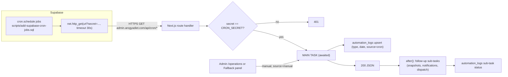

# 10 — Cron and Automation

Terms:
- **Cron**: a schedule expression (`minute hour day month weekday`) that runs a job repeatedly.
- **pg_cron**: a Postgres extension in Supabase that runs SQL on a cron schedule.
- **pg_net**: a Postgres extension that makes HTTP requests from SQL (`net.http_get`). It queues the request; "succeeded" in `cron.job_run_details` only means "queued".
- **`after()`**: a Next.js function (`import { after } from "next/server"`) that runs code after the response is sent.

## 1. Architecture

Why pg_cron instead of Vercel Cron: `vercel.json` has `"crons": []`. Scheduling lives in the database, next to the data, and calls the same HTTP routes. Hobby-plan cron limits and a single place to see job history (`cron.job_run_details`, `net._http_response`) are likely reasons — the repo does not state the reason explicitly (assumption).

Why GET: the SQL header explains that routes export only `GET`; using `http_post` returns 405 while the cron history still says "succeeded".

Why `after()`: pg_net's default timeout is 5 s. Slow notifications used to run before the log write, so the request timed out and no log was written (comment in `activate-subscriptions/route.ts`). Now the route answers as soon as the main task is done.

## 2. Schedule (from `scripts/add-supabase-cron-jobs.sql`, UTC → IST = +5:30)

| Job | Cron (UTC) | IST | Route | Main task | Follow-ups |
|---|---|---|---|---|---|
| auto-off-duty-sweep | `*/5 * * * *` | every 5 min | `/api/cron/auto-off-duty` | `src/lib/delivery/auto-off-duty-sweep.ts` | — |
| activate-subscriptions | `30 8 * * *` | 14:00 | `/api/cron/activate-subscriptions` | `FallbackAutomationService.runSubscriptionActivation`: PENDING starting tomorrow → ACTIVE; ACTIVE past end → stopped; log SUB_ACTIVATE | notify activated / expired |
| generate-orders | `45 11 * * *` | 17:15 | `/api/cron/generate-orders` | `generateDailyOrders(tomorrow)` (date must equal tomorrow) | workload snapshot, notify admins, notify customers |
| expire-kits | `0 18 * * *` | 23:30 | `/api/cron/expire-kits` | `KitLifecycleService.expireEligibleKits` | — |
| link-products | `25 18 * * *` | 23:55 | `/api/cron/link-products` | `runProductLinkingAction(today IST)` | notify, **dispatch/routing** (`executeAutomatedDispatch`), snapshot, notify dispatch |
| transition-stays | `30 19 * * *` | 01:00 | `/api/cron/transition-stays` | `runStayTransitions` → `AccommodationService.transitionStays` | — |
| cleanup-dispatch-images | `0 3 * * *` | 08:30 | `/api/cron/cleanup-dispatch-images` | delete `franchise-dispatch-images` older than 10 days | — |
| cleanup-old-po | `30 22 1 * *` | 04:00 on the 2nd | `/api/cron/cleanup-old-po` | delete purchase-order files older than 3 months | — |
| (not scheduled) | — | — | `/api/cron/dispatch` | dispatch only for a date | snapshot, notify |
| (not scheduled) | — | — | `/api/cron/generate-rider-payments` | monthly rider summaries (27th→26th) | — |

## 3. The daily meal pipeline, step by step

1. **14:00** activate subscriptions starting tomorrow, so 17:15 picks them up.
2. **17:00** customer edit cutoff for tomorrow (`isPastNextDayCutoff`, enforced in actions).
3. **17:15** generate tomorrow's orders. Riders' UI switches to "Tomorrow's Route" from 17:00 (`RIDER_DAY_ROLLOVER_HOUR_IST`).
4. **23:55** link paid shop orders → dispatch (batches, sequences, payouts) → workload snapshots → notify.
5. **~05:00** riders depart (`DEFAULT_RIDER_DEPARTURE_TIME_IST`, used as Routes API departure time).
6. **01:00** stays transition; **23:30** kits expire; **every 5 min** riders auto-off-duty.

IST handling: all date strings are produced with `Intl.DateTimeFormat(..., { timeZone: "Asia/Kolkata" })` in `src/lib/dates/ist.ts` (`getISTDateString(offset)`), so the server's own timezone (UTC on Vercel) does not matter. Pure variants (`istDateStringOf`, `istHourOf`, `addDaysToISODate`) exist for tests.

⚠ Date check: at 23:55 IST, `getISTDateString(0)` is still the current day. The route comment says it is meant to run at ~00:05 IST (after midnight) for "today's" deliveries. If the live job matches the SQL file (18:25 UTC), linking and dispatch target the day that is ending. Verify with `SELECT jobname, schedule FROM cron.job;` and fix either the schedule (18:35 UTC) or the date offset.

## 4. Retry and halt behaviour (what really happens)

| Layer | Behaviour |
|---|---|
| pg_net | No retry. A timeout or 5xx is just recorded in `net._http_response`. |
| Route main task | No retry. Returns 4xx/5xx with the error. `generateDailyOrders` and dispatch are safe to re-run (skip existing / reset-then-rebuild). |
| Follow-ups | Each wrapped in `runSubTask`, errors recorded as sub-task `failed`; never fail the main task. In link-products, dispatch failure skips only the dispatch notification; snapshots still run. |
| `runDailyPipeline` | Has retry ×3 for order creation and product linking and halt-on-failure, but is only used by tests. |
| Manual recovery | Admin `/operations` → `triggerSystemAutomation` (`checkGroupManage("operations")`), allowed for today or tomorrow; Fallback Automations panel → `fallbackAutomationActions.ts` → same `FallbackAutomationService` functions with `source = "manual"`. Manual and cron runs keep separate counters in `automation_logs` (`scripts/add-manual-run-tracking-to-automation-logs.sql`, `enhance-automation-logs-run-tracking.sql`). |

## 5. Security of cron routes
- Most routes: `if (!expectedSecret || secret !== expectedSecret) return 401` — fails closed when the env var is missing.
- `generate-rider-payments`: falls back to a hard-coded literal if `CRON_SECRET` is unset.
- `cleanup-dispatch-images`: also accepts a hard-coded literal secret.
- `scripts/add-supabase-cron-jobs.sql` embeds the secret in the URLs (committed to git). Rotate it and store it in Supabase Vault or a DB setting instead.
- Secrets in query strings end up in access logs; a header (`Authorization: Bearer`) is safer — `net.http_get` supports headers.

## 6. Observability
`automation_logs` (ORDER_GEN, PRODUCT_LINK, ROUTING, SUB_ACTIVATE, …) with per-source counters and sub-task statuses → `src/shared/components/admin/operations/AutomationLogs.tsx`, master `biKitchenOpsActions.getAutomationHealthLog`. Admin notifications after each run. SQL helpers in the cron script header to check `cron.job` and `net._http_response`.

## 7. Interview questions
1. *Why does the route return before notifications finish?* pg_net timeout; `after()` keeps the main result authoritative and fast.
2. *How do you avoid duplicate orders if the cron fires twice?* Existing `(customer, meal_category)` keys for the date are skipped.
3. *How do you re-run routing safely?* Dispatch resets re-routable orders and orphan batches first.
4. *What if the 17:15 job fails?* Admin sees the missing ORDER_GEN log / notification and re-runs "5:15 PM Order Gen" from Operations.

## 8. Trace it yourself
`scripts/add-supabase-cron-jobs.sql` → `src/app/api/cron/generate-orders/route.ts` → `src/lib/automation/logging.ts` → `src/app/api/cron/link-products/route.ts` → `src/services/FallbackAutomationService.ts`.
