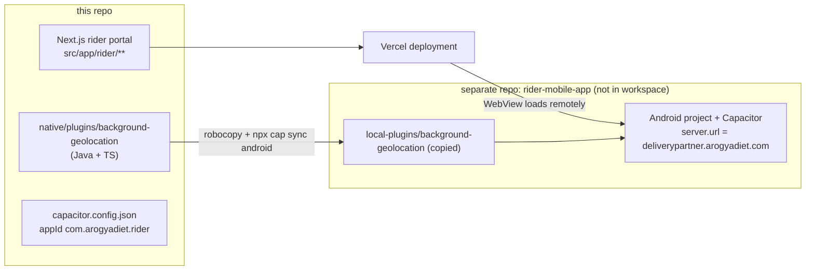
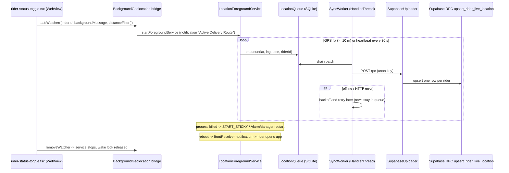

# 11 — Native Mobile: Capacitor Rider App and Background GPS

Terms:
- **Capacitor**: a toolkit that wraps a web app in a native Android/iOS shell (a WebView) and lets JavaScript call native code through **plugins**.
- **WebView**: an embedded browser inside a native app.
- **Foreground service**: an Android background component that shows a persistent notification and is allowed to keep running (e.g. GPS) while the app is not on screen.
- **Doze / App Standby**: Android power-saving modes that pause timers, network and background work.
- **START_STICKY**: a return value telling Android to recreate the service if the OS kills it.

## 1. How the web app becomes an Android app

Facts (from `.kiro/steering/rider-gps-tracking.md` §3 and `docs/rider-mobile-native-integration.md`):
- The APK does **not** bundle the web code. Capacitor's `server.url` points at `deliverypartner.arogyadiet.com`, so web changes ship with a normal Vercel deploy; only native changes need a new APK.
- The Android project lives in `E:\Local Clients\Next.js\rider-mobile-app` (outside this repo). The native plugin source is maintained here and copied over.
- `capacitor.config.json` in this repo (`webDir: out`, plugin texts) is a reference copy; the `server.url` setting is in the other repo (**UNVERIFIED** from this workspace).
- Release builds are sideloaded (signing alias `rider_alias`); the APK is also distributed through the QR landing page (see `modules/app-apk-distribution.md`).

## 2. How web code calls native code without breaking the web build

- `package.json` installs `@capacitor-community/background-geolocation` from `file:./native/plugins/background-geolocation`.
- `next.config.ts` aliases `@capacitor-community/background-geolocation`, `@capacitor-community/keep-awake`, `@capacitor/app` to stubs in `src/lib/capacitor/*-stub.ts` for both webpack and Turbopack, and lists them in `serverExternalPackages`.
- The background-geolocation "stub" is not a no-op: it calls Capacitor's `registerPlugin("BackgroundGeolocation")`. In a normal browser, `Capacitor.isNativePlatform()` is false and the code paths are skipped; inside the APK, the same bundle reaches the native plugin through the Capacitor bridge.
- Native-only components: `src/shared/components/rider/NativeShellProvider.tsx` (back button via `src/lib/capacitor/native-back-button.ts`, notification permission, viewport fix), `rider-status-toggle.tsx`, `BatteryPermissionOnboarding.tsx`, `src/lib/capacitor/splash-screen.ts`, `keep-awake.ts`, `tracking-permissions.ts`, `oem-battery-instructions.ts`. Loaded through `src/app/rider/(main)/rider-layout-client.tsx` with dynamic imports.

## 3. The background GPS pipeline

Java classes in `native/plugins/background-geolocation/android/src/main/java/com/arogyadiet/rider/location/` and the bridge class `com/equimaps/capacitor_background_geolocation/BackgroundGeolocation.java`:

| Class | Responsibility |
|---|---|
| `BackgroundGeolocation.java` | `@CapacitorPlugin`: `addWatcher` (receives the real `riderId`), `removeWatcher`, `getBatteryOptimizationStatus`, `requestIgnoreBatteryOptimizations` |
| `LocationForegroundService.java` | Foreground service of type `location`; owns the shift; `START_STICKY`; `onTaskRemoved` schedules a restart in 5 s with `AlarmManager.setExactAndAllowWhileIdle` when the shift is active; 30 s heartbeat (`HEARTBEAT_INTERVAL_MS`); dedicated `HandlerThread("LocationSyncThread")`; redelivery retry cap 3 |
| `LocationEngine.java`, `LocationEngineConfig.java` | Fused location requests; 10 m distance filter; interval capped at 15 s (`MAX_INTERVAL_MS`) |
| `LocationQueue.java`, `QueuedLocation.java` | Durable SQLite queue (bounded ~10k rows); `deleteForRidersOtherThan(riderId)` purges stale rows |
| `SyncWorker.java`, `SyncState.java` | Drains the queue with retry/backoff on the sync thread |
| `SupabaseUploader.java` | Plain `HttpURLConnection` POST to the `upsert_rider_live_location` RPC with headers `apikey` + `Authorization: Bearer` = the public anon key (embedded as a constant) |
| `ShiftState.java`, `ShiftStateStore.java`, `ShiftAuthorityCallback.java` | Persisted shift state (SharedPreferences `arogyadiet_shift_state`); server-authoritative check is a stub returning UNKNOWN |
| `BootReceiver.java` | On `BOOT_COMPLETED`/`QUICKBOOT_POWERON`, if a shift was active, shows a notification; tapping it opens the app, which restarts tracking from a foreground context (Play-policy-safe: no background location start at boot) |
| `WakeLockManager.java` | Partial wake lock scoped to the shift |
| `LocationConstants.java`, `DeliveryCallback.java`, `StopCallback.java`, `DeliveryException.java` | Constants and callbacks |

## 4. Offline queue and sync
- Every fix is written to SQLite before upload, so a tunnel or app crash does not lose points; the queue survives process death.
- The DB keeps only the latest location per rider (upsert), so replaying old points just moves the row; history is not stored.
- The 30 s heartbeat keeps `rider_live_locations.updated_at` fresh while stationary; the server's auto-off-duty sweep and admin "GPS inactive" badge rely on it.

## 5. Battery optimisation handling
- In-app banner `BatteryPermissionOnboarding.tsx` on the rider dashboard: checks `getBatteryOptimizationStatus()` (stock Android exemption only), offers the system prompt (`REQUEST_IGNORE_BATTERY_OPTIMIZATIONS` permission in the manifest), shows manufacturer steps from `src/lib/capacitor/oem-battery-instructions.ts` (Vivo, Xiaomi, Oppo, Realme, OnePlus, Samsung), re-checks on `appStateChange`. Fails open if the native method is missing (old APK).
- Test evidence (steering doc §4): on a Vivo Android 13 phone, forced Doze killed tracking at ~7–9 min until the OEM "iManager unrestricted" setting was enabled; then it ran 18+ minutes without interruption. Only one device was tested.
- Rider admin checklist: `RIDER_GPS_TRACKING_SETUP_CHECKLIST.md`.

## 6. Why native upload (the key design decision)
The first version uploaded from WebView JavaScript. Android throttles WebView timers in the background, so uploads stopped when the screen locked. Moving upload into the native service fixed it. A later regression (steering §9): `LiveLocationTracker.tsx` started a second watcher on the route page and clobbered the native one; fixed by making the route page passive.

## 7. Security notes
- The anon key in `SupabaseUploader.java` is the same public key used by the website; it is not a secret, but any holder can call `upsert_rider_live_location` for any known rider UUID (accepted trade-off documented in the SQL).
- A comment in `LocationForegroundService.java` (line ~284) mentions a "service-role key"; the uploader actually uses the anon key. Treat the comment as stale. `scripts/verify-apk-secrets.*` and `docs/capacitor-build-security-audit.md` exist to check builds for leaked secrets.
- The committed `Arogya-rider.apk` should be checked with `verify-apk-secrets` before sharing.

## 8. Known gaps
- Server-authoritative shift check not wired (`ShiftAuthorityCallback` stub).
- `tracker_session_id` does not rotate per shift.
- No WorkManager second recovery path.
- Not tested across many OEMs or multi-hour real shifts.

## 9. Interview questions
1. *How does your app track location with the screen off?* Typed foreground service + native upload + durable queue + heartbeat + restart paths.
2. *Why not a pure React Native app?* The rider portal already existed as a Next.js app; a Capacitor shell reused it and only the GPS part needed native code. Web fixes deploy instantly without store releases.
3. *What can't you fix in code?* OEM battery killers; mitigated by onboarding UI and a rider checklist.
4. *How does the web bundle compile when native packages don't exist on Vercel?* Module aliases to stubs in `next.config.ts`; runtime checks with `Capacitor.isNativePlatform()`.

## 10. Trace it yourself
`next.config.ts` → `src/lib/capacitor/background-geolocation-stub.ts` → `src/shared/components/rider/rider-status-toggle.tsx` → `BackgroundGeolocation.java` → `LocationForegroundService.java` (`onStartCommand`, heartbeat) → `SupabaseUploader.java` → `scripts/create-rider-live-location-upsert-rpc.sql`.
