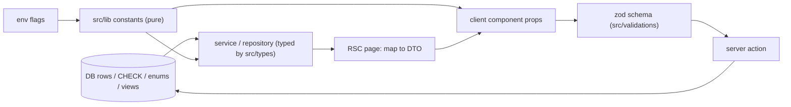

# 13 — State and Data Sources of Truth

"Source of truth" = the one place a value is defined; everything else reads from it. In this project truth lives in four layers: **database** (rows, CHECKs, enums, triggers, views), **pure TypeScript constants** (`src/lib/**`), **types** (`src/types/**`, zod schemas in `src/validations/**`), and **environment** (feature flags, rates fallbacks).

## 1. Global sources

| Concern | Source of truth | Consumers |
|---|---|---|
| Roles | `roles.code` rows (CUSTOMER, RIDER, ADMIN, FRANCHISE_ADMIN, MASTER_ADMIN) | middleware, layouts, `AuthService.login`, guards |
| Access levels, groups, path rules | `src/lib/auth/adminAccessCore.ts` (`ADMIN_ACCESS_LEVELS`, `OPERATIONS_GROUPS`, `FRANCHISE_OPERATIONS_GROUPS`, `GROUP_ROUTE_PREFIX`, `DIETITIAN_ALLOWED_PREFIXES`, `FRANCHISE_PATH_ALIASES`) + DB columns `users.admin_access_level`, `admin_operations_access`, `admin_clinic_id` | middleware, layouts, navbars (menu trimming), guards, master user forms |
| Portal map | `portals` object in `src/middleware.ts`; `FRANCHISE_SUBDOMAIN = "franchies"` in `src/lib/franchise/constants.ts` | middleware |
| Franchise flag | env `FRANCHISE_FEATURES_ENABLED` → `resolveFranchiseFeatureFlag` (`src/lib/franchise/constants.ts`) | middleware, context, stamping, scope resolver, dispatch |
| Tenant of a row | `franchise_id` column on each table; `clinic_id` stamps on orders/batches (immutable) | every query |
| Time | `src/lib/dates/ist.ts` (IST formatting, 17:00 rollover, cutoff predicate, departure time) | actions, cron, rider UI |
| Customer category | `subscriptions.customer_category` (MEAL/KIT/ACCOMMODATION); resolved per request in middleware → header `x-customer-category` | sidebar, route gate, dashboard branch |
| Money defaults | `src/lib/delivery/deliveryCharge.ts` (`DEFAULT_RIDER_PAYOUT_RATE_PER_KM`, `DEFAULT_DELIVERY_RATE_PER_KM`), DB `rate_configs` via `RateConfigService` | routing, checkout, onboarding |
| Cron schedule | `scripts/add-supabase-cron-jobs.sql` (what is actually in `cron.job` is UNVERIFIED) | — |

## 2. Per major screen

| Screen | Data source of truth | Constants / enums / types | How it reaches the UI |
|---|---|---|---|
| Customer meal planner | `subscription_daily_preferences` rows + `subscriptions.pause_credits_total/used`, `effective_end_on` | `meal_categories.code` (VEG/CHICKEN/EGG/MIXED), cutoff in `ist.ts` | RSC page reads rows → props → `MealPlannerClient` |
| Customer checkout | `subscription_plans` (price, tax, duration, pause credits), `coupons`, `rate_configs` | `mealTypeMap` in `checkoutActions.ts`; `OUTSTANDING_BALANCE_CUSTOMER_MESSAGE` (`src/types/subscriptionPayment.ts`) | page + wizard client state; server recomputes everything |
| Customer shop | `products`, `clinic_product_settings` / `franchise_product_settings`, cart in `useCartStore` (client) | `src/types/product.ts`, `clinicShop.ts` | catalog RSC → cart store → checkout action |
| Customer tracking | `rider_live_locations` (realtime), `delivery_orders.status` | `FRESH_WINDOW_MS` (tracking-client) | RSC + Supabase Realtime |
| Rider route | `delivery_batches`, `delivery_orders.route_sequence/status` | `src/lib/delivery/orderStatuses.ts`, `failedDeliveryReasons.ts`, `ACTIVE_DELIVERY_STATUSES` (`duty-lifecycle.ts`) | RSC → stop cards → route actions |
| Rider payout | `delivery_orders.payout_amount` (per stop), `rider_monthly_summaries` | status CHECK GENERATED/PAID | RSC (note `net_payable` vs `total_earnings`) |
| Admin Customer 360 | `customer_profiles`, `subscriptions`, `payments` + ledgers, `stay_entries`, KIT tables | `src/types/*` per domain | RSC `Promise.all` → `Customer360Dashboard` |
| Admin operations | `delivery_orders`, `delivery_batches`, `automation_logs`, `workload_snapshots` | automation names in `triggerSystemAutomation` | RSC + client tables |
| Inventory (central) | `inventory_lots` (quantities), `inventory_transactions` (history) | `src/lib/inventory/product-schema.ts`, `inventory_lot_status` enum, buckets constants | engine reads → dashboard; `useInventoryStore` staging |
| Franchise inventory | `franchise_inventory_lots`, `franchise_inventory_ledger`, `franchise_stock_transfers.state` | `FranchiseTransferState` (`src/types/franchiseInventory.ts`), `VALID_TRANSITIONS` (`transfer-state-reducer.ts`) mirrored in SQL | engine → page → controls |
| Clinic shop stock | `clinic_product_settings.stock_quantity` guarded by trigger; `clinic_product_ledger` append-only | `clinic_movement_source` enum; error prefixes `CLINIC_STOCK_*` → `src/shared/utils/clinicStockErrors.ts` | actions + RPC |
| Report cards | `report_cards.status` + view `v_report_card_editability` | `src/lib/dietitian/logSlots.ts`, `fieldSets.ts`, `reportCardLifecycle.ts` | actions → workspace |
| KIT tracker | `subscriptions.kit_received_date`, `kit_tracker_end_date`, `kit_total_skipped_days` (maintained only by triggers), `kit_daily_logs` | `src/types/kitLifecycle.ts`, `kitTrackerSchema.ts` | actions → tracker |
| Stays | `stay_entries.status` (CHECK), ledgers, history tables | `src/types/accommodation.ts`, paise helpers in `AccommodationService.ts` | actions → stay tabs |
| Hierarchy | `businesses/cities/groups/kitchens/clinics/franchises` with UNIQUE/CHECK constraints | `VALID_STATUS_TRANSITIONS` (franchise status) | master actions → `HierarchyTree` |
| Disputes | `franchise_disputes.status` CHECK | `DISPUTE_CATEGORIES`, `DisputeStatus` (`disputeSchema.ts`) | actions |
| Partial payments | `subscription_payment_transactions` ledger; `payments.amount_paid/balance_due` is a projection | `src/types/partialPayment.ts`, `partialPaymentBreakup.ts` | `SubscriptionPaymentService` |

## 3. Derived vs stored — the rules this codebase follows
- **Derive, don't store** when a ledger exists: balances (`deriveSubscriptionBalance`, `deriveStayBalance`), "final invoice" label, stock parity.
- **Store but maintain in the DB** when reads must be cheap: KIT end date and skip count (trigger), `pause_credits_used` (recounted after every pause change in app code).
- **Stamp once, never update**: `delivery_orders.clinic_id`, `delivery_batches.clinic_id`.
- **Lenient read / strict write**: `resolveAccessConfiguration` vs `validateOperationsAccessInput`.

## 4. Type sources
- No generated Supabase types (`Database` interface) in the repo; types are hand-written in `src/types/*` and zod-inferred (`z.infer`). Risk: types can drift from the schema; generating types with the Supabase CLI would close it.
- Enum-like values often duplicated between SQL CHECKs and TS unions (e.g. transfer states, dispute statuses); property tests (`src/lib/franchise-inventory/*.test.ts`) protect some of them.

## 5. Data flow from source to UI (generic)

