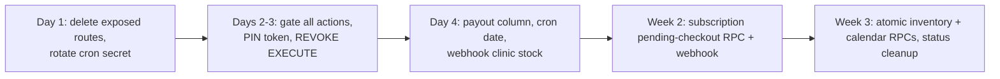

# 16 — Known Issues and Technical Debt

Found by reading the code on 2026-11-02 (commit `0e3fadd`). Nothing here was changed; these are recommendations for Ravi's client work. Each item: **where**, **why it matters**, **fix approach (in words)**, **rough effort** (S ≤ 0.5 day, M 1–2 days, L 3+ days).

"Verified" = seen in code. "Needs confirmation" = the code strongly suggests it, but behaviour depends on runtime/DB state that was not checked (no DB or server was run).

How Server Action exposure works (needed for several items): an exported function in a `"use server"` file becomes an HTTP-callable action once the module is imported by a client component. The following modules are imported by client components (verified by search): `master-actions/adminActions.ts` (`UserManagement.tsx`), `admin-actions/adminPinActions.ts` (`ResetPinDialog.tsx`), `admin-actions/financeActions.ts` (master finance views, admin finance tabs), `franchise-actions/franchiseRiderActions.ts` (`FranchiseRiderDashboard.tsx`), `admin-actions/systemActions.ts` (`PlannedDeliveries.tsx`), `manageMealActions.ts` (planner, address switcher), `pinAuthActions.ts` (login forms), `routingSandboxActions.ts` (`RoutingSandbox.tsx`), `master-actions/biOverviewActions.ts` (`OverviewShell.tsx`). Treat every export in those files as reachable by anyone who can send a POST with the action id (ids are present in the downloaded JS).

---

## P0 — Security (fix first)

### 1. Unauthenticated password-reset endpoint
- **Where**: `src/app/api/reset-franchise-password/route.ts` (POST `{ email, newPassword }`), file says "TEMPORARY … DELETE THIS FILE after use!".
- **Why**: middleware skips `/api/*`; the route has no auth and uses the service-role key to set **any** user's password by email (not only franchise users). Account takeover of any admin or master account. Verified.
- **Fix**: delete the route (or protect it with a master session check + one-time token). Then rotate passwords of accounts that may have been reset; review Supabase Auth logs.
- **Effort**: S.

### 2. Unauthenticated migration endpoints
- **Where**: `src/app/api/migrate/reset-customer-passwords/route.ts` (GET/POST resets every customer's auth password to `CUSTOMER_SERVER_PASSWORD`), `src/app/api/migrate/fix-stuck-accommodation-user/route.ts` (GET/POST creates an auth identity and sets a temp PIN for a given mobile; default temp PIN is a fixed value in code).
- **Why**: callable by anyone; the second one lets an attacker set a known PIN on a stuck account. Verified.
- **Fix**: delete both (they were one-offs), or move to scripts run locally with the service key.
- **Effort**: S.

### 3. Ungated privileged Server Actions
- **Where / what** (no caller check found in the file; service-role client used):
  - `master-actions/adminActions.ts`: `getAdminUsers`, `createAdminUser`, `updateAdminUser`, `deleteAdminUser`, `toggleAdminActive` → anyone could create an ADMIN with full access.
  - `admin-actions/adminPinActions.ts`: `resetCustomerPinAction(userId, newPin)` → set a known temp PIN for any customer.
  - `admin-actions/financeActions.ts`: `generateMonthlyPayment`, `createCustomPayment`, `updateSystemSettings`, reads of revenue; `markPaymentAsPaid` only checks "is logged in".
  - `franchise-actions/franchiseRiderActions.ts`: `franchiseOnboardRider(formData)` trusts `formData.franchiseId`.
  - `master-actions/bi*Actions.ts`, `dashboardActions.ts`, report actions: business data reads.
  - `admin-actions/routingSandboxActions.ts`, `workloadActions.ts`, `conflictActions.ts`, `kitProductActions.ts`, `franchiseKitchenActions.ts`, `franchiseActions.ts`, `packageImageActions.ts`, `notificationSettingsActions.ts`, `logActions.ts`: no shared gate found by search — review each (master `kitchenActions.ts`/`businessActions.ts` do have local asserts).
  - `manageMealActions.ts`: exported helpers `cascadePendingSubscriptionDates(customerProfileId, baseEnd)`, `repairOverLimitPauseCredits(subscriptionId)`, `processPausePreferenceUpdates`, `rebuildPendingSubscriptionPreferences` have no ownership check.
  - `admin-actions/systemActions.ts`: `runProductLinkingAction(date, source = "cron")` only gates when `source === "manual"`, so a direct call with the default skips the gate.
  - `system-actions/orderGeneration.ts` / `dailyPipeline.ts` are `"use server"` with no gate (exposure depends on client imports; currently imported only by server code).
- **Why**: privilege escalation, data tampering, data leaks. Mostly verified by reading; exploitability "needs confirmation" with a test POST in a staging environment.
- **Fix**: add the right gate at the top of every exported action (`assertMasterAdmin`, `checkGroupManage(group)`, `checkFranchiseGroupManage`, `resolveScope`); derive franchise/customer ids from the session; move internal helpers out of `"use server"` files into plain server modules (as was done for `routeEngine.ts`); make `runProductLinkingAction` private and expose a gated wrapper; add a static test (like `src/test/architecture/use-server-exports.test.ts`) that fails if an exported action has no gate call.
- **Effort**: M (mechanical but many files) + S for the test.

### 4. PIN takeover via `setPermanentPinAction`
- **Where**: `src/actions/pinAuthActions.ts` `setPermanentPinAction(mobile, newPin, confirmPin)` → `PinService.setPermanentPin` → `signInWithPassword`.
- **Why**: it does not check that the account has `is_temp_pin = true` or that this caller just verified the temp PIN. A caller who knows a customer's mobile can set a new PIN and receive a session. Verified by reading; confirm in staging.
- **Fix**: after `verifyPinAction` returns TEMP_PIN, issue a short-lived signed token (or store a server-side nonce row) and require it in `setPermanentPinAction`; also require `is_temp_pin = true` in the update's WHERE clause; throttle it.
- **Effort**: S–M.

### 5. Shared customer password model
- **Where**: `CUSTOMER_SERVER_PASSWORD` used for every customer (`OnboardingService`, `pinAuthActions.establishSession`).
- **Why**: one leaked env value = sign in as any customer directly via Supabase Auth with their (often guessable placeholder) email.
- **Fix**: per-user random password stored only as Auth credential (generate at onboarding, keep in Vault or never needed), or mint sessions server-side with the Admin API (`generateLink`/custom JWT) after PIN verification.
- **Effort**: M.

### 6. Hard-coded secrets in the repo
- **Where**: `scripts/add-supabase-cron-jobs.sql` (cron secret in every URL); `src/app/api/cron/cleanup-dispatch-images/route.ts` (accepts a literal secret in addition to `CRON_SECRET`); `src/app/api/cron/generate-rider-payments/route.ts` (literal fallback when env unset); `src/lib/notifications.ts` (hard-coded personal admin email fallback); `.env.local` exists in the working folder (check it is git-ignored — `.gitignore` present; not verified that it was never committed).
- **Fix**: rotate `CRON_SECRET`; store it in Supabase Vault and build the URL/headers from it; remove literal fallbacks (fail closed); send the secret in an `Authorization` header instead of the query string; move the fallback email to `system_settings`/env. Run `git log -p -- .env.local` to confirm no history.
- **Effort**: S.

### 7. SECURITY DEFINER functions callable by anon/authenticated
- **Where**: `scripts/create-*-rpc.sql` (e.g. `onboard_customer`, `dispatch_to_franchise`, `receive_franchise_transfer`, `record_franchise_stock_out`, `transfer_stock`, `move_pincode_and_reassign`, `set_franchise_context`). No `REVOKE EXECUTE` found in `scripts/`.
- **Why**: Postgres grants EXECUTE to PUBLIC by default and Supabase exposes public functions over the REST API, so the public anon key (shipped to every browser) may be enough to call them with arbitrary arguments. `set_franchise_context` also trusts a caller-supplied role. Needs confirmation (`SELECT proname, proacl FROM pg_proc WHERE pronamespace = 'public'::regnamespace;`).
- **Fix**: `REVOKE EXECUTE ON FUNCTION ... FROM PUBLIC, anon, authenticated; GRANT EXECUTE ... TO service_role;` for every server-only RPC; keep only `upsert_rider_live_location` (and intended dietitian helpers) for anon/authenticated; optionally move internal functions to a non-exposed schema.
- **Effort**: S–M.

### 8. Public dev/debug surfaces
- **Where**: `/architecture` (Pages Router viewer of internal docs, public by middleware bypass, marked TEMPORARY); `/sandbox` (OneSignal test page + `sandbox/actions.ts`, public).
- **Fix**: remove after use or require a master session.
- **Effort**: S.

---

## P1 — Functional correctness

### 9. Rider payout column mismatch
- **Where**: `src/app/rider/(main)/payout/page.tsx` (leaderboard sums `net_payable`), `dashboard/dashboard-content.tsx` (reads `net_payable`); writers (`financeActions.generateMonthlyPayment`, `/api/cron/generate-rider-payments`) write `total_earnings`. No code or SQL in the repo writes `net_payable`.
- **Why**: leaderboard and dashboard totals show ₹0 unless the DB has a generated column or trigger not in the repo (needs confirmation).
- **Fix**: decide the meaning (`net_payable = total_earnings + adjustments`); add it as a generated column or compute it in a view, or switch readers to `total_earnings` + adjustments.
- **Effort**: S.

### 10. Subscription payment not webhook-reconciled
- **Where**: `src/app/api/webhooks/razorpay/route.ts` ignores non-ADDON; `checkoutActions.ts` passes `checkoutData` from the client after payment.
- **Why**: if Android kills the WebView during a UPI switch, the money is captured but no subscription is created; recovery is manual.
- **Fix**: create a `pending_checkouts` row (server-computed checkout data, customer from session) at order creation and put its id in `order.notes`; let the webhook and the client both call one idempotent `activate_subscription(pending_checkout_id, payment_id)` RPC.
- **Effort**: M.

### 11. Non-atomic, non-idempotent subscription activation
- **Where**: `checkoutActions.ts activateSubscription` (6+ separate writes); `verifyAndActivateSubscriptionAction` has no "already processed" check.
- **Why**: partial records on failure; duplicate subscription if handler and resume both succeed.
- **Fix**: same RPC as item 10 with a UNIQUE constraint on `razorpay_transactions.razorpay_payment_id` (and/or order id) and `ON CONFLICT DO NOTHING`. Also take `customerProfileId` from the session, not `checkoutData`.
- **Effort**: M (with item 10).

### 12. Link-products / dispatch date at 23:55 IST
- **Where**: `scripts/add-supabase-cron-jobs.sql` schedules `link-products` at `25 18 * * *` (23:55 IST); `src/app/api/cron/link-products/route.ts` uses `getISTDateString(0)` and its comment says ~12:05 AM.
- **Why**: if live, linking and dispatch target the day that is ending instead of the next delivery day. Needs confirmation against `cron.job`.
- **Fix**: schedule at `35 18 * * *` (00:05 IST) or pass `date=` tomorrow when before midnight; add a guard in the route that rejects past dates for dispatch.
- **Effort**: S.

### 13. Webhook skips clinic stock decrement
- **Where**: webhook only calls `decrement_franchise_product_stock`; `verifyAddonPayment` also calls `clinic_shop_apply_sale` for core clinics.
- **Why**: core-clinic stock and ledger drift when only the webhook completes an order.
- **Fix**: extract one `finalizeAddonPayment(paymentId, source)` used by both paths.
- **Effort**: S.

### 14. Central warehouse dispatch is not atomic
- **Where**: `src/services/inventoryEngine.ts dispatchInventoryStock` (JS FIFO loop + manual rollback, no row locks).
- **Why**: concurrent dispatches can over-deplete; crash mid-loop leaves partial state.
- **Fix**: a `dispatch_inventory_stock` RPC modelled on `dispatch_to_franchise` (`FOR UPDATE`, single transaction).
- **Effort**: M.

### 15. Meal planner reconciliation is multi-query
- **Where**: `manageMealActions.ts executePauseReconciliationEngine`.
- **Why**: concurrent edits or a failure halfway can break the invariant `pause_credits_used = count(is_paused)`; the planner page already self-repairs, which shows it happens.
- **Fix**: move to a `reconcile_subscription_calendar(subscription_id)` RPC with a row lock on the subscription.
- **Effort**: M.

### 16. Dead middleware guard for temporary PINs
- **Where**: `src/middleware.ts` declares `let isTempPin = null` and never assigns it.
- **Fix**: select `is_temp_pin` in the existing users query and assign it, or remove the block and its test model.
- **Effort**: S.

### 17. Franchise RLS cannot work via session variables
- **Where**: `scripts/create-franchise-rls-policies.sql` + `set_franchise_context` (transaction-local `set_config`); documented in the middleware comment.
- **Why**: if someone enables `enable-franchise-rls.sql`, session-client queries see core rows only and franchise rows disappear; the app relies on service role + filters instead.
- **Fix**: either drop the idea and document "app-enforced tenancy", or rewrite policies using JWT claims (custom access token hook adding `franchise_id`/`role` to the JWT, policies on `auth.jwt()`).
- **Effort**: L (if moving to JWT claims).

### 18. Franchise pages trust a cookie for tenant id
- **Where**: many `src/app/franchise/(main)/*/page.tsx` read `x-franchise-id` from cookies and query with the service role.
- **Why**: middleware overwrites the cookie on its response, but whether the RSC sees the browser-sent or the middleware-set value in the same request is not verified. Newer pages already switched to `guardFranchise*()`.
- **Fix**: replace cookie reads with the session-derived guard everywhere.
- **Effort**: S–M.

### 19. Inconsistent payment status values
- **Where**: `SUCCESS` (subscription checkout) vs `PAID` (shop, webhook, onboarding) vs `PENDING`/partial; no CHECK on `payments.status` (per `docs/meal-partial-payment-plan.md`).
- **Fix**: pick one set, backfill, add a CHECK, centralise constants.
- **Effort**: S.

### 20. Monthly payout generation not scheduled
- **Where**: `/api/cron/generate-rider-payments` exists but is not in the cron SQL.
- **Fix**: schedule it (27th) or remove it and document the manual finance flow.
- **Effort**: S.

---

## P2 — Tech debt and hygiene

| # | Item | Where | Fix | Effort |
|---|---|---|---|---|
| 21 | OTP login built but unmounted | `mobileAuthActions.ts` (marked @deprecated), `OtpLoginService.ts`, `MobileOtpLoginForm.tsx`, tests | Delete or keep behind a flag; document decision | S |
| 22 | `runDailyPipeline` unused in production | `system-actions/dailyPipeline.ts` | Either use it from the cron routes (gets retries/halt) or delete and keep tests on real paths | S–M |
| 23 | Legacy one-line routes | `src/app/rider/subscription/page.tsx`, `rider/tracking/page.tsx`, `customer/(main)/tracking/page.tsx` | Remove or redirect via `next.config` | S |
| 24 | Deprecated `middleware.ts` name in Next 16 | `src/middleware.ts` | Run the official codemod to `proxy.ts` when convenient (behaviour unchanged; proxy defaults to Node runtime) | S |
| 25 | Unused dependencies | `@tanstack/react-query` (no usage), `@onesignal/node-onesignal` (server uses fetch) | Remove or adopt | S |
| 26 | No generated DB types | `src/types/*` hand-written, many `any` | `supabase gen types typescript` and type the clients | M |
| 27 | No migration runner/history | `scripts/*.sql` run by hand | Adopt Supabase CLI migrations (`supabase/migrations` already exists) with ordering | M |
| 28 | Fire-and-forget notifications | `void sendAdminEmails(...)` in `lib/notifications.ts` | Use `after()` from callers or await with timeouts | S |
| 29 | In-memory dedupe in serverless | `manageMealActions.ts` notification dedupe map | Use `web_push_topic` / DB-based dedupe | S |
| 30 | Webhook signature compare | `!==` in webhook and verify actions | `crypto.timingSafeEqual` on equal-length buffers | S |
| 31 | Stale comments/docs | `LocationForegroundService.java` (~line 284 mentions service-role key; uploader uses anon), `duty-lifecycle.ts` (says 5-min default, code 10), `docs/meal-partial-payment-plan.md` ("PLAN not executed"), `AI_CONTEXT/*` (Next 15, `src/modules`), `.kiro/steering/tech.md` (React Query) | Update | S |
| 32 | Scratch files in repo root | `out.txt`, `fail_lines.txt`, `response*.html`, `login.html`, `globals-output.css`, `prerev_*.txt`, `PRPGRESS.MD`, `accomtab_debug.txt` | Delete / git-ignore | S |
| 33 | Committed APK | `Arogya-rider.apk` | Remove from git; distribute via Storage (already built) | S |
| 34 | Backup file | `src/lib/inventory/schema.ts.bak` | Delete | S |
| 35 | Odd filename | `checkout-wizard.tsx.tsx` | Rename | S |
| 36 | Missing tests for payments/webhook/planner engine/middleware | see `14` | Add | M |
| 37 | Unchecked spec items | report-card PDF/verification, APK operator steps, latency checkpoint (`15`) | Finish or close | M |
| 38 | `isRetrospectiveReport`, cadence etc. fine; BI aggregations in Node | `master-actions/bi*` | SQL views/RPCs for heavy aggregates | M |

---

## Suggested order of work
1. Items 1, 2, 6, 8 (delete/rotate) — same day.
2. Items 3, 4, 7 (gates, PIN token, REVOKEs) + a static "every action has a gate" test.
3. Items 9, 12, 13, 20 (quick functional fixes).
4. Items 10, 11 (subscription reconciliation RPC).
5. Items 14, 15, 19, 18.
6. P2 hygiene.

