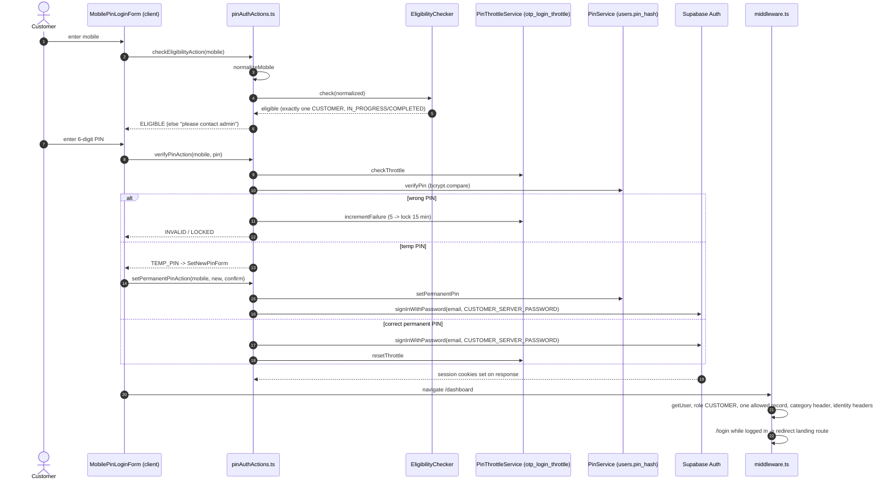

# Flow: Customer Login (mobile + PIN)

Files in order: `src/app/customer/(auth)/login/page.tsx` → `CustomerLoginView.tsx` → `src/shared/components/customer/MobilePinLoginForm.tsx` → `src/actions/pinAuthActions.ts` → `src/services/EligibilityChecker.ts` → `src/repositories/customerOnboardingRepository.ts` → `src/services/PinThrottleService.ts` → `src/services/PinService.ts` → Supabase Auth `signInWithPassword` → `src/middleware.ts` (customer branch) → `src/app/customer/(main)/layout.tsx` → `src/lib/customer/get-session.ts`.

Step notes:
1. Eligibility never reveals why a number is rejected (same message for not registered / bad status / ambiguous).
2. The email used for sign-in may be a placeholder (`m<mobile>@placeholder.arogyadiet.internal`).
3. Throttle is per mobile in `otp_login_throttle` (RLS on, no policies → service role only).
4. Middleware then lets the user through only if `roles.code = CUSTOMER` and exactly one `customer_profiles` row is IN_PROGRESS/COMPLETED.

Known issues: `setPermanentPinAction` lacks a temp-PIN proof check; middleware `isTempPin` guard is dead code. See `16-known-issues-and-tech-debt.md`.
