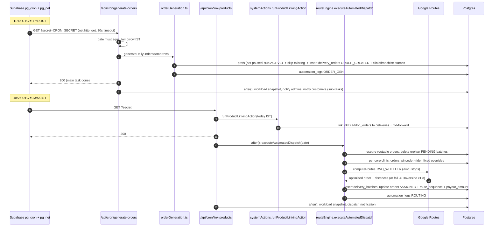

# Flow: Daily Order Generation and Dispatch

Files: `scripts/add-supabase-cron-jobs.sql` → `src/app/api/cron/activate-subscriptions/route.ts` (14:00) → `src/app/api/cron/generate-orders/route.ts` (17:15) → `src/actions/system-actions/orderGeneration.ts` → `src/lib/clinic/workload.ts` → `src/app/api/cron/link-products/route.ts` (23:55 per SQL) → `src/actions/admin-actions/systemActions.ts runProductLinkingAction` → `src/actions/system-actions/routeEngine.ts executeAutomatedDispatch` → `src/lib/routing/googleRoutes.ts` / `src/lib/distance.ts` → `src/lib/automation/logging.ts` → rider pages.

Manual recovery: Admin `/operations` → `triggerSystemAutomation("5:15 PM Order Gen" | "Product Linking" | "Routing & Batching", { targetDate })` → same functions with `source = "manual"`, gated by `checkGroupManage("operations")`, allowed for today or tomorrow only.

Retry/halt: no automatic retry in the cron routes (pg_net does not retry). `runDailyPipeline` (retry ×3, halt-on-failure) exists but is used only by tests.

Watch-out: link-products uses today's IST date but runs at 23:55 IST per the SQL file; confirm the live schedule (`SELECT jobname, schedule FROM cron.job`).
