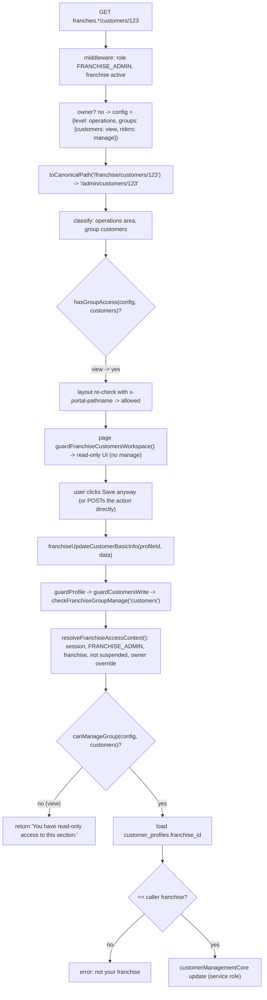

# Flow: Franchise Permission Check (end to end)

Example: a franchise user with `admin_access_level = "operations"` and `admin_operations_access = { customers: "view", riders: "manage" }` opens a customer and tries to edit it.

Files: `src/middleware.ts` → `src/lib/auth/adminAccessCore.ts` (`resolveAccessConfiguration`, `toCanonicalPath`, `isPortalPathAllowed`, `hasGroupAccess`, `canManageGroup`) → `src/app/franchise/(main)/layout.tsx` → `src/app/franchise/(main)/customers/[id]/page.tsx` (`guardFranchiseCustomersWorkspace`) → `src/actions/franchise-actions/franchiseCustomerManagementActions.ts` (`guardCustomersWrite`, `guardProfile`) → `src/lib/auth/adminAccess.ts` (`resolveFranchiseAccessContext`, `checkFranchiseGroupManage`) → `src/services/customerManagementCore.ts`.

Takeaways:
1. **Path gate** (middleware + layout) decides reachability.
2. **Page guard** decides read-only vs editable rendering.
3. **Action gate** decides permission (manage vs view).
4. **Tenancy guard** decides ownership of the specific row.
5. The franchise owner (`franchises.owner_user_id`) skips 1–3 restrictions (full access) but not 4.
