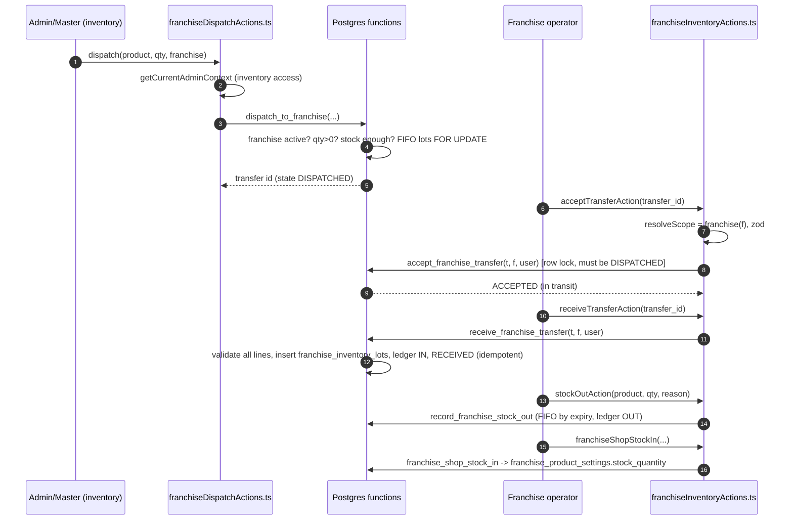
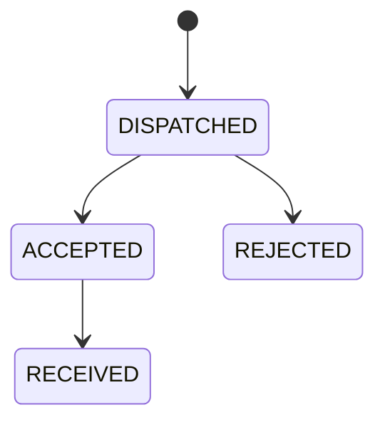

# Flow: Franchise Stock Transfer (central → franchise)

Files: admin/master dispatch UI → `src/actions/admin-actions/franchiseDispatchActions.ts` → `src/services/franchiseInventoryEngine.ts dispatchToFranchise` → `scripts/create-dispatch-to-franchise-rpc.sql` → franchise `src/app/franchise/(main)/inventory/page.tsx` → `_components/IncomingTransfersPanel.tsx`, `ReceiveTransferControls.tsx` → `src/actions/franchise-actions/franchiseInventoryActions.ts` → `src/lib/auth/scope-resolver.ts` → `src/validations/franchiseInventory.ts` → engine → `create-accept-reject-franchise-transfer-rpcs.sql`, `create-receive-franchise-transfer-rpc.sql` → `StockOutModal.tsx` → `create-record-franchise-stock-out-rpc.sql`.

State machine:

Interview line: "Every arrow above is one Postgres function, so each step is one transaction with row locks; the app only proves identity and tenancy and passes ids."
