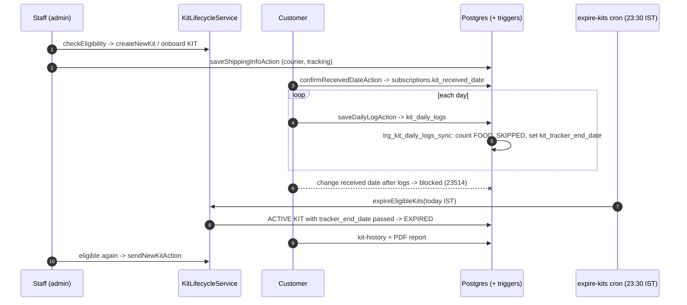
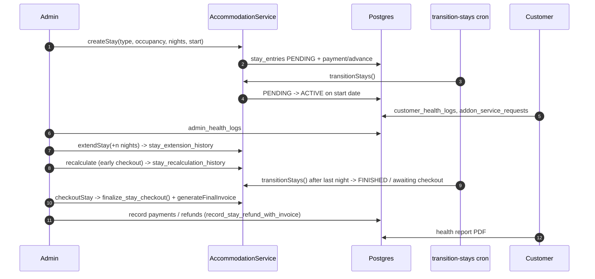
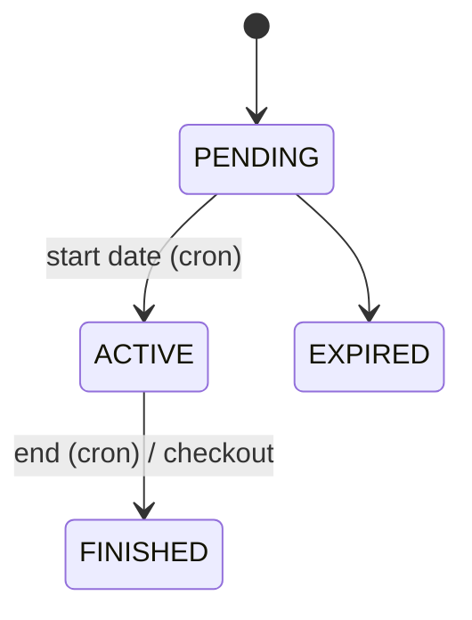

# Flow: KIT Lifecycle

Files: onboarding (`OnboardingService.onboard`, category KIT, any pincode) or `admin-actions/kitLifecycleActions.ts sendNewKitAction` → `KitLifecycleService.createNewKit` → `shippingActions.saveShippingInfoAction` (`kit_shipping_info`) → customer `dashboard/ShippingTracker.tsx` → `kitTrackerActions.confirmReceivedDateAction` → `kitTrackerActions.saveDailyLogAction` → triggers (`create-kit-tracker-sync-trigger.sql`, `create-kit-received-date-lock-trigger.sql`, category guards) → `/api/cron/expire-kits` → `KitLifecycleService.expireEligibleKits` → `kit-history/page.tsx` → `/api/kit-report/[subscriptionId]` (`KitReportService`, `KitReportTemplate.tsx`).

End date formula (trigger): `kit_tracker_end_date = kit_received_date + (kit_duration_days - 1) + skipped_days`.

---

# Flow: Accommodation Stay Lifecycle

Files: `admin/(main)/customers/[id]` → `AccommodationTab`/`NewStayDialog` → `src/actions/stayActions.ts createNewStayAction` (or `accommodationOnboardingActions.ts`) → `AccommodationService.createStay` → payments/ledger (`stayPaymentActions.ts`, `create-stay-payment-lifecycle.sql`) → `/api/cron/transition-stays` (01:00 IST) → `AccommodationService.transitionStays` → daily logs (customer `stay-tracker`, admin logs) → `extendStayAction` / `RecalculateStayDialog` (`create-stay-recalculation.sql`) → `markStayCheckedOutAction` / `checkoutStay` → `generateFinalInvoice` → `/api/stay-health-report/[stayId]`.

