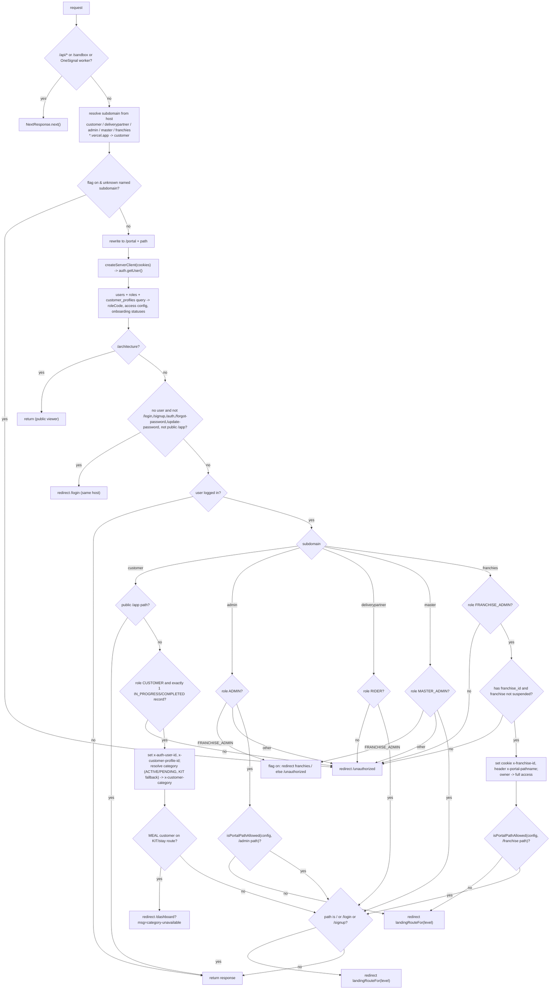

# Flow: Middleware Decision Tree (`src/middleware.ts`)

Matcher: every path except `_next/static`, `_next/image`, `favicon.ico` and image extensions. Runs before every page. Note: Next.js 16 deprecated the `middleware` file name in favour of `proxy.ts` (`node_modules/next/dist/docs/01-app/03-api-reference/03-file-conventions/proxy.md`); this project still uses `middleware.ts`.

Notes:
- `landingRouteFor`: inventory → `/inventory`, dietitian → `/customers`, others → `/dashboard`.
- Queries per request: 1 auth call + 1 users query; +1–2 subscriptions queries (customer); +2 (franchise: users.franchise_id, franchises).
- Middleware deliberately does not call `set_franchise_context` (transaction-local setting would not persist; see the comment block in the file).
- Dead code: `isTempPin` is never assigned.
