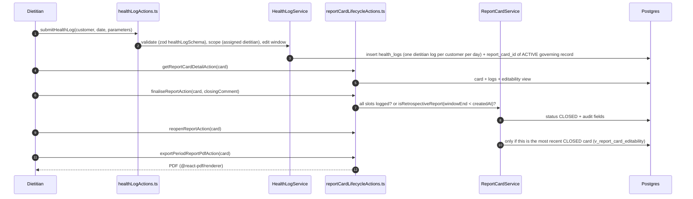
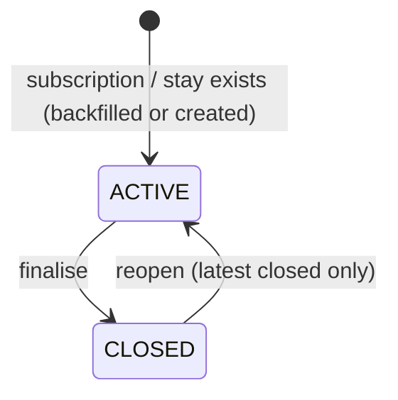

# Flow: Report Card Lifecycle

Files: `src/app/admin/(main)/log-customer/[id]/page.tsx` (or franchise equivalent) → `src/actions/dietitian-actions/healthLogActions.ts submitHealthLog` → `src/services/HealthLogService.ts` → `health_logs` (with `report_card_id`) → `src/app/admin/(main)/customers/[id]/report-card/page.tsx` → `src/actions/dietitian-actions/reportCardLifecycleActions.ts` → `src/services/ReportCardService.ts` → view `v_report_card_editability` (`scripts/create-report-card-lifecycle.sql`) → `src/lib/dietitian/reportCardLifecycle.ts` → `DietitianReportService` + `DietitianReportTemplate.tsx` (PDF).

Scope rules: dietitian must be linked (`customer_profiles.dietitian_id`), checked by `dietitian_can_read_customer()` in SQL and `scopeFranchiseCustomersForDietitian` (fail-closed) in TS.
