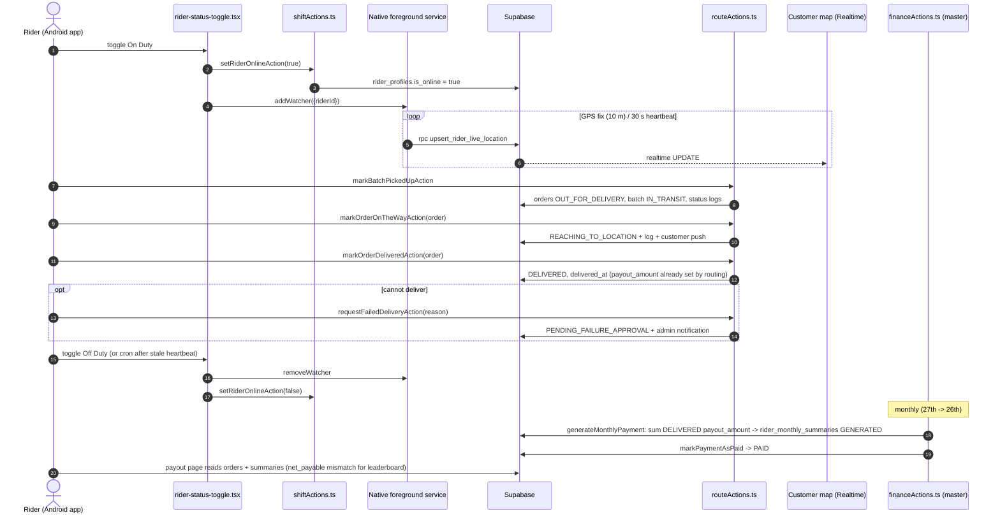

# Flow: Rider Duty → Delivery → Payout

Files: `src/app/rider/(main)/dashboard/dashboard-content.tsx` → `src/shared/components/rider/BatteryPermissionOnboarding.tsx`, `rider-status-toggle.tsx` → `src/actions/rider-actions/shiftActions.ts` → native `LocationForegroundService.java` → `SupabaseUploader.java` → RPC `upsert_rider_live_location` → `src/app/rider/(main)/route/page.tsx` → `src/actions/rider-actions/routeActions.ts` → `src/lib/delivery/deliveryStatusNotifications.ts` → `src/app/api/cron/auto-off-duty/route.ts` → `src/actions/admin-actions/financeActions.ts` → `src/app/rider/(main)/payout/page.tsx`.

Notes:
- Payout per stop = route leg km × ₹/km from `RateConfigService` (default constant if no rate).
- The auto-off-duty cron (every 5 min) flips riders whose heartbeat is older than `RIDER_HEARTBEAT_STALE_MINUTES` (default 10) unless they have an in-progress delivery.
- The monthly cron route exists but is not in the pg_cron SQL.
