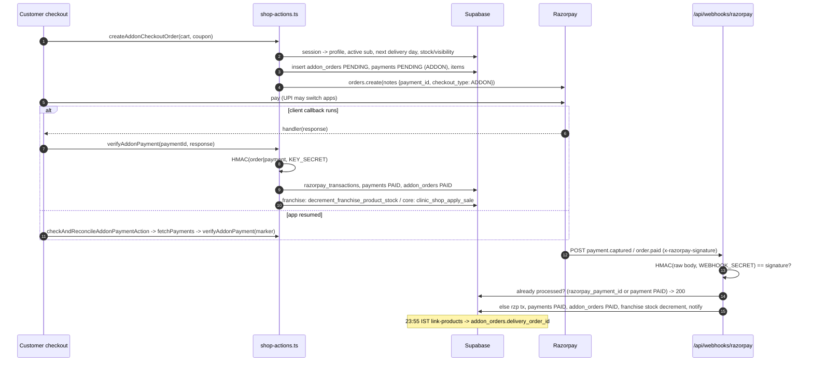

# Flow: Shop Order with Razorpay Webhook Backstop

Files: `src/store/useCartStore.ts` → `src/app/customer/(main)/shop/checkout/page.tsx` → `src/actions/shop-actions.ts` (`createAddonCheckoutOrder`, `verifyAddonPayment`, `checkAndReconcileAddonPaymentAction`) → Razorpay → `src/app/api/webhooks/razorpay/route.ts` → RPCs `decrement_franchise_product_stock` / `clinic_shop_apply_sale` → `src/app/api/cron/link-products/route.ts` → `systemActions.runProductLinkingAction`.

Error/retry behaviour:
- Webhook returns 500 on DB failures so Razorpay retries (Razorpay retries failed webhooks — per Razorpay docs, not verifiable in code).
- Returns 200 for ignored events and already-processed payments (idempotent).
- Gap: webhook path does not call `clinic_shop_apply_sale`, so core-clinic stock is not decremented when only the webhook completes the order.
