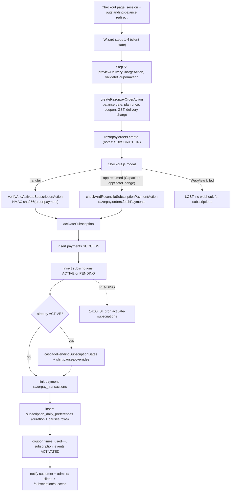

# Flow: Subscription Purchase with Razorpay

Files: `src/app/customer/(main)/subscription/checkout/page.tsx` → `src/shared/components/customer/subscription/checkout/checkout-wizard.tsx.tsx` → `step-5-preview.tsx` → `src/actions/checkoutActions.ts` → `src/services/DeliveryChargeService.ts`, `src/lib/coupons/resolveSubscriptionCoupon.ts`, `src/services/SubscriptionPaymentService.ts` → Razorpay → `activateSubscription` → `src/actions/manageMealActions.ts` (`cascadePendingSubscriptionDates`) → `src/lib/notifications.ts` → later `src/app/api/cron/activate-subscriptions/route.ts`.

Key facts for interviews:
- The server never trusts the client's price.
- Two confirmation paths (handler, resume reconciliation); idempotency check exists only in the reconcile path.
- The writes are sequential supabase-js calls, not a transaction.
- Payment status written: `SUCCESS` (other flows use `PAID`).
