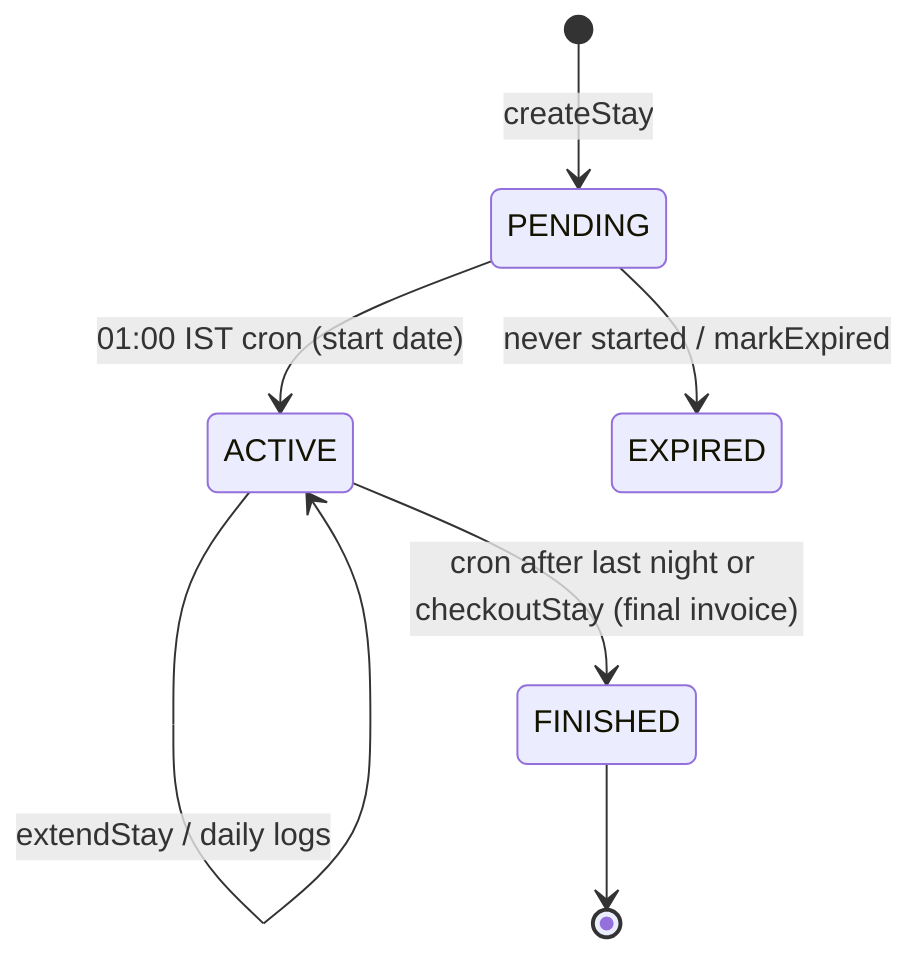

# Module: Accommodation (Wellness Stay)

## 1. What it does
A customer books a stay at a clinic (AC Villa or Village Style Hut, single/double, meal preference, N nights). The stay starts and ends automatically each night, can be extended or closed early (with billing recalculation), collects payments/refunds through a ledger with invoices and receipts, records daily health logs (customer + admin), add-on service requests, and produces a health report PDF. Portals: **Customer** (dashboard stay view, `/stay-tracker`, `/stay-history`, `/health-report`, `/addon-services`), **Admin** (Customer 360 accommodation tab, stay dialogs, payments), **Franchise** (shared), **Master** (BI).

## 2. Entry points
- Customer pages: `src/app/customer/(main)/dashboard/AccommodationDashboard.tsx`, `stay-tracker/page.tsx`, `stay-history/page.tsx`, `health-report/page.tsx`, `addon-services/page.tsx`
- Admin: `customers/[id]` → `AccommodationTab`, `NewStayDialog`, `StayExtensionDialog`, `RecalculateStayDialog`, `StayCheckoutActionBar`, `StayPaymentPanel`, `RecordStayPaymentForm`, `RecordStayRefundDialog`, `StayDocumentsDialog`; receipt page `customers/[id]/billing/stay-receipt/[transactionId]`
- Actions: `stayActions.ts` (`createNewStayAction`, `extendStayAction`, `markStayCheckedOutAction`, `markStayExpiredAction`, `saveStayDetailsAction`, `getActiveStayAction`, `getStayHistoryAction`, `getAllStaysAction`), `stayPaymentActions.ts` (`recordStayPaymentAction`, `recordStayRefundAction`, `getStayPaymentLedgerAction`, `getStayPaymentReceiptAction`), `stayInvoiceActions.ts`, `accommodationOnboardingActions.ts`, `admin-actions/accommodationCustomerActions.ts`, `addonServiceActions.ts`, `customerHealthReportActions.ts`
- Cron: `/api/cron/transition-stays` (19:30 UTC = 01:00 IST) → `runStayTransitions("cron")`
- PDF: `GET /api/stay-health-report/[stayId]`

## 3. Files
| Path | Role |
|---|---|
| `src/services/AccommodationService.ts` (61 KB) | Pure money/date helpers (`calculateGstBreakup`, `gstFromTotal`, `toPaise`/`fromPaise`, `deriveStayBalance`, `nightsFromEndDate`, `transitionStatus`, `shouldSkipBilling`, `deriveStayActionVisibility`, `computeElapsedNights`, `isRecalculationEligible`, `applyStayRecalculationMath`, `buildPaymentReceiptData`) and I/O (`createStay`, `extendStay`, `transitionStays`, `markExpired`, `generateFinalInvoice`, `checkoutStay`, `saveStayDetails`, `recordRefundWithInvoice`) |
| `src/services/AccommodationPaymentHostService.ts` | Payment host adapter |
| `src/repositories/stayRepository.ts`, `stayPaymentRepository.ts`, `stayExtensionHistoryRepository.ts`, `stayRecalculationHistoryRepository.ts`, `addonServiceRepository.ts`, `healthReportRepository.ts` | Data access |
| `src/lib/accommodation/*` | `stayLifecycle.ts`, `backdatedStay.ts`, `paymentHistory.ts`, `recalculationHistory.ts` |
| `src/services/HealthReportService.ts`, `HealthReportTemplate.tsx` | Report PDF |
| `src/validations/accommodationSchema.ts`, `src/types/accommodation.ts` | zod + types |
| SQL | `create-accommodation-tables.sql` (stay_entries, customer_health_logs, admin_health_logs…), `create-stay-payment-lifecycle.sql`, `create-stay-extension-history.sql`, `create-stay-recalculation.sql`, `update-stay-awaiting-checkout.sql`, `add-cancelled-status-to-addon-requests.sql` |

## 4. Data flow
1. Admin onboards/creates a stay (`createNewStayAction` → `AccommodationService.createStay`) → `stay_entries` PENDING, payment rows.
2. 01:00 IST cron: `transitionStays` moves PENDING → ACTIVE on start date and ACTIVE → FINISHED after the last night (`transitionStatus` pure function decides).
3. Daily: customer logs water, activity etc. (`customer_health_logs`), admin logs vitals (`admin_health_logs`).
4. Extension: `extendStay` adds nights, writes `stay_extension_history`, adjusts billing.
5. Early checkout / recalculation: `isRecalculationEligible` + `applyStayRecalculationMath` (elapsed nights) → SQL recalculation function → `stay_recalculation_history`.
6. Payments/refunds through `stayPaymentActions` with receipts; final invoice on checkout (`generateFinalInvoice`).
7. Health report PDF from logs.

## 5. Reads / writes
`stay_entries`, `stay_payment_transactions`, `stay_extension_history`, `stay_recalculation_history`, `customer_health_logs`, `admin_health_logs`, `addon_service_requests`, `payments` (`invoice_type` ACCOMMODATION_*), Storage (stay documents).

## 6. Source of truth
Status CHECK in `create-accommodation-tables.sql` (PENDING, ACTIVE, FINISHED, EXPIRED; later scripts add awaiting-checkout handling). Money in paise helpers to avoid floating errors. Spec: `.kiro/specs/accommodation-customer-flow/`, `accommodation-payment-lifecycle/` (138 KB design).

## 7. RBAC
Customer routes gated to ACCOMMODATION by middleware table (MEAL enforced). Admin actions use `getCurrentAdminContext` / `checkGroupManage`. PDF route checks session/ownership.

## 8. Diagram

## 9. Techniques
Pure functions for all money/date math (unit + property tested in `src/test/accommodation/*`); paise integers; history tables for every billing change.

## 10. Gotchas
Commit history mentions an accommodation onboarding bug fixed with `/api/migrate/fix-stuck-accommodation-user` (unauthenticated one-off route still present).

## 11. Interview questions
- *How do you avoid rounding bugs in invoices?* Convert to paise, compute GST from totals with dedicated helpers, convert back once.
- *What triggers stay start/end?* A nightly pg_cron call to `/api/cron/transition-stays`.

## 12. Trace it yourself
`AccommodationTab.tsx` → `stayActions.ts createNewStayAction` → `AccommodationService.createStay` → `transition-stays/route.ts` → `AccommodationService.transitionStays`.
