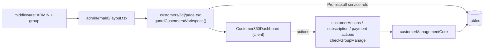

# Module: Admin Customer 360, Operations Board, Riders and Dashboard

## 1. What it does
The admin portal's daily workspace:
- **Customers / Customer 360**: list and search customers; one page per customer with MEAL/KIT/ACCOMMODATION sections, payments and partial payments, coupons, medical documents, PIN reset, dietitian and clinic assignment, shop orders, history.
- **Operations board**: today/tomorrow deliveries, live routing board, failed-delivery approvals, clinic workload, fixed rider assignments, routing sandbox, automation logs and manual re-runs, fallback automations.
- **Riders**: rider list, service areas (pincodes), clinic links, live tracking, force off-duty.
- **Dashboard**: executive summary KPIs and pincode-conflict clinics.
Portal: **Admin** (reused by **Franchise** through shared components).

## 2. Entry points
| Route | Page file | Guard |
|---|---|---|
| `/customers` | `admin/(main)/customers/page.tsx` + `AdminCustomersWrapper.tsx` | `guardCustomersWorkspace()` (admits dietitians read-only) |
| `/customers/[id]` | `customers/[id]/page.tsx` → `Customer360Dashboard` | `guardCustomersWorkspace()` |
| `/operations` | `operations/page.tsx` → `AdminOperationsWrapper`, `OperationsClientTable` | `guardAdminGroup("operations")` |
| `/riders` | `riders/page.tsx` + `AdminRidersWrapper` | group `riders` (middleware + page) |
| `/dashboard` | `dashboard/page.tsx` → `ExecutiveDashboard`, `ConflictClinicList` | operations area |
| `/subscriptions`, `/subscriptions/[id]`, `/subscriptions/kits` | subscriptions pages | group `subscriptions` |

## 3. Files
| Path | Role |
|---|---|
| `src/shared/components/admin/customers/Customer360Dashboard.tsx` | Tabbed 360 view; calls admin customer actions (and is shared with franchise, which is why admin action gates must reject non-ADMIN roles) |
| `.../MealCustomerSection.tsx`, `KitCustomerSection.tsx`, `AccommodationCustomerSection.tsx`, `AccommodationTab.tsx` | Product-line sections |
| `.../PartialPaymentSection.tsx`, `RecordSubscriptionPaymentForm.tsx`, `RecordSubscriptionRefundForm.tsx`, `SubscriptionPaymentSummaryCard.tsx` | Billing |
| `.../AdminCouponsTab.tsx`, `AdminMedicalUploadModal.tsx`, `DietitianAssignmentSelector.tsx`, `ClinicAssignmentSelector.tsx`, `CustomerHistoryTab.tsx` | Other tabs |
| `src/shared/components/admin/operations/*` | `OperationsDashboard`, `LiveRoutingBoard`, `FailedDeliveryApprovals`, `ClinicWorkloadView`, `DailyMealRoster`, `PlannedDeliveries`, `TodaysDeliveries`, `FixedRiderAssignments`, `RoutingSandbox`, `AutomationLogs`, `FallbackAutomationsPanel`, `AdminLiveTracking(Map)` |
| `src/actions/admin-actions/customerActions.ts`, `adminSubscriptionActions.ts`, `adminLifecycleActions.ts`, `subscriptionPaymentActions.ts`, `partialPaymentActions.ts`, `adminCouponActions.ts`, `adminPinActions.ts`, `dietitianAssignmentActions.ts` | Customer writes |
| `operationsActions.ts`, `routingActions.ts`, `routingSandboxActions.ts`, `fixedAssignmentActions.ts`, `workloadActions.ts`, `systemActions.ts`, `fallbackAutomationActions.ts`, `adminDeliveryActions.ts` | Operations writes |
| `riderActions.ts`, `riderClinicActions.ts`, `serviceAreaActions.ts` (RPC `move_pincode_and_reassign`), `liveTrackingActions.ts`, `conflictActions.ts` | Riders |
| `src/services/dashboardMetrics.ts` | `getExecutiveSummary` |
| `src/services/customerManagementCore.ts`, `addonOrderCore.ts`, `customerCouponCore.ts` | Shared ungated cores |

## 4. Data flow (example: Customer 360 page load and an edit)
1. Middleware: ADMIN, path `/admin/customers/...` allowed for `customers` group or dietitian allow-list.
2. Layout re-checks; page calls `guardCustomersWorkspace()` → `{ config, isDietitian, clinicId }`.
3. Page uses `createAdminClient()` and `Promise.all` to load profile, subscriptions, payments, KIT data (`kitLifecycleRepository`), stay data, signed URLs for medical documents, clinic and dietitian rows; payment overview via `getSubscriptionPaymentOverview`.
4. Renders `Customer360Dashboard` with `isDietitian` → read-only UI for dietitians.
5. An edit calls e.g. `customerActions.ts` → `checkGroupManage("customers")` → `customerManagementCore` → tables → `revalidatePath`.

Operations re-run: Operations page → `triggerSystemAutomation("Routing & Batching" | "5:15 PM Order Gen" | "Product Linking", { targetDate })` → same functions as cron with `source = "manual"` (tracked separately in `automation_logs`).

## 5. Reads / writes
Almost every domain table. Storage: signed URLs for medical documents.

## 6. Source of truth
Groups/levels: `adminAccessCore.ts`. Order statuses: `src/lib/delivery/orderStatuses.ts`, `adminOrderStatusTransitions.ts`. Automation names: string literals in `triggerSystemAutomation`.

## 7. RBAC
Middleware path gate → layout → page guard → action `checkGroupManage(group)`; view-only users get "You have read-only access to this section." Dietitians: allow-list + `dietitian_can_read_customer`.

## 8. Diagram

## 9. Non-obvious techniques
- **Parallel server reads** with `Promise.all` in RSC to cut latency.
- **Read-only mode** derived on the server and passed as a prop.
- **Shared cores + per-portal gates** (see `08`).

## 10. Gotchas
- `Customer360Dashboard` imports admin actions; they become callable from the franchise bundle — the role check inside admin gates is the protection.
- `adminPinActions.resetCustomerPinAction` has no gate in its file (relies on page access only) ⚠.
- The Customer 360 page loads a lot of data in one request (performance audit notes in `DASHBOARD_PERFORMANCE_AUDIT.md`).

## 11. Interview questions
- *How do dietitians use the admin portal without seeing operations?* They are ADMIN with level `dietitian`; middleware allow-list + read-only 360 + DB-level dietitian read function.
- *How does an admin re-run a failed automation?* Operations page → `triggerSystemAutomation` → same engine code as cron, logged as manual.

## 12. Trace it yourself
`admin/(main)/customers/[id]/page.tsx` → `Customer360Dashboard.tsx` → `customerActions.ts` → `customerManagementCore.ts`; then `operations/page.tsx` → `AdminOperationsWrapper.tsx` → `systemActions.ts`.
