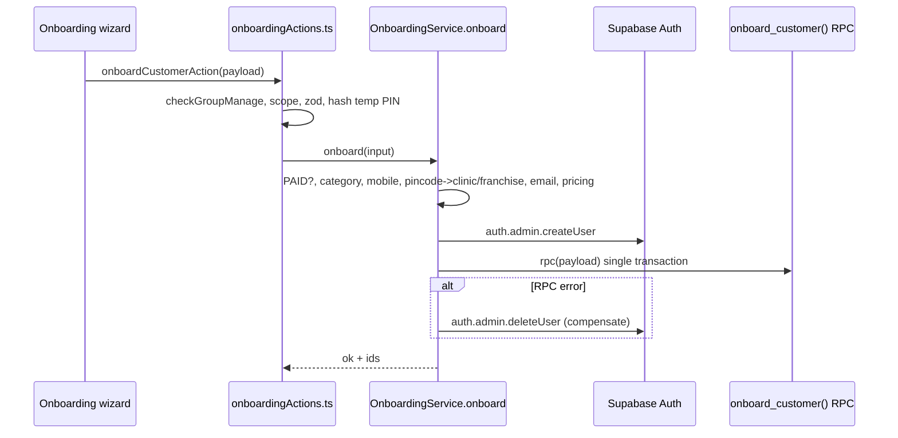

# Module: Admin / Franchise Customer Onboarding

## 1. What it does
Staff create a customer in one wizard: identity (name, mobile, optional email), primary address, product line (MEAL / KIT / ACCOMMODATION), plan, start date, discount and misc charges, payment (full or partial advance), optional dietitian and a temporary PIN. The result is a login-ready customer with an active subscription and invoice. Customers cannot self-register. Portals: **Admin** (`/customers/onboarding`, `/customers/quick-onboard`, `/customers/bulk-import`), **Franchise** (`/customers/quick-onboard`, create modal).

## 2. Entry points
- Pages: `src/app/admin/(main)/customers/onboarding/page.tsx`, `quick-onboard/page.tsx`, `bulk-import/page.tsx`; `src/app/franchise/(main)/customers/quick-onboard/page.tsx`, `FranchiseCreateCustomerModal.tsx`
- Actions: `onboardCustomerAction`, `activateAddOnCategoryAction`, `checkMobileUniqueAction`, `listOnboardedCustomersAction` (`src/actions/admin-actions/onboardingActions.ts`); `bulkImportActions.ts`, `kitBulkImportActions.ts`; `accommodationOnboardingActions.ts` (stays)
- After first login: `ProfileCompletionDialog` → `profileCompletionActions.ts` → `OnboardingService.completeProfile`

## 3. Files
| Path | Type | Role |
|---|---|---|
| `src/actions/admin-actions/onboardingActions.ts` | action | Gate, scope, zod, temp-PIN hash, call service |
| `src/validations/onboardingSchema.ts` | zod | `createQuickOnboardingSchema(serviceablePincodes, skipServiceability)` |
| `src/services/OnboardingService.ts` | service | `onboard`, `completeProfile`, `activateAddOnCategory` |
| `src/repositories/customerOnboardingRepository.ts` | repo | Lookups (`findCustomerByMobile`), writes |
| `src/lib/onboarding/*` | lib | `cutoff.ts` (start-date rule), `dailyPreferences.ts` (calendar rows), `discount.ts`, `miscCharge.ts`, `category.ts`, `sections.ts`, `testEmail.ts` (placeholder email), `routing.ts` |
| `src/lib/clinic/pincode-resolver.ts` | lib | `resolveClinicForPincode` |
| `src/services/PinService.ts` | service | `hashPin` |
| `src/services/DeliveryChargeService.ts` | service | delivery charge for the plan |
| `scripts/create-onboard-customer-rpc.sql` + `update-onboard-customer-with-daily-prefs.sql`, `-with-kit-support.sql`, `-with-partial-payment.sql`, `add-discount-to-onboard-rpc.sql`, `add-misc-charge-to-onboard-rpc.sql`, `add-dietitian-id-to-onboard-rpc.sql` | SQL | Successive versions of `onboard_customer(payload jsonb)` |
| `src/lib/bulk-migration/*`, `src/validations/kitBulkImportSchema.ts` | lib | Excel templates + row validation for bulk import |

## 4. Data flow
1. **Action** `onboardCustomerAction(payload)`:
   1. `checkGroupManage("customers")` (manage required).
   2. Admin id + franchise scope (`resolveScopedFranchiseId`).
   3. For non-KIT, load serviceable pincodes for the scope; build the zod schema with that list (the schema itself rejects non-serviceable pincodes).
   4. `safeParse`; field errors mapped back to the form.
   5. Validate and bcrypt-hash the temporary PIN.
   6. Call `OnboardingService.onboard`.
2. **Service** `onboard`:
   1. Payment must be PAID (or a valid partial advance).
   2. Exactly one primary category.
   3. Normalize mobile.
   4. Resolve `clinic_id` + `franchise_id` from the pincode; KIT may ship anywhere / use a chosen clinic.
   5. Dietitian must belong to the clinic (MEAL); KIT in a franchise auto-assigns the franchise dietitian.
   6. Email: real or `m<mobile>@placeholder.arogyadiet.internal` with `is_test_email`.
   7. Unique `customer_code`, plan pricing, discount/misc charge/delivery charge, partial payment split.
   8. Create the Supabase Auth user (email + `CUSTOMER_SERVER_PASSWORD` + phone, confirmed).
   9. `admin.rpc("onboard_customer", { payload })` — one transaction writing users, customer_profiles (`IN_PROGRESS`), subscriptions, payments, addresses, daily preferences, dietitian link, partial-payment rows (per the later script versions).
   10. On RPC failure → `auth.admin.deleteUser(authUserId)` (compensation).
3. Customer logs in with mobile + temp PIN → sets a permanent PIN (see `05`) → completes profile → status `COMPLETED`.

## 5. Reads / writes
Reads `rider_service_areas`/clinics (pincode), `subscription_plans`, `users` (uniqueness), dietitian tables. Writes: Supabase Auth, `users`, `customer_profiles`, `subscriptions`, `payments`, `addresses`, `subscription_daily_preferences`, payment ledger tables.

## 6. Source of truth
Schema: `src/validations/onboardingSchema.ts`; categories `src/lib/onboarding/category.ts`; cutoff rules `src/lib/onboarding/cutoff.ts` (past-date flexibility specs: `.kiro/specs/onboarding-past-date-flexibility`, `new-plan-past-date-start`); types `src/types/onboarding.ts`.

## 7. RBAC / scoping
`checkGroupManage("customers")`; franchise portal resolves its franchise from the session; pincode resolution stamps `franchise_id`/`clinic_id` so the customer lands in the right tenant automatically.

## 8. Diagram

## 9. Non-obvious techniques
- **Schema built per request** from the scope's serviceable pincodes (`createQuickOnboardingSchema`).
- **Compensating transaction** across Supabase Auth and Postgres.
- **Thin transactional writer**: all decisions in TypeScript, all writes in one SQL function.

## 10. Gotchas
- Several SQL versions of the RPC exist; which one is deployed is UNVERIFIED (the latest by name: partial payment / dietitian).
- A fix-up route (`/api/migrate/fix-stuck-accommodation-user`) exists because the accommodation onboarding once created users without auth identities.

## 11. Interview questions
- *Why can't customers sign up?* Clinic-led business; every customer is paid and assigned to a clinic/dietitian by staff first.
- *How do you keep onboarding atomic when it touches Auth and DB?* Auth first, one RPC for all rows, delete the auth user if the RPC fails.

## 12. Trace it yourself
`quick-onboard/page.tsx` → `onboardingActions.ts onboardCustomerAction` → `onboardingSchema.ts` → `OnboardingService.ts onboard` (steps 1–8) → `scripts/create-onboard-customer-rpc.sql`.
