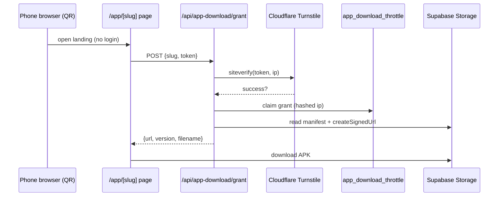

# Module: App (APK) Distribution via QR Landing Page

## 1. What it does
A public landing page (`customer.*/app/customer` or `/app/rider`) explains the Android app and offers a download. To stop bots and hot-linking, the download link is a short-lived **signed Storage URL** issued only after a Cloudflare **Turnstile** check and a per-IP rate limit. Rider and admin login pages show a QR code to this page. Portals: **Customer** (public route group), **Rider** (QR on login).

## 2. Entry points
- Page: `src/app/customer/(public)/app/[slug]/page.tsx` + `DownloadControl.tsx` + `_components/*` (layout `customer/(public)/layout.tsx`)
- API: `POST /api/app-download/grant` (`src/app/api/app-download/grant/route.ts`)
- Middleware: `isPublicAppPath()` — `/app` and `/app/*` skip login and role checks on the customer subdomain (so a signed-in admin scanning the QR is not bounced).

## 3. Files
| Path | Role |
|---|---|
| `src/lib/appDistribution/config.ts`, `content.ts`, `slug.ts` | Allowed slugs (`customer`, `rider`), copy |
| `src/lib/appDistribution/turnstile.ts` | `verifyTurnstileToken(token, ip)` → VALID / REJECTED / MISCONFIGURED / UNAVAILABLE |
| `src/lib/appDistribution/rateLimit.ts` | `resolveClientIp`, `hashClientIp` (IP stored hashed) |
| `src/repositories/appDownloadThrottleRepository.ts` | `claimDownloadGrant` against `app_download_throttle` (`scripts/create-app-download-throttle.sql`, SECURITY DEFINER function) |
| `src/lib/appDistribution/storage.ts`, `manifest.ts` | `readReleaseManifest`, `createSignedDownloadUrl` from Supabase Storage |
| `src/lib/appDistribution/qr.ts` | QR generation (`qrcode`) |
| `src/validations/appDistribution.ts` | `grantRequestSchema` |
| Docs | `docs/app-distribution-*.md`, `docs/capacitor-build-security-audit.md`, `scripts/verify-apk-secrets.*` |

## 4. Data flow
1. Page renders with the Turnstile widget (`NEXT_PUBLIC_TURNSTILE_SITE_KEY`).
2. User passes the challenge → `DownloadControl` POSTs `{ slug, token }`.
3. Route: zod → slug allow-list → IP → Turnstile verify (fails short-circuit, no URL) → claim rate-limit grant (after verification so bots cannot burn quota) → manifest (version, filename) → signed URL → `{ url, version, filename }` (429 with `Retry-After` on limit).

## 5. Reads / writes
`app_download_throttle`, Storage bucket with APKs + manifest. External: Cloudflare Turnstile siteverify.

## 6. Source of truth
Release manifest in Storage; slug list in `slug.ts`. Env: `NEXT_PUBLIC_TURNSTILE_SITE_KEY`, Turnstile secret (server env), `NEXT_PUBLIC_APP_DOWNLOAD_BASE_URL`.

## 7. RBAC
Public by design; protection = Turnstile + rate limit + expiring URL.

## 8. Diagram

## 9. Techniques
Ordering as a security property ("no unverified byte"); hashed IPs; method-restricted route (only POST exported → 405 otherwise).

## 10. Gotchas
`.kiro/specs/app-apk-distribution/tasks.md` has unchecked operator/E2E items; a built APK is also committed to the repo root (`Arogya-rider.apk`).

## 11. Interview question
*Why not just link the APK file?* Public links get scraped and abused; signed URLs expire and every download passes a human check.

## 12. Trace it yourself
`customer/(public)/app/[slug]/DownloadControl.tsx` → `api/app-download/grant/route.ts` → `lib/appDistribution/turnstile.ts` → `appDownloadThrottleRepository.ts` → `lib/appDistribution/storage.ts`.
