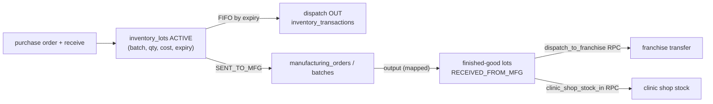

# Module: Central Warehouse Inventory and Manufacturing

## 1. What it does
The central kitchen/warehouse keeps a master product catalog (raw materials and finished goods), receives stock in **lots** (batch, quantity, cost, expiry, purchase-order file), dispatches stock out FIFO, sends raw materials to manufacturing, records finished outputs (1:1, 1:many, many:1 via batches), and keeps an audit ledger. Portals: **Admin** inventory-level users (`admin.*/inventory/**`), **Master** (`master.*/inventory/warehouse/**`; product create/edit/delete is master-only).

## 2. Entry points
- Admin: `src/app/admin/inventory/{page,ledger,manufacturing,mappings,shop-products}/page.tsx` (layout `admin/inventory/layout.tsx`)
- Master: `src/app/master/(main)/inventory/warehouse/**`, `InventoryIntelligenceShell.tsx`
- Actions: `src/actions/inventory-actions/index.ts` (add/edit/delete product, categories, receive, dispatch, bulk in/out, manufacturing dispatch/output/revert, mappings, multi-material batches); `admin-actions/inventoryActions.ts`
- Export: `GET /api/admin/inventory/purchase-orders/export` (xlsx); cron `cleanup-old-po`

## 3. Files
| Path | Type | Role |
|---|---|---|
| `src/services/inventoryEngine.ts` (65 KB) | service | All warehouse logic (see function list below) |
| `src/actions/inventory-actions/index.ts` | actions | zod-validated wrappers, `checkWarehouseAccess`, revalidation per portal |
| `src/lib/inventory/warehouse-access.ts` | pure lib | `resolveWarehouseAuthorization(role, level, capability)`, `resolvePortalFromHost`, `resolveRevalidationTargets` |
| `src/lib/inventory/product-schema.ts` | lib | Catalog shapes/validation |
| `src/lib/auth/adminAccess.ts` | guards | `assertWarehouseAccess`, `checkWarehouseAccess` |
| `src/shared/components/admin/inventory/**`, `product-inventory/**` | UI | Dashboard, product cards, modals, ledger, `OperationsCart` |
| `src/shared/stores/useInventoryStore.ts` | zustand | Staging cart for bulk receive/dispatch |
| `scripts/create-manufacturing-*.sql`, `add-inventory-*.sql`, `create-inventory-product-categories.sql`, `create-transfer-stock-rpc.sql`, `create-stock-transfers-table.sql` | SQL | Tables and `transfer_stock` RPC |

Engine functions: `createInventoryProduct`, `updateInventoryProduct`, `deleteInventoryProduct` (soft delete), image/PO upload to Storage, `getInventoryMasterCatalog`, `getInventoryMetrics`, `getTransactionLedger`, `receiveInventoryStock`, `dispatchInventoryStock`, `processBulkInbound/Outbound`, `sendToManufacturing`, `processManufacturingOutput`, `revertPendingManufacturing`, mapping CRUD, `getFinishedGoodsForRawProduct`, `sendMultiToManufacturing`, `processBatchOutput`, `revertPendingBatch`.

## 4. Data flow (dispatch out)
1. Client cart (`useInventoryStore`) → `dispatchStockAction` / `bulkDispatchAction`.
2. Action: `checkWarehouseAccess("inventory_operations")` (MASTER_ADMIN, or ADMIN with inventory level) + zod.
3. `inventoryEngine.dispatchInventoryStock(productId, qty, reason)`:
   - read ACTIVE lots ordered by expiry;
   - check total available;
   - loop lots: update `quantity_remaining`/`status`, insert `inventory_transactions` OUT;
   - on any error, `rollbackDispatch()` deletes the inserted transactions and restores lot quantities (manual compensation).
4. Revalidate `/admin/inventory` or `/inventory/warehouse` depending on the Host header.

Manufacturing: raw lot → `manufacturing_orders` (SENT_TO_MFG) → output creates finished lots (RECEIVED_FROM_MFG) with cost distributed by weight; mappings restrict which finished products a raw material may produce (fallback: all finished goods, per `AI_CONTEXT/BUSINESS_RULES.md` §6).

## 5. Reads / writes
`inventory_products`, `inventory_product_categories`, `inventory_lots`, `inventory_transactions`, `manufacturing_orders`, `manufacturing_outputs`, `manufacturing_batches`, `manufacturing_product_mappings`, Storage buckets for product images and purchase orders.

## 6. Source of truth
Business rules: `AI_CONTEXT/DATABASE_RULES.md` (inventory section) and `BUSINESS_RULES.md` §6. Types: `src/lib/inventory/product-schema.ts`. Lot status enum `inventory_lot_status`.

## 7. RBAC
Middleware: `/admin/inventory` is the inventory area (levels `inventory`, `inventory_operations`). Layout `admin/inventory/layout.tsx`. Action: `resolveWarehouseAuthorization` — product management is **master only**; operations for master or inventory admins.

## 8. Diagram

## 9. Non-obvious techniques
- **Compensating rollback in application code** (`rollbackDispatch`) — compare with `dispatch_to_franchise`, which does the same FIFO inside one SQL transaction with `FOR UPDATE` row locks. Interview point: the RPC version is safe under concurrency and crashes; the TS version is not.
- **Host-aware revalidation**: the same action serves admin and master, so it revalidates the initiating portal's paths.

## 10. Gotchas
- Two concurrent dispatches can both read the same lot quantities (no lock) and over-deplete.
- A server crash mid-loop leaves partial updates (rollback never runs).
- `src/lib/inventory/schema.ts.bak` is a stale backup file.

## 11. Interview questions
- *How does FIFO work here?* Lots ordered by `expiry_date`; deduct `min(lot remaining, still needed)` per lot until done.
- *Why does franchise dispatch use an RPC but central dispatch doesn't?* Franchise was built later with atomicity as a requirement; central dispatch predates it. Moving it to an RPC is a listed improvement.

## 12. Trace it yourself
`admin/inventory/layout.tsx` → `inventory-actions/index.ts dispatchStockAction` → `inventoryEngine.ts dispatchInventoryStock` → compare with `scripts/create-dispatch-to-franchise-rpc.sql`.
