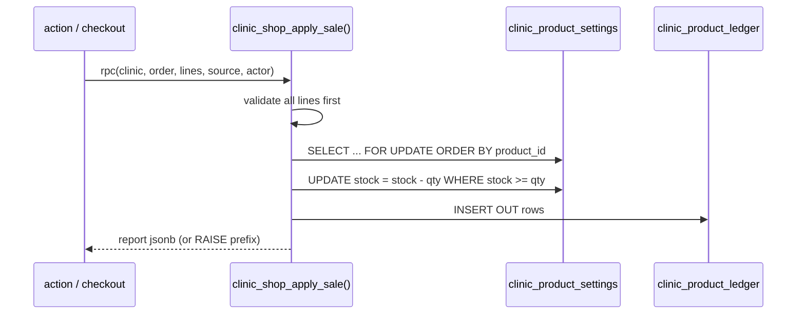

# Module: Clinic Shop Inventory (core clinics)

## 1. What it does
Each core clinic holds its own stock of shop products. Stock comes in from the warehouse ("stock in"), goes out through three selling channels (customer app purchase, assisted order, walk-in sale), and every movement is written to an append-only ledger. Admins can hide/show a product per clinic. Clinic-scoped admins see only their clinic. Portals: **Admin** (`/kitchen-shop/inventory`, `/inventory/shop-products`), **Master** (shop products views), indirectly **Customer** (stock checks at checkout).

## 2. Entry points
- `src/app/admin/(main)/kitchen-shop/inventory/page.tsx` (group `shop_products`)
- `src/app/admin/inventory/shop-products/page.tsx`, `src/app/master/(main)/inventory/warehouse/shop-products/page.tsx`, `master/(main)/inventory/ShopProductsView.tsx`
- Actions: `src/actions/admin-actions/clinicShopInventoryActions.ts`
- RPCs: `clinic_shop_stock_in`, `clinic_shop_apply_sale`, `set_clinic_product_visibility`, `verify_clinic_stock_ledger_parity`

## 3. Files
| Path | Type | Role |
|---|---|---|
| `src/actions/admin-actions/clinicShopInventoryActions.ts` | actions | `checkWarehouseAccess`, `checkClinicScope`, zod (`src/validations/clinicShopInventory.ts`) |
| `src/lib/shop/clinicStock.ts` | lib | Effective stock overlay (`resolveEffectiveOverlay`), sale submission evaluation mirroring the SQL rules |
| `src/shared/utils/clinicStockErrors.ts` | util | Maps `CLINIC_STOCK_*` error prefixes to user messages |
| `src/repositories/clinic/clinicProductRepository.ts`, `clinicProductLedgerRepository.ts` | repos | Reads |
| `scripts/create-clinic-product-settings-table.sql` | SQL | Overlay table + `trg_cps_increase_guard` (stock may only increase inside the stock-in RPC, via a transaction-local flag) |
| `scripts/create-clinic-product-ledger-table.sql` | SQL | Ledger + trigger blocking UPDATE/DELETE + REVOKE for anon/authenticated |
| `scripts/create-clinic-shop-stock-in-rpc.sql`, `create-clinic-shop-apply-sale-rpc.sql`, `create-verify-clinic-stock-ledger-parity-rpc.sql`, `migrate-shared-shop-stock-to-clinics.sql` | SQL | RPCs + migration from shared stock |
| `src/test/shop/*` (31 files incl. `clinicStockModel.ts`) | tests | Reference model + property tests |

## 4. Data flow (sale)
1. Customer checkout pre-checks `clinic_product_settings` (visibility + stock).
2. After payment `verifyAddonPayment` calls `clinic_shop_apply_sale(clinic, order, lines, "CUSTOMER_APP_SALE", actor)`.
3. RPC validates source, clinic is core, actor/order/products exist, no duplicate lines, quantities 1..1,000,000, every line has enough stock — **before** any write; locks rows `FOR UPDATE ORDER BY product_id` (deadlock-free ordering); conditional `UPDATE ... WHERE stock_quantity >= qty`; inserts ledger rows; returns a jsonb report.
4. Errors carry stable prefixes (`CLINIC_STOCK_INSUFFICIENT_CLINIC:` etc.) that the app maps to messages.

## 5. Reads / writes
`clinic_product_settings`, `clinic_product_ledger`, `products`, `addon_orders`, `clinics`.

## 6. Source of truth
Movement sources enum `clinic_movement_source` (CUSTOMER_APP_SALE, ASSISTED_SALE, WALKIN_SALE, WAREHOUSE_STOCK_IN, MIGRATION). Spec: `.kiro/specs/clinic-scoped-shop-inventory/`.

## 7. RBAC
`shop_products` group; clinic-scoped admins confined via `resolveReadableClinicId` / `checkClinicScope`; `admin_clinic_id` must be a core clinic (DB trigger).

## 8. Diagram

## 9. Non-obvious techniques
Validate-everything-then-write; deterministic lock order to avoid deadlocks; guard trigger that only allows stock increases inside a sanctioned function (transaction-local flag); append-only ledger enforced by trigger, not just permissions; reference model in tests mirrors SQL behaviour.

## 10. Gotchas
Webhook-only shop payments do not call `clinic_shop_apply_sale` (see `shop-and-addons.md`).

## 11. Interview questions
- *How do you guarantee stock never goes negative?* Conditional update in SQL under a row lock, plus a pre-check that names every shortfall.
- *Why a ledger?* Auditability and a parity check; stock can be recomputed from history.

## 12. Trace it yourself
`clinicShopInventoryActions.ts` → `scripts/create-clinic-shop-stock-in-rpc.sql` → `create-clinic-shop-apply-sale-rpc.sql` → `create-clinic-product-ledger-table.sql`.
