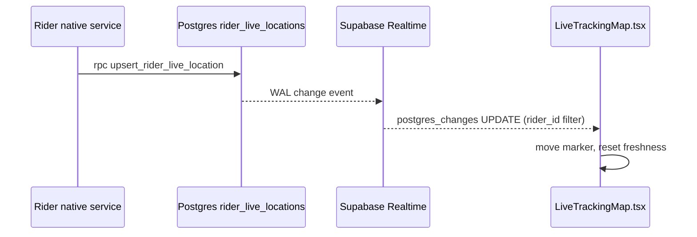

# Module: Live Tracking (Customer and Admin)

## 1. What it does
When an order is out for delivery, the customer opens a map showing the rider moving in near real time, ETA/distance, and the order contents. Admins see all online riders on a map with GPS freshness. Portals: **Customer** (`/tracking/[orderId]`), **Admin** (riders/operations live map), **Franchise** (shared components, own riders).

## 2. Entry points
- `customer.*/tracking/[orderId]` → `src/app/customer/(main)/tracking/[orderId]/page.tsx` + `tracking-client.tsx`
- `customer.*/tracking` → 1-line redirect page
- Admin: `src/actions/admin-actions/liveTrackingActions.ts` (`getRiderLiveLocation`, `getLiveTrackingRiders`, `getAdminLiveTrackingData`, `adminSetRiderOffDutyAction`)

## 3. Files
| Path | Type | Role |
|---|---|---|
| `tracking/[orderId]/page.tsx` | RSC | Loads order (session client), rider, address, meal, add-ons |
| `tracking/[orderId]/tracking-client.tsx` | client | Freshness clock (3 s tick, 45 s fresh window), status copy |
| `src/shared/components/customer/tracking/*` | client | Hero, map panel, rider card, journey progress, breakfast preview |
| `src/shared/components/customer/LiveTrackingMap.tsx` | client | Google map + **Supabase Realtime** subscription on `rider_live_locations` filtered by `rider_id` |
| `src/lib/routing/googleRoutes.ts` | lib | Route details/polyline helpers (`computeOptimizedRouteDetails`, `computeFixedOrderRoutePreview`) |
| `liveTrackingActions.ts` | actions | Admin map data, force off-duty |

## 4. Data flow
1. Page checks the order belongs to the session customer and loads display data.
2. `canTrack` only for `OUT_FOR_DELIVERY` or `REACHING_TO_LOCATION`.
3. `LiveTrackingMap` subscribes: `supabase.channel(...).on("postgres_changes", { table: "rider_live_locations", filter: "rider_id=eq.<id>" })`. Each native upsert produces an UPDATE event → marker moves → `onLocationUpdate` resets the freshness timer.
4. Admin map calls `getAdminLiveTrackingData()` (service role) and marks riders stale by `updated_at`.

## 5. Reads / writes
Reads `delivery_orders`, `addresses`, `rider_profiles/users`, `addon_orders`, `rider_live_locations`. Admin writes `rider_profiles.is_online` (force off-duty).

## 6. Source of truth
`rider_live_locations` (single row per rider). UI constant `FRESH_WINDOW_MS = 45_000` in `tracking-client.tsx`.

## 7. RBAC / scoping
Customer page via session client (RLS on `delivery_orders`). Realtime respects RLS on `rider_live_locations` for the browser client (policies UNVERIFIED; the steering doc says RLS was intentionally relaxed for this table). Admin actions: `checkGroupManage` in `liveTrackingActions.ts`.

## 8. Diagram

## 9. Non-obvious techniques
Supabase Realtime listens to Postgres changes (logical replication) and pushes them over a WebSocket, so the browser needs no polling.

## 10. Gotchas
Realtime must be enabled for the table in Supabase (publication) — not visible in repo scripts (UNVERIFIED). Anyone with the anon key could spoof a rider location (see `rider-duty-and-gps.md`).

## 11. Interview questions
- *Polling or push?* Push via Supabase Realtime for customers; server action reads for admin maps.
- *How do you show "GPS inactive"?* Compare `updated_at` with now; heartbeat every 30 s keeps it fresh when stationary.

## 12. Trace it yourself
`tracking/[orderId]/page.tsx` → `tracking-client.tsx` → `TrackingMapPanel` → `LiveTrackingMap.tsx` (search `postgres_changes`).
