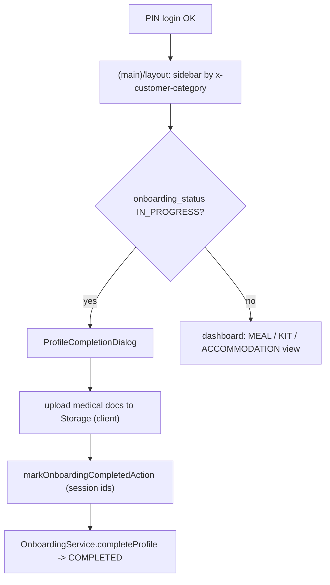

# Module: Customer Login, Profile Completion, Profile and Dashboard Shell

## 1. What it does
Covers the customer's account surface: mobile + PIN login (details in `05`), the first-login **mandatory profile completion popup** (personal details, real email replacing the placeholder, medical history confirmation or uploaded medical documents), profile edit and PIN change, and the dashboard shell that switches between the MEAL, KIT and ACCOMMODATION experiences. Portal: **Customer**.

## 2. Entry points
- `src/app/customer/(auth)/login/*`, `forgot-password`, `update-password`, `success`, `signup` (redirect)
- `src/app/customer/(main)/layout.tsx` (sidebar/header with `x-customer-category`), `template.tsx`, `dashboard/page.tsx` (37 KB: branches into `KitDashboard.tsx`, `AccommodationDashboard.tsx`, meal widgets)
- `src/app/customer/(main)/profile/page.tsx`
- Actions: `pinAuthActions.ts`, `pinManagementActions.ts` (`changePinAction`), `profileActions.ts` (`updateProfileAction`), `profileCompletionActions.ts` (`saveProfileCompletionAction`, `markOnboardingCompletedAction`, `submitRealEmailAction`), `addressActions.ts`

## 3. Files
| Path | Role |
|---|---|
| `src/shared/components/customer/MobilePinLoginForm.tsx`, `SetNewPinForm.tsx` | Login UI |
| `src/shared/components/customer/ProfileCompletionDialog.tsx` (via `DeferredClientProviders`) | Popup; uploads medical documents client-side to the `medical_records` bucket, sends only `{name,url,type}` refs |
| `src/services/OnboardingService.ts` `completeProfile`, `shouldShowProfileCompletionDialog` | Rules; IN_PROGRESS → COMPLETED |
| `src/validations/profileCompletionSchema.ts`, `realEmailSchema.ts`, `profileSchema.ts`, `addressSchema.ts`, `addressCaptureSchema.ts` | zod |
| `src/lib/onboarding/testEmail.ts` | `isDisplayableEmail`, placeholder domain |
| `src/lib/customer/get-session.ts` | Session with header trust |
| `src/shared/components/layout/customer-sidebar.tsx`, `customer-header.tsx` | Category-aware navigation |
| `src/shared/components/loader/GlobalLoader.tsx` | Branded first paint; `AppReadyBeacon` in template |
| `src/lib/kit/resolveCustomerCategory.ts` | Category resolution for dashboard |

## 4. Data flow (profile completion)
1. After login, the deferred providers check `shouldShowProfileCompletionDialog` (status IN_PROGRESS etc.).
2. Dialog uploads medical files to Storage (browser client), then calls `markOnboardingCompletedAction(input, medicalExtras)`.
3. Action authenticates from the session, resolves own `customer_profiles.id` and `users.id` (never from the client), calls `completeProfile`: validate fields, replace placeholder email (also updates Supabase Auth email — UNVERIFIED detail), persist, transition to COMPLETED, `revalidatePath("/dashboard")`.
4. Middleware already allows both IN_PROGRESS and COMPLETED customers in, so completion is not a login prerequisite.

## 5. Reads / writes
`users`, `customer_profiles` (`onboarding_status`, medical fields), `addresses`, Storage `medical_records`.

## 6. Source of truth
`onboarding_status` values (IN_PROGRESS, COMPLETED) in `scripts/add-onboarding-status-to-customer-profiles.sql`; spec `.kiro/specs/mandatory-profile-completion-popup/`, `customer-mobile-onboarding/`.

## 7. RBAC
Middleware customer gate (exactly one allowed record), category gate, session-derived ids in actions.

## 8. Diagram

## 9. Techniques
Synchronous outer layout paints a loader immediately while the inner layout awaits the session (streaming with `Suspense`); identity headers avoid duplicate auth calls.

## 10. Gotchas
Storage bucket access rules for `medical_records` are not in repo scripts (UNVERIFIED).

## 11. Interview question
*Why upload files from the browser instead of through the action?* Avoids sending large files through the Server Action body (limit raised to 25 MB only for product galleries) and lets Storage handle the upload directly.

## 12. Trace it yourself
`customer/(main)/layout.tsx` → `DeferredClientProviders` → `ProfileCompletionDialog` → `profileCompletionActions.ts` → `OnboardingService.completeProfile`.
