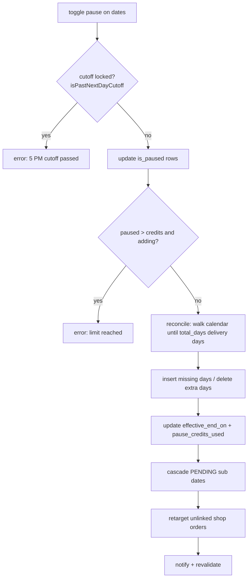

# Module: Meal Planner, Pause Credits and Per-Day Address

## 1. What it does
A MEAL customer edits future days of an active subscription: pause a day (uses a pause credit and extends the end date), change the meal type for a day, or change the delivery address for a day. Admins can do the same with an override (`admin-actions/adminMealActions.ts`). Portals: **Customer** (planner, address), **Admin/Franchise** (bulk override).

## 2. Entry points
- `customer.*/subscription/manage/planner` → `src/app/customer/(main)/subscription/manage/planner/page.tsx`
- `customer.*/subscription/manage/address` → `.../manage/address/page.tsx`
- Admin Customer 360 meal tabs → `src/actions/admin-actions/adminMealActions.ts`

## 3. Files
| Path | Type | Role |
|---|---|---|
| `planner/page.tsx` | RSC | Loads active sub, paused count (repairs over-limit), meal categories, calendar rows, holidays |
| `src/shared/components/customer/subscription/manage/meal-planner-client.tsx` | client | Calendar UI, calls pause + meal actions, `router.refresh()` |
| `src/shared/components/customer/subscription/manage/address-switcher-client.tsx` | client | Calls `bulkUpdateAddressPreferencesAction` |
| `src/actions/manageMealActions.ts` | actions | `bulkUpdatePausePreferencesAction`, `bulkUpdateMealPreferencesAction`, `bulkUpdateAddressPreferencesAction`, reconciliation engine, cascade helpers |
| `src/lib/dates/ist.ts` | lib | `isPastNextDayCutoff(now, date)` (5 PM IST rule) |
| `src/lib/shop/retargetUnlinkedAddonOrders.ts` | lib | Moves unlinked paid shop orders off a paused day |
| `src/actions/admin-actions/holidayActions.ts` | action | `fetchHolidaysInRange(start, end, franchiseId)` |
| `src/actions/admin-actions/adminMealActions.ts` | action | Admin override path (`checkGroupManage`) |

## 4. Data flow (pause)
1. Page reads with the **session client** (RLS): subscription, `count` of paused rows, daily rows from `starts_on` to `effective_end_on`.
2. If paused count > `pause_credits_total`, the page calls `repairOverLimitPauseCredits` (self-healing for legacy data).
3. Client toggles days and calls `bulkUpdatePausePreferencesAction(subscriptionId, [{date, isPaused}])`.
4. Action: `assertOwnsSubscription` (session user → users → customer_profiles → subscription belongs to profile), `assertMealSubscription` (category MEAL), `findCutoffLockedDate` (reject if any date is locked).
5. `processPausePreferenceUpdates`: update each row's `is_paused`/`pause_credit_used`; recount; if over the limit and net new pauses > 0 → error "Pause credit limit reached".
6. `executePauseReconciliationEngine`:
   - `trimExcessPauseCredits` unpauses the oldest extra paused days if over the limit;
   - walks the calendar from `starts_on` counting non-paused days until `total_days` is reached → the new `effective_end_on`;
   - inserts missing rows (default address = primary), deletes rows beyond the new end;
   - updates `subscriptions.pause_credits_used` (capped) and `effective_end_on`.
7. `cascadePendingSubscriptionDates(customerProfileId, newEnd)` shifts any queued PENDING subscription.
8. `retargetUnlinkedAddonOrdersForPausedDates`: unlinked PAID shop orders targeting a paused day move to the next active day (best effort).
9. Notify customer + admins (2-second in-memory dedupe), `revalidatePath` for dashboard/subscription/planner and the root layout.

## 5. Reads / writes
`subscriptions`, `subscription_daily_preferences`, `customer_profiles.addresses`, `addon_orders`, `holidays`, `notifications`.

## 6. Source of truth
- Business rules: `AI_CONTEXT/BUSINESS_RULES.md` §2 and `docs/system-rules.md` §7 ("Pause Reconciliation Engine", "5 PM cutoff").
- Cutoff code: `RIDER_DAY_ROLLOVER_HOUR_IST = 17` and `isPastNextDayCutoff` in `src/lib/dates/ist.ts` — before 17:00 IST the earliest editable date is tomorrow, after 17:00 it is the day after tomorrow.
- Invariant: `subscriptions.pause_credits_used` = count of `is_paused = true` rows.

## 7. RBAC / scoping
Customer: middleware category gate + `assertOwnsSubscription` + `assertMealSubscription`. Writes use a module-level service-role client after the ownership check. Admin path: `checkGroupManage("customers"/"subscriptions")` in `adminMealActions.ts`.

## 8. Diagram

## 9. Non-obvious techniques
- The calendar is **materialised**: one row per day. This makes per-day address/meal changes and order generation trivial (`WHERE preference_date = X`), at the cost of keeping rows in sync when pauses move the end date.
- Self-healing reads: the page repairs over-limit data before showing it.

## 10. Gotchas
- The engine is many separate queries, not a transaction; concurrent edits (two tabs) can race.
- `cascadePendingSubscriptionDates` and `repairOverLimitPauseCredits` are exported from a `"use server"` file without their own ownership check.
- The 5 PM rule is enforced in actions, not in the DB; generated orders at 17:15 IST read the calendar, so an edit at 17:14 for tomorrow is accepted and included, while 17:00–17:15 edits are rejected.
- Holidays are shown in the planner; whether order generation skips holidays is not in `generateDailyOrders` (it only reads preferences) — holiday handling is via preferences, UNVERIFIED how they are marked.

## 11. Interview questions
- *Why not just store pause dates as an array on the subscription?* Order generation, per-day address, and per-day meal type all need a row per day; the calendar table is the single source of what happens each day.
- *How do you keep pause credits consistent?* Recount from rows after every change and write the count, never increment.
- *What is the cutoff and where is it enforced?* 17:00 IST; pure predicate in `ist.ts`, called by every customer edit action before writing.

## 12. Trace it yourself
1. `planner/page.tsx`
2. `meal-planner-client.tsx` (search `bulkUpdatePausePreferencesAction`)
3. `manageMealActions.ts`: `bulkUpdatePausePreferencesAction` → `processPausePreferenceUpdates` → `executePauseReconciliationEngine`
4. `src/lib/dates/ist.ts` `isPastNextDayCutoff`
