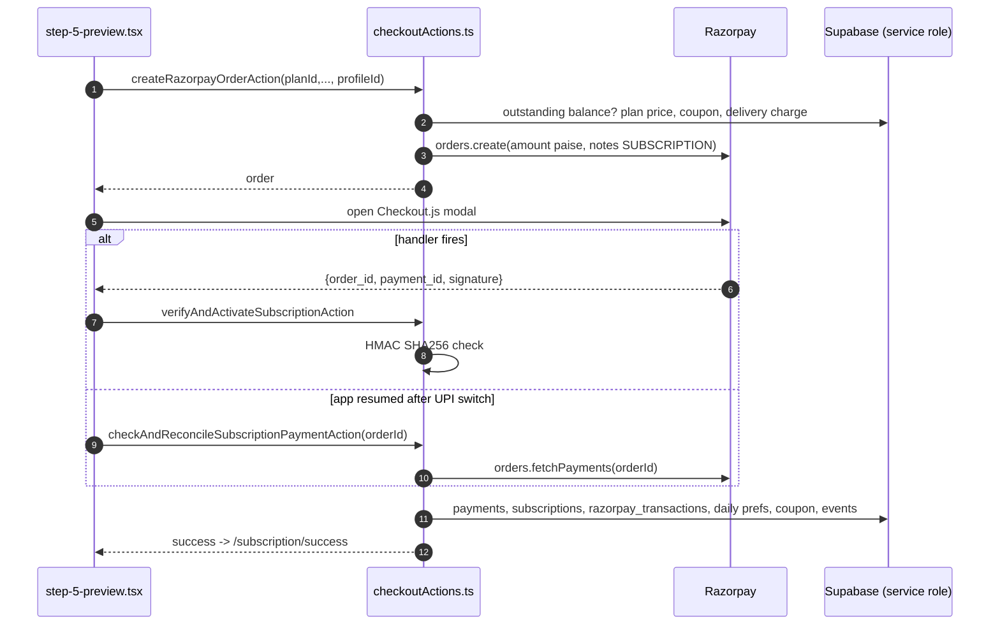

# Module: Customer Subscription Checkout (MEAL)

## 1. What it does
A logged-in customer picks a meal plan, start date, pause days and per-day meal overrides, pays with Razorpay, and gets an ACTIVE (or PENDING, if one is already running) subscription with a full day-by-day calendar. Portal: **Customer**. Admin/franchise create subscriptions through onboarding instead (see `admin-onboarding.md`).

## 2. Entry points
- Page: `customer.*/subscription/checkout` → `src/app/customer/(main)/subscription/checkout/page.tsx`
- Success page: `src/app/customer/(main)/subscription/success/page.tsx`
- Cron that later flips PENDING → ACTIVE: `/api/cron/activate-subscriptions` (14:00 IST) → `runSubscriptionActivation` in `src/services/FallbackAutomationService.ts`
- No webhook for this flow (the Razorpay webhook ignores `checkout_type !== "ADDON"`).

## 3. Files
| Path | Type | Role |
|---|---|---|
| `src/app/customer/(main)/subscription/checkout/page.tsx` | RSC page | Session, outstanding-balance gate (`getOutstandingBalanceForCustomer`), holidays, renders wizard |
| `src/shared/components/customer/subscription/checkout/checkout-wizard.tsx.tsx` | client | Multi-step state (note the double `.tsx.tsx` filename) |
| `step-1-plan.tsx` … `step-4-customization.tsx` | client | Plan, delivery date/address, pauses, meal overrides |
| `step-5-preview.tsx` | client | Price summary, coupon, delivery charge, loads Checkout.js, handler + reconciliation |
| `src/actions/checkoutActions.ts` | actions | `validateCouponAction`, `previewDeliveryChargeAction`, `createRazorpayOrderAction`, `verifyAndActivateSubscriptionAction`, `checkAndReconcileSubscriptionPaymentAction`, private `activateSubscription` |
| `src/services/DeliveryChargeService.ts` | service | `computeForCustomer` (clinic-resolved delivery charge) |
| `src/lib/delivery/deliveryCharge.ts` | lib | `calculateTotalPayable` |
| `src/lib/coupons/resolveSubscriptionCoupon.ts` | lib | coupon resolution + `applyCouponToBasePrice` |
| `src/services/SubscriptionPaymentService.ts` | service | outstanding balance gate |
| `src/actions/manageMealActions.ts` | action/helper | `cascadePendingSubscriptionDates` (queue PENDING after ACTIVE) |
| `src/lib/notifications.ts` | lib | customer + admin notifications |

## 4. Step-by-step data flow
1. **Page load**: `getCustomerSession()` → if the customer has an outstanding balance, redirect away (UI courtesy).
2. **Steps 1–4** keep everything in client state (plan id, `startDate`, `foodType`, `pausedDates[]`, `mealOverrides{date: code}`, `addressId`).
3. **Preview**: `previewDeliveryChargeAction(customerProfileId, planId)` and optional `validateCouponAction(code, customerProfileId, planId)`.
4. **Pay click** (`step-5-preview.tsx`): load `https://checkout.razorpay.com/v1/checkout.js`, then `createRazorpayOrderAction(planId, duration, coupon, customerProfileId)`:
   - authoritative **outstanding-balance gate** (before any money moves);
   - price from `subscription_plans` (never from the client);
   - coupon applied server-side, GST recomputed with the plan's own rate (`tax_amount / base_price`, default 5%);
   - delivery charge via `computeForCustomer`; failure refuses the order;
   - `razorpay.orders.create({ amount in paise, notes: { checkout_type: "SUBSCRIPTION" } })`.
5. Client stores `pendingPaymentRef = { razorpayOrderId, checkoutData, couponCode }` and opens the Razorpay modal.
6. **Path A — normal**: Checkout.js `handler(response)` → `verifyAndActivateSubscriptionAction(response, checkoutData, coupon)` → HMAC check `sha256(order_id|payment_id, RAZORPAY_KEY_SECRET)` → `activateSubscription`.
7. **Path B — Android UPI app-switch**: on Capacitor `appStateChange` (app resumes), `checkAndReconcileSubscriptionPaymentAction(orderId, checkoutData, coupon)`:
   - if a `razorpay_transactions` row for that order exists → `alreadyProcessed`;
   - else `razorpay.orders.fetchPayments(orderId)` server-to-server; if `captured`/`authorized` → `activateSubscription` with marker signature `"server-verified-via-razorpay-api"`.
8. **`activateSubscription`** (all with service-role client, sequential, not one transaction):
   1. recompute delivery charge; reject if client value differs;
   2. recompute coupon + GST → `exactAmountPaid`;
   3. insert `payments` (status `SUCCESS`, invoice breakdown, `invoice_type: SUBSCRIPTION`);
   4. dates: `ends_on = start + duration - 1`, `effective_end_on = start + duration + pauses - 1`;
   5. status ACTIVE, or PENDING if the customer already has an ACTIVE subscription; insert `subscriptions` with code `SUB-xxxxxx`;
   6. if PENDING, `cascadePendingSubscriptionDates` moves it to start after the latest active end; pause/meal dates are shifted by the same offset;
   7. link payment → subscription; insert `razorpay_transactions`;
   8. build and insert one `subscription_daily_preferences` row per day (`duration + pauses`) with meal category id, address, pause flags;
   9. increment coupon `times_used`; insert `subscription_events` ACTIVATED;
   10. notify customer (push + email) and admins (shared email).
9. Client → `router.push("/subscription/success")`.
10. Next 14:00 IST cron activates PENDING subs that start tomorrow and expires ended ones.

## 5. Reads / writes
- Reads: `subscription_plans`, `coupons`, `customer_profiles`, `addresses`/clinic for delivery charge, `meal_categories`, `subscriptions` (active), `razorpay_transactions` (reconcile).
- Writes: `payments`, `subscriptions`, `razorpay_transactions`, `subscription_daily_preferences`, `coupons.times_used`, `subscription_events`, `notifications`.
- External: Razorpay Orders API (create, fetchPayments), OneSignal, Resend.

## 6. Source of truth
- Prices: `subscription_plans.base_price`, `tax_amount`, `duration_days`, `pause_credits`.
- Meal type mapping: inline `mealTypeMap` in `activateSubscription` (`Veg→VEG`, `Non-Veg→CHICKEN`, `Egg→EGG`, `Mixed→MIXED`) against `meal_categories.code`.
- Outstanding message: `OUTSTANDING_BALANCE_CUSTOMER_MESSAGE` in `src/types/subscriptionPayment.ts`.
- Delivery charge rules: `RateConfigService` + `src/lib/delivery/deliveryCharge.ts`.

## 7. RBAC / tenant scoping
- Page: middleware customer gate (role CUSTOMER, one onboarding record) + layout session.
- Actions: **no session check** in `createRazorpayOrderAction`/`activateSubscription`; `customerProfileId` comes from the client. Payment proof (HMAC or Razorpay API) is required to activate, so free subscriptions are not possible, but the subscription could be attached to another profile id.
- Franchise stamp: the insert does not set `franchise_id` on the subscription (UNVERIFIED whether a DB default/trigger fills it). Orders inherit `subscriptions.franchise_id`, so a franchise customer buying online may produce core-stamped orders — verify.

## 8. Diagram

## 9. Non-obvious techniques
- **Server-side price authority**: client totals are display-only; the server recalculates on order creation and again on activation.
- **HMAC signature verification**: Razorpay signs `order_id|payment_id` with your secret; recomputing it proves the payment response was not forged.
- **Server-to-server reconciliation**: instead of trusting the client after an app-switch, ask Razorpay's API.
- **Queueing a second plan**: PENDING + `cascadePendingSubscriptionDates` keeps back-to-back plans contiguous.

## 10. Gotchas / known issues
- Not atomic: a crash after `payments` insert leaves a SUCCESS payment with no subscription. Fix: move steps into one RPC.
- Idempotency only on the reconcile path. If `handler` and resume both fire, path A does not check for an existing transaction → possible duplicate subscription (the second `razorpay_transactions` insert may or may not fail depending on a UNIQUE constraint — UNVERIFIED).
- `pendingPaymentRef` is in memory. If Android kills the WebView, the order id is lost and nothing reconciles. The webhook does not cover subscriptions (documented in `src/app/api/webhooks/razorpay/route.ts`).
- Prefill uses dummy name/email/phone in Razorpay options.
- Payment status `SUCCESS` here vs `PAID` elsewhere.

## 11. Interview questions
- *How do you prevent price tampering?* Server reads plan price, applies coupon and delivery charge itself, and rejects mismatched client delivery charge.
- *What happens if the user's phone switches to GPay and the app is killed?* Resume handler reconciles with Razorpay API if the page survives; otherwise it is a known gap — the fix is persisting checkout data at order creation and letting the webhook activate.
- *Why PENDING status?* A customer can prepay the next plan while one is running; the 2 PM cron activates it.

## 12. Trace it yourself
1. `src/app/customer/(main)/subscription/checkout/page.tsx`
2. `src/shared/components/customer/subscription/checkout/step-5-preview.tsx` (search `createRazorpayOrderAction`, `appStateChange`)
3. `src/actions/checkoutActions.ts` (`createRazorpayOrderAction` → `activateSubscription`)
4. `src/actions/manageMealActions.ts` `cascadePendingSubscriptionDates`
5. `src/app/api/cron/activate-subscriptions/route.ts` → `src/services/FallbackAutomationService.ts` `runSubscriptionActivation`
