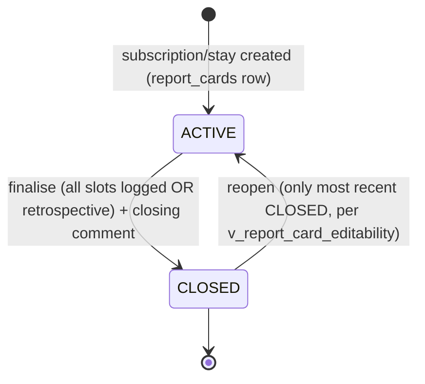

# Module: Dietitian Workspace, Health Logs, Cadence and Report Cards

## 1. What it does
Dietitians follow assigned customers. They write daily **health logs** (weight, parameters, custom parameters, notes) per log slot; customers on KIT/stays also self-log. Each MEAL/KIT subscription and each stay gets a **report card** that the dietitian finalises (ACTIVE → CLOSED) with a closing comment, can reopen (only the most recent closed one), and export as PDF. A **cadence** engine shows who is due/overdue for a log across admin, franchise and master. Portals: **Admin** (dietitian-level admins: `/customers`, `/log-customer`, report card page), **Franchise** (`/dietitian-activity`, `/log-customer`), **Master** (dietitian activity, report card view), **Customer** (health report for stays; KIT tracker self-logs).

## 2. Entry points
- Admin: `src/app/admin/(main)/log-customer/page.tsx`, `log-customer/[id]/page.tsx`, `customers/[id]/report-card/page.tsx`
- Franchise: `src/app/franchise/(main)/dietitian-activity/page.tsx`, `[customerId]/report-card/page.tsx`, `log-customer/*`, `customers/[id]/report-card/page.tsx`
- Master: `src/app/master/(main)/dietitian-activity/[customerId]/report-card/page.tsx`, `dashboard/DietitianActivitySection.tsx`
- Actions: `dietitian-actions/healthLogActions.ts` (`submitHealthLog`, `getHealthLogTimeline`, `getSelfLogForDate`, `getDietitianLogForDate`), `dietitianCustomerActions.ts` (`listDietitianCustomers`, `getDietitianCustomerDetail`, `getCustomParameterSuggestions`), `reportCardActions.ts` (`getReportCard`, `exportReportCardPdf`), `reportCardLifecycleActions.ts` (`getReportCardHistoryAction`, `getReportCardDetailAction`, `finaliseReportAction`, `reopenReportAction`, `getPeriodReportAction`, `exportPeriodReportPdfAction`); franchise/master `*DietitianActivityActions.ts`; assignment actions.

## 3. Files
| Path | Role |
|---|---|
| `src/services/HealthLogService.ts`, `DietitianLogWorkspaceService.ts` | Log write rules (one dietitian log per customer per day, edit windows, write lock) |
| `src/services/ReportCardService.ts`, `DietitianReportService.ts`, `DietitianReportTemplate.tsx` | Report card lifecycle + PDF via `@react-pdf/renderer` |
| `src/services/CadenceService.ts` + `repositories/dietitian/cadenceRepository.ts` | Due/overdue computation shared by 3 portals |
| `src/services/AssignmentService.ts`, `DietitianAccountService.ts` | Assign dietitian ↔ customer, dietitian accounts |
| `src/repositories/dietitian/*` | health logs, report cards, audit, assignments |
| `src/lib/dietitian/*` | `scope.ts` (`dietitianCanRead`), `franchiseCustomerScope.ts` (fail-closed), `cadence.ts`, `fieldSets.ts`, `customParameters.ts`, `logSlots.ts`, `logDates.ts`, `kitSelfLog.ts`, `reportCardLifecycle.ts` (`isRetrospectiveReport`), `messages.ts` |
| `src/validations/healthLogSchema.ts`, `dietitianSchema.ts` | zod |
| `src/shared/components/dietitian/*` | Workspace and report UI |
| SQL | `create-dietitian-management.sql`, `create-dietitian-management-rls.sql` (`current_dietitian()`, `dietitian_can_read_customer()`, policies on customer_profiles/health_logs/audit), `restrict-dietitian-read-scope-to-assigned.sql`, `allow-multiple-franchise-dietitians.sql`, `create-report-card-lifecycle.sql` (`report_cards`, `v_report_card_editability`, `health_logs.report_card_id`, backfill) |

## 4. Data flow (finalise a report)
1. Dietitian opens the report card page → guard (`guardCustomersWorkspace` / `guardDietitianPage` / franchise guard) → `getReportCardDetailAction`.
2. Service checks dietitian scope (`assertDietitianScope`: customer linked to this dietitian).
3. `finaliseReportAction(reportCardId, closingComment)` → `ReportCardService`: all log slots in the window must have a dietitian log, **unless** `isRetrospectiveReport` (window ended before the report row existed) → set status CLOSED + audit fields.
4. Editability comes from the view `v_report_card_editability`: every ACTIVE card plus the single most recent CLOSED card per customer.
5. `exportPeriodReportPdfAction` renders `DietitianReportTemplate` to PDF.

## 5. Reads / writes
`health_logs`, `health_log_audit_entries`, `report_cards`, `customer_profiles.dietitian_id`, `subscriptions`, `stay_entries`, `kit_daily_logs`, view `v_health_log_timeline`.

## 6. Source of truth
SQL view for editability; `logSlots.ts`/`fieldSets.ts` for what a log contains; spec `.kiro/specs/dietitian-management/` and `report-card-lifecycle/` (the latter has unchecked tasks — see `15`).

## 7. RBAC
Dietitian = ADMIN or FRANCHISE_ADMIN with level `dietitian`; middleware allow-list; tenancy + link check (`dietitian_id = me`) in both SQL (`dietitian_can_read_customer`) and TS (`scopeFranchiseCustomersForDietitian` fails closed). Core dietitians see only assigned customers (`restrict-dietitian-read-scope-to-assigned.sql`).

## 8. Diagram

## 9. Techniques
- Self-describing exemption (`window_end < created_at`) instead of a magic migration date.
- Editability defined once as a DB view so UI and service cannot drift.
- Explicit `report_card_id` FK instead of date-window attribution to avoid ambiguity.

## 10. Gotchas
Some health-log actions show no shared gate in the file; scope checks happen inside services (verify per function).

## 11. Interview questions
- *How do you stop a dietitian seeing another dietitian's customer?* Link check in SQL function + TS scope helper, both fail closed.
- *Why can only the latest closed report be reopened?* Prevents rewriting old clinical history; enforced by the editability view.

## 12. Trace it yourself
`admin/(main)/customers/[id]/report-card/page.tsx` → `reportCardLifecycleActions.ts finaliseReportAction` → `ReportCardService.ts` → `scripts/create-report-card-lifecycle.sql` (view section) → `src/lib/dietitian/reportCardLifecycle.ts`.
