# Module: Daily Order Generation, Workload Snapshots, Dispatch and Routing

## 1. What it does
Every day the system turns the meal calendar into concrete delivery work:
1. **Order generation** (17:15 IST): one `delivery_orders` row per active, non-paused calendar day for tomorrow.
2. **Product linking** (23:55 IST per the SQL file): attach paid shop orders to those deliveries.
3. **Workload snapshot**: per-clinic counts of veg / non-veg / egg meals and shop products for the kitchen.
4. **Dispatch / routing**: for each clinic, map each order's pincode to a rider, cap 20 stops, compute an optimised two-wheeler route with Google Routes (Haversine fallback), create one `delivery_batches` row per rider, set `route_sequence` and `payout_amount` per stop.
Portals: **Admin** (operations page: status, manual re-runs, manual routing and sandbox), **Franchise** (own scope operations), **Rider** (consumes batches), system cron.

## 2. Entry points
- Cron: `/api/cron/generate-orders`, `/api/cron/link-products` (runs dispatch inside `after()`), `/api/cron/dispatch` (dispatch only; not in the pg_cron SQL).
- Admin manual: `src/app/admin/(main)/operations/page.tsx` → `triggerSystemAutomation(name, {targetDate})` in `src/actions/admin-actions/systemActions.ts`.
- Admin manual routing: `routingActions.ts`, `routingSandboxActions.ts`, `fixedAssignmentActions.ts`, `serviceAreaActions.ts`.
- Not used in production: `runDailyPipeline` (`system-actions/dailyPipeline.ts`) — only tests call it.

## 3. Files
| Path | Type | Role |
|---|---|---|
| `src/actions/system-actions/orderGeneration.ts` | server fn | `generateDailyOrders(date, source)` |
| `src/actions/admin-actions/systemActions.ts` | actions | `runProductLinkingAction`, `triggerSystemAutomation` |
| `src/actions/system-actions/routeEngine.ts` | server module | `executeAutomatedDispatch`, `dispatchScope`, `processRiderDispatch`, `commitRiderBatch`, `resetPendingRoutingForDate` |
| `src/lib/routing/googleRoutes.ts` | lib | `computeOpenLoopRoute` → Routes API `computeRoutes` (TWO_WHEELER, TRAFFIC_AWARE, `optimizeWaypointOrder`, field mask) |
| `src/lib/distance.ts` | lib | Haversine, `estimateRoadDistanceKm` (×1.3), `computeOpenLoopHaversineRoute` (nearest neighbour, farthest last) |
| `src/lib/geocoding.ts` | lib | `resolveAddressCoordinates` (address lat/lng or pincode centroid via Geocoding, cached per run) |
| `src/services/RateConfigService.ts` | service | `resolveRatesForClinic` → rider payout ₹/km (5 s timeout, default `DEFAULT_RIDER_PAYOUT_RATE_PER_KM`) |
| `src/lib/clinic/order-stamp.ts` | lib | `resolveOrderClinicStamp`, `resolveBatchClinicStamp` |
| `src/lib/clinic/workload.ts` | lib | `computeClinicMealCounts`, `computeClinicShopProductCounts`, `finalizeWorkloadSnapshot`, `persistWorkloadSnapshots` |
| `src/lib/automation/logging.ts` | lib | `upsertAutomationLog`, sub-task tracking in `automation_logs` |
| `src/lib/delivery/deliveryStatusNotifications.ts` | lib | `notifyRoutingAssignmentComplete` |
| `src/shared/components/admin/operations/*` | UI | Operations dashboards, automation cards |

## 4. Step-by-step
**A. Order generation** (`generateDailyOrders`)
1. Route checks `?secret` = `CRON_SECRET` and that the date is exactly tomorrow (IST).
2. Select tomorrow's `subscription_daily_preferences` where `is_paused = false` inner-joined to `subscriptions` with `status = ACTIVE`.
3. Load existing orders for that date; skip any `customer_profile_id:meal_category_id` already present (idempotent re-runs).
4. Stamp `franchise_id` from the subscription and `clinic_id` from `addresses.clinic_id` (set once, never updated).
5. Bulk insert with status `ORDER_CREATED`; write `automation_logs` (ORDER_GEN).
6. Respond 200; `after()` runs snapshot, admin notification and customer notifications as tracked sub-tasks.

**B. Product linking** (`runProductLinkingAction(date)`) — see `shop-and-addons.md`.

**C. Dispatch** (`executeAutomatedDispatch(date, scope?, source)`)
1. `resetPendingRoutingForDate`: orders in `ORDER_CREATED/MEAL_PREPARED/ASSIGNED` lose batch/rider/sequence/payout; orphan PENDING batches are deleted. Re-running dispatch is therefore safe (idempotent by reset).
2. Need a Google key (`GOOGLE_MAPS_API_KEY` or `NEXT_PUBLIC_GOOGLE_MAPS_API_KEY`); departure time = date 05:00 IST (`buildISTDepartureISO`) if in the future.
3. Load `fixed_rider_assignments` for active riders → customer → rider override map.
4. Build scopes: one per **core clinic** (`clinics.franchise_id IS NULL`) with valid lat/lng (invalid clinics are skipped and reported). With the franchise flag on, add one scope per active franchise using its wired clinic as origin.
5. `dispatchScope` per scope:
   - orders for the date, `ORDER_CREATED`, unbatched, `clinic_id = scope.clinicId` (or `franchise_id` for franchise scopes);
   - pincode → rider map from `rider_service_areas` for the clinic;
   - resolve coordinates; pincode-centroid fallback writes lat/lng back to `addresses`; unresolved → `delivery_status_logs` note and skip;
   - rider = override or pincode rider; none → skipped;
   - payout rate via `RateConfigService` with a 5 s `Promise.race` timeout.
6. Per rider (in parallel with `Promise.all`): first 20 orders (`MAX_STOPS_PER_RIDER`), rest logged as spillover for manual assignment; Google route, else Haversine; `commitRiderBatch` inserts a `delivery_batches` row (PENDING, total km, expected payout, franchise/clinic stamp) and updates each order to `ASSIGNED` with sequence and per-leg payout.
7. Log ROUTING stats; notify; the cron route then persists workload snapshots.

## 5. Reads / writes
Reads: `subscription_daily_preferences`, `subscriptions`, `addresses`, `clinics`, `rider_service_areas`, `rider_profiles`, `fixed_rider_assignments`, `rate_configs`. Writes: `delivery_orders`, `delivery_batches`, `delivery_status_logs`, `addresses.lat/lng`, `workload_snapshots`, `automation_logs`, `notifications`. External: Google Routes, Google Geocoding.

## 6. Source of truth
- Schedules: `scripts/add-supabase-cron-jobs.sql` (UTC). Generation 11:45 UTC = 17:15 IST; link-products 18:25 UTC = 23:55 IST.
- Constants: `RE_ROUTABLE_STATUSES`, `MAX_STOPS_PER_RIDER = 20` (routeEngine.ts); `DEFAULT_RIDER_DEPARTURE_TIME_IST = "05:00:00"`, `ROUTE_GENERATION_LABEL = "12:10 AM"` (ist.ts).
- Pincode ownership: `rider_service_areas` (unique pincode → one clinic).

## 7. RBAC / scoping
Cron: shared secret in query string. Manual: `triggerSystemAutomation` → `checkGroupManage("operations")`. Scope isolation: orders and riders are filtered by clinic (core) or franchise id; batches stamped. Engine uses a module-level service-role client.

## 8. Diagram

```mermaid
flowchart TD
  subgraph T1["17:15 IST generate-orders"]
    P["daily prefs (tomorrow, not paused, sub ACTIVE)"] --> O["delivery_orders ORDER_CREATED<br/>+ franchise_id + clinic_id stamp"]
  end
  subgraph T2["23:55 IST link-products"]
    L["PAID addon_orders -> delivery_order_id<br/>(+ roll-forward)"] --> D
    D["executeAutomatedDispatch"] --> R["reset re-routable orders"]
    R --> S["scope per core clinic (origin = clinic lat/lng)"]
    S --> M["pincode -> rider (or fixed override)"]
    M --> C{"<= 20 stops"}
    C --> G["Google Routes TWO_WHEELER optimize"]
    G -- fail --> H["Haversine x1.3 nearest-neighbour"]
    G --> B["delivery_batches PENDING + orders ASSIGNED<br/>route_sequence, payout_amount"]
    H --> B
    B --> W["workload_snapshots per clinic"]
  end
```

## 9. Non-obvious techniques
- **Open-loop route**: destination is the farthest stop (riders do not return to the clinic); Google reorders intermediates.
- **Field masks** (`X-Goog-FieldMask`) request only needed fields — required by the Routes API and cheaper.
- **Immutable stamps**: `clinic_id` on orders at creation and on batches at routing, so later address or rider changes do not rewrite history.
- **`after()`** (Next.js): run follow-up work after sending the response, so pg_net's HTTP timeout only covers the main task.
- **Retry/halt** policy is coded in `runDailyPipeline` but not used by cron routes; production retry is "admin re-runs manually".

## 10. Gotchas
- Schedule/date mismatch: link-products runs 23:55 IST but uses today's IST date (route comment says ~12:05 AM). If the deployed job matches the SQL file, dispatch may target the wrong day. Check `cron.job` in the DB.
- Dispatch only routes `ORDER_CREATED`; orders whose address had no clinic stamp are never routed (by design).
- 20-stop cap: overflow orders stay unassigned until an admin assigns them.
- Commit is per order update (N queries per batch), not transactional.

## 11. Interview questions
- *How do you make a nightly job safe to re-run?* Generation skips existing keys; dispatch resets re-routable orders before rebuilding; snapshots upsert.
- *What if Google is down?* Haversine fallback with 1.3 road factor; recorded in `routingFallbacks`.
- *Why per clinic?* Each clinic is a pickup point with its own riders and pincodes; the clinic coordinate is the route origin.

## 12. Trace it yourself
1. `scripts/add-supabase-cron-jobs.sql` (do not copy the secret)
2. `src/app/api/cron/generate-orders/route.ts` → `orderGeneration.ts`
3. `src/app/api/cron/link-products/route.ts` → `systemActions.ts runProductLinkingAction`
4. `routeEngine.ts`: `executeAutomatedDispatch` → `dispatchScope` → `processRiderDispatch` → `commitRiderBatch`
5. `src/lib/routing/googleRoutes.ts` `computeOpenLoopRoute`
6. `src/lib/clinic/workload.ts` `persistWorkloadSnapshots`
