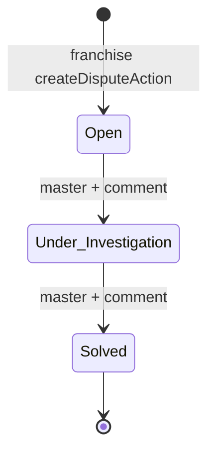

# Module: Franchise Disputes

## 1. What it does
A franchise raises a dispute with the central business (for example about received stock). Master reviews it and moves it through a one-way lifecycle **Open → Under_Investigation → Solved**, with a mandatory comment at each step. Portals: **Franchise** (raise, history), **Master** (list, resolve).

## 2. Entry points
- Franchise: `src/app/franchise/(main)/disputes/page.tsx` → `DisputesClient.tsx`, `RaiseDisputeForm.tsx`, `DisputeHistoryTable.tsx`
- Master: `src/app/master/(main)/disputes/page.tsx` → `DisputesClient.tsx`, `DisputeListTable.tsx`, `ResolveDisputeDialog.tsx`
- Actions: `src/actions/franchise-actions/franchiseDisputeActions.ts` (`createDisputeAction`, `fetchReceivedOrdersAction`), `src/actions/master-actions/disputeActions.ts` (`updateDisputeStatusAction`)

## 3. Files
| Path | Type | Role |
|---|---|---|
| `src/validations/disputeSchema.ts` | zod | `createDisputeSchema` (category enum, description ≤ 2000, optional `related_order_ids` uuids), `updateDisputeStatusSchema` (status Under_Investigation/Solved + comment) |
| `src/repositories/disputeRepository.ts` | repo | create, list, `updateDisputeStatus`, `getReceivedOrdersForFranchise` |
| `src/types/dispute.ts` | types | |
| `scripts/create-franchise-disputes-table.sql` | SQL | Table with CHECKs on category, description length, status; RLS policies |

## 4. Data flow
1. Franchise form → `createDisputeAction(formData)` → `resolveScope()` must be franchise → zod → repository insert with `franchise_id = scope.franchise_id` (never from the form).
2. Master dialog → `updateDisputeStatusAction(formData)` → `resolveScope()` must be `full_network` → zod → read current status → `isValidTransition(current, next)` → repository update with comment.

## 5. Reads / writes
`franchise_disputes`; reads received transfers/orders for linking.

## 6. Source of truth
Status/category CHECK lists in the SQL; `DISPUTE_CATEGORIES` and `DisputeStatus` in `disputeSchema.ts`.

## 7. RBAC
Franchise scope for create; full-network for status changes. Middleware maps `/franchise/disputes` to the operations group via `FRANCHISE_PATH_ALIASES`.

## 8. Diagram

## 9. Techniques
Linear state machine checked in the action before the update; DB CHECK constrains values.

## 10. Gotchas
Transition check is read-then-write in the app (no row lock) — two masters could race; low impact.

## 11. Interview question
*Why is the franchise id never taken from the form?* Tenancy must come from the session; a client could send any id.

## 12. Trace it yourself
`RaiseDisputeForm.tsx` → `franchiseDisputeActions.ts` → `disputeRepository.ts`; `ResolveDisputeDialog.tsx` → `master-actions/disputeActions.ts`.
