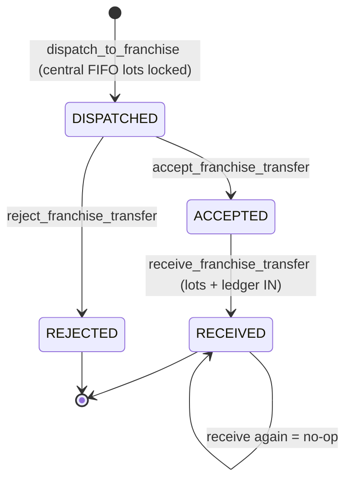

# Module: Franchise Inventory and Stock Transfers

## 1. What it does
The central kitchen sends finished goods to a franchise. The transfer moves through a state machine: **DISPATCHED → ACCEPTED (in transit) → RECEIVED**, or **DISPATCHED → REJECTED**. Receiving creates franchise inventory lots; the franchise records stock-outs (FIFO) and can move stock into its customer shop. Every step is a single Postgres function. A second, older path (`transfer_stock`) moves stock into franchise warehouses from master. Portals: **Admin/Master** (dispatch), **Franchise** (accept/reject/receive/stock-out/shop stock-in/ledger).

## 2. Entry points
- Franchise: `src/app/franchise/(main)/inventory/page.tsx` (`IncomingTransfersPanel`, `ReceiveTransferControls`, `StockOutModal`, `FranchiseDispatchModal`, `FranchiseOperationsCart`), `inventory/ledger/page.tsx` (`FranchiseLedgerWorkspace`)
- Admin dispatch: `src/actions/admin-actions/franchiseDispatchActions.ts` → `franchiseInventoryEngine.dispatchToFranchise`
- Master warehouse transfer: `src/actions/master-actions/stockTransferActions.ts` (`initiateStockTransfer` → RPC `transfer_stock`, `listFranchiseWarehouseStock`)
- Franchise actions: `src/actions/franchise-actions/franchiseInventoryActions.ts`

## 3. Files
| Path | Type | Role |
|---|---|---|
| `src/services/franchiseInventoryEngine.ts` | service | `getFranchiseInventoryCatalog`, `getIncomingTransfers`, `getFranchiseLedger`, `acceptTransfer`, `rejectTransfer`, `receiveTransfer`, `recordStockOut`, `franchiseShopStockIn`, `listActiveFranchiseDestinations`, `dispatchToFranchise` |
| `src/actions/franchise-actions/franchiseInventoryActions.ts` | actions | `resolveScope` → zod → engine → revalidate |
| `src/validations/franchiseInventory.ts` | zod | `transferActionInputSchema`, `stockOutInputSchema`, `franchiseShopStockInInputSchema` |
| `src/lib/franchise-inventory/*` | pure lib + tests | `transfer-state-reducer.ts`, `fifo-depletion.ts`, `on-hand-calculator.ts`, `stock-out-validation.ts`, `finished-product-guard.ts`, `stock-in-guard.ts`, `active-destination-filter.ts`, `scope-predicate.ts`, `permissions.ts` |
| `src/repositories/franchise/franchiseInventoryRepository.ts`, `warehouseRepository.ts` | repos | Reads |
| `src/shared/stores/useFranchiseInventoryStore.ts` | zustand | Operations cart |
| SQL | | `create-dispatch-to-franchise-rpc.sql`, `create-accept-reject-franchise-transfer-rpcs.sql`, `create-receive-franchise-transfer-rpc.sql`, `create-record-franchise-stock-out-rpc.sql`, `create-franchise-shop-stock-in-rpc.sql`, `create-provision-franchise-inventory-rpc.sql`, `create-franchise-stock-transfers-tables.sql`, `create-franchise-inventory-lots-table.sql`, `create-franchise-inventory-ledger-table.sql`, `create-franchise-inventories-table.sql`, `create-franchise-inventory-rls-policies.sql`, `add-package-images-to-franchise-transfers.sql`, `create-transfer-stock-rpc.sql`, `create-franchise-warehouse-tables.sql` |

## 4. Step-by-step
1. **Dispatch** (admin/master): `dispatch_to_franchise(dest, product, qty, by, kitchen)` — franchise must be `active`, qty > 0, enough central stock; header DISPATCHED; FIFO over `inventory_lots` by expiry with `FOR UPDATE`; one transfer line per lot; one central OUT transaction. Optional package images (`add-package-images-to-franchise-transfers.sql`, `packageImageActions.ts`).
2. **Accept / Reject** (franchise): `accept_franchise_transfer` / `reject_franchise_transfer(transfer, franchise, by)` — `SELECT ... WHERE id AND dest_franchise_id FOR UPDATE`, must be DISPATCHED, set state + timestamp; on-hand unchanged.
3. **Receive**: `receive_franchise_transfer` — must be ACCEPTED (RECEIVED = idempotent no-op), validates all lines, creates `franchise_inventory_lots`, ledger IN, state RECEIVED.
4. **Stock out**: `record_franchise_stock_out(franchise, product, qty, reason, comment)` — reason from allowed set, `OTHER` needs a 1–500 char comment, FIFO by expiry/received with lock, one ledger OUT.
5. **Shop stock-in**: `franchise_shop_stock_in` moves inventory into `franchise_product_settings.stock_quantity` (customer shop stock).

## 5. Reads / writes
`franchises`, `inventory_lots`, `inventory_transactions`, `franchise_stock_transfers`, `franchise_stock_transfer_lines`, `franchise_inventories`, `franchise_inventory_lots`, `franchise_inventory_ledger`, `franchise_product_settings`, `franchise_warehouses`, `franchise_warehouse_stock`, `stock_transfers`.

## 6. Source of truth
States `FranchiseTransferState` in `src/types/franchiseInventory.ts`; valid edges in `transfer-state-reducer.ts` (`VALID_TRANSITIONS`) mirror the SQL; spec `.kiro/specs/franchise-inventory/`.

## 7. RBAC / tenant scoping
- Franchise actions: `resolveScope()` must be `franchise`; franchise id comes from the session; RPCs re-check `dest_franchise_id = p_franchise_id`.
- Middleware: `/franchise/inventory` = inventory area (levels inventory / inventory_operations, owner always).
- Dispatch side: admin `getCurrentAdminContext`; master `assertFullNetworkScope` (`resolveScope` = full_network) + flag check.
- `resolveScope` returns "unresolved" when `FRANCHISE_FEATURES_ENABLED` is off, so all of this requires the flag.

## 8. Diagram

## 9. Non-obvious techniques
- State machine enforced twice: a pure reducer (tested) and the SQL function (authoritative).
- `FOR UPDATE` on the transfer row prevents two operators accepting and rejecting at once.
- Stable error prefixes (`FRANCHISE_TRANSFER_LINE_INVALID:`) let the action map DB errors to friendly messages without parsing Postgres text.

## 10. Gotchas
- Rejecting does not put stock back into central `inventory_lots` in the reject function (header says on-hand is not changed); how rejected stock is returned is UNVERIFIED.
- Two transfer systems exist (`franchise_stock_transfers` and `stock_transfers`/warehouses); explain both if asked.
- Many franchise pages read the franchise id from the `x-franchise-id` cookie; the actions do not (they use the session).

## 11. Interview questions
- *How do you make receiving idempotent?* RECEIVED → no-op inside the function, so a double click cannot create duplicate lots.
- *Why lots on the franchise side too?* Expiry tracking and FIFO for stock-outs need batch-level quantities.

## 12. Trace it yourself
`ReceiveTransferControls.tsx` → `franchiseInventoryActions.ts` → `franchiseInventoryEngine.ts` → the four SQL files in step order.
