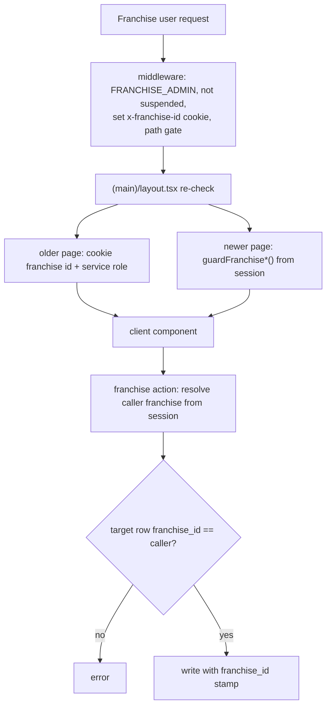

# Module: Franchise Portal Operations (customers, subscriptions, riders, pincodes, orders, marketing)

## 1. What it does
A franchise operator runs a mini ArogyaDiet on `franchies.*`: onboard and manage its own customers, add subscriptions, onboard riders, manage rider service-area pincodes inside the pincodes the franchise owns, request new pincodes from master, watch today's deliveries and reports, create franchise-wide coupons and holidays, and run the franchise shop. All data is filtered by `franchise_id`. Portal: **Franchise**.

## 2. Entry points
| Route | Page | Main actions |
|---|---|---|
| `/dashboard` | `franchise/(main)/dashboard/page.tsx` | metrics via service role + cookie franchise id |
| `/customers`, `/customers/[id]`, `/customers/quick-onboard`, `/customers/shop-orders` | `FranchiseCustomerDashboard`, `FranchiseCreateCustomerModal`, shared `Customer360Dashboard` | `franchiseCustomerManagementActions.ts`, `franchiseCustomerActions.ts`, onboarding |
| `/subscriptions`, `/subscriptions/[id]` | `FranchiseSubscriptionsClient`, `FranchiseGlobalDiscount`, `FranchiseHolidayCalendar` | `franchiseSubscriptionActions.ts` (`franchiseAddSubscription`, `guardSubscription`), `franchiseMarketingActions.ts` |
| `/riders` | `FranchiseRiderDashboard`, `FranchiseServiceAreaManager` | `franchiseRiderActions.ts` (`franchiseOnboardRider`), `franchiseServiceAreaActions.ts`, `franchisePincodeRequestActions.ts` |
| `/operations`, `/orders`, `/reports` | `FranchiseOperationsClient` | `franchiseOperationsActions.ts` (`assertOrderInFranchise`, `assertBatchInFranchise`, `assertCustomerInFranchise`, `assertRiderInFranchise`) |
| `/shop-products`, `/shop-products/assisted-order` | `FranchiseShopProductsClient` | `franchiseShopOrderActions.ts`, `franchiseAssistedOrderActions.ts` |
| `/profile` | `FranchiseServiceAreaCard` | profile |
| `/dietitian-activity`, `/log-customer` | shared dietitian components | see `dietitian-report-cards.md` |

## 3. Key files
- Layout and gates: `src/app/franchise/(main)/layout.tsx`, `src/middleware.ts` (franchies branch), `src/lib/auth/adminAccess.ts` (franchise guards).
- Tenancy helpers: `src/lib/franchise/context.ts` (`resolveFranchiseContext`), `stamping.ts`, `src/lib/auth/scope-resolver.ts`.
- Shared UI: `src/shared/components/franchise/*`, `src/shared/hooks/useFranchiseScope.ts`.
- SQL: `create-franchise-tables.sql`, `create-franchise-pincode-requests-table.sql`, `franchise-holidays-and-discounts.sql`, `franchise-product-settings.sql`, `enforce-one-clinic-per-franchise.sql`.

## 4. Data flow patterns
**Read pattern (older pages)**: page reads `x-franchise-id` cookie (set by middleware) → `createAdminClient()` → `.eq("franchise_id", id)`.
**Read pattern (newer pages)**: `guardFranchiseCustomersWorkspace()` / `guardFranchiseGroupAccess(group)` resolves the franchise from the session.
**Write pattern**: each action file has a local "resolve caller" helper (`resolveCallerFranchiseId`, `resolveFranchiseContext`) → verify the target row's `franchise_id` matches → write with service role → stamp `franchise_id` on inserts.

Example — service area: `franchiseUpsertServiceArea` → caller franchise from session → pincode must be in `franchise_pincodes` for that franchise → existing area must belong to caller → insert/update `rider_service_areas` with `franchise_id`.

Example — pincode request: `requestFranchisePincode` → reject if already owned or pending → insert `franchise_pincode_requests`; master resolves conflicts in hierarchy UI (`PincodeConflictSection`, `conflictActions.ts`).

## 5. Reads / writes
Franchise-stamped versions of: `customer_profiles`, `users`, `subscriptions`, `subscription_daily_preferences`, `payments`, `subscription_payment_transactions`, `rider_profiles`, `rider_service_areas`, `franchise_pincodes`, `franchise_pincode_requests`, `coupons`, `holidays`, `delivery_orders`, `delivery_batches`, `addon_orders`, `franchise_product_settings`.

## 6. Source of truth
`FRANCHISE_OPERATIONS_GROUPS` (`adminAccessCore.ts`), `FranchiseStatus` + `VALID_STATUS_TRANSITIONS` (`src/lib/franchise/constants.ts`: onboarding→active, active↔suspended), types in `src/types/franchise.ts`.

## 7. RBAC / scoping
Middleware + layout: FRANCHISE_ADMIN, franchise assigned, not suspended, owner override, path gate with aliases. Actions: permission (`checkFranchiseGroupManage`) where used + tenancy (row franchise match).

⚠ `franchiseRiderActions.franchiseOnboardRider(formData)` uses `formData.franchiseId` and the service-role client with no session check visible in the file — a caller could create riders for any franchise. Verify and fix (see `16`).

## 8. Diagram

## 9. Non-obvious techniques
Shared admin components rendered in the franchise portal with franchise-specific action props (the franchise wrapper actions are passed in), so one UI serves both tenants.

## 10. Gotchas
- Cookie-based franchise id in pages: the cookie is httpOnly and overwritten by middleware each request, but a server component reading `cookies()` could see a client-sent value if middleware-set cookies are not merged into the request — UNVERIFIED; the newer guards avoid the question.
- Feature flag must be on for franchise scope resolution.

## 11. Interview questions
- *How does a franchise see only its riders?* Rider rows carry `franchise_id`; service areas are limited to franchise-owned pincodes; dispatch scopes by franchise when the flag is on.
- *What happens when master suspends a franchise?* Middleware and layout send all its users to `/unauthorized`.

## 12. Trace it yourself
`franchise/(main)/layout.tsx` → `riders/page.tsx` → `FranchiseServiceAreaManager.tsx` → `franchiseServiceAreaActions.ts franchiseUpsertServiceArea`.
