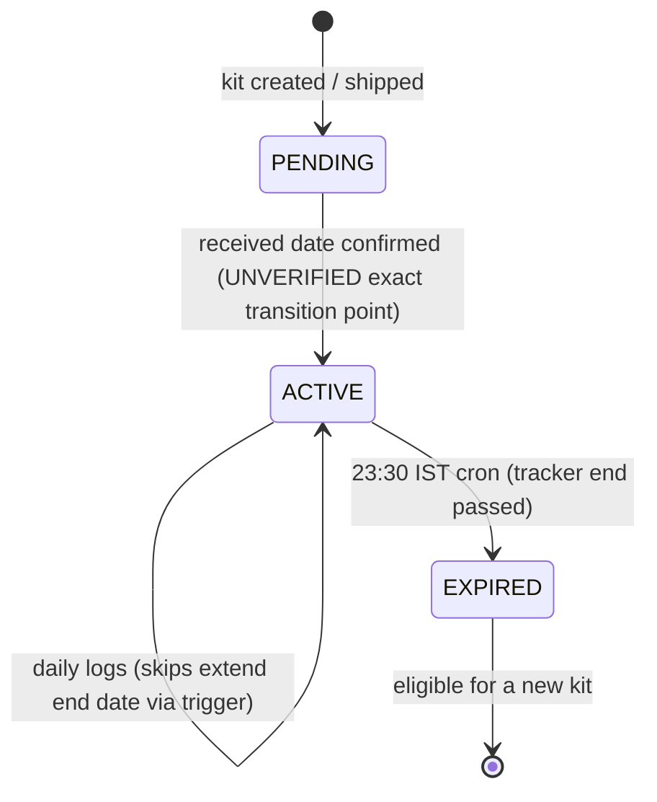

# Module: KIT Lifecycle

## 1. What it does
A KIT customer receives a diet kit by courier, confirms the received date, and logs each day (food followed / skipped, weight, activity, nutrition fields). Skipped days extend the tracker end date. When the tracker ends, a nightly cron marks the kit EXPIRED; the customer sees history and a PDF report, and staff can send a new kit. Portals: **Customer** (dashboard KIT view, `/kit-tracker`, `/kit-history`), **Admin** (KIT products, KIT section in Customer 360, shipping, bulk import, new kit), **Franchise** (shared components), **Master** (BI).

## 2. Entry points
- Customer: `src/app/customer/(main)/dashboard/KitDashboard.tsx`, `ShippingTracker.tsx`, `kit-tracker/page.tsx`, `kit-history/page.tsx`; PDF `GET /api/kit-report/[subscriptionId]`
- Admin: `subscriptions/kits/*` (KIT product catalog), `customers/[id]/shipping/page.tsx`, `customers/bulk-import` (KIT template)
- Actions: customer `src/actions/kitTrackerActions.ts` (`confirmReceivedDateAction`, `saveDailyLogAction`, `getKitTrackerStateAction`), `src/actions/kitLifecycleActions.ts` (`markKitReceivedAction`, `startNewKitAction`, `getKitHistoryAction`, `getKitTrackerStateAction`); admin `admin-actions/kitLifecycleActions.ts` (`sendNewKitAction`, `checkKitEligibilityAction`, `getExpiredKitCustomersAction`), `kitProductActions.ts`, `kitCustomerShippingActions.ts`, `shippingActions.ts` (`saveShippingInfoAction`, `getShippingInfoAction`), `kitBulkImportActions.ts`
- Cron: `/api/cron/expire-kits` (18:00 UTC = 23:30 IST) → `KitLifecycleService.expireEligibleKits`

## 3. Files
| Path | Role |
|---|---|
| `src/services/KitLifecycleService.ts` | `expireEligibleKits`, `checkEligibility`, `createNewKit`, `markKitReceived`, `startNewKit`, `getKitHistory` |
| `src/repositories/kitLifecycleRepository.ts` | `findExpiredKitSubscriptions(istDate)`, `batchUpdateStatus` |
| `src/services/KitReportService.ts`, `KitReportTemplate.tsx` | PDF |
| `src/lib/kit/resolveCustomerCategory.ts`, `adminKitOverview.ts`, `src/lib/dietitian/kitSelfLog.ts` | helpers |
| `src/validations/kitTrackerSchema.ts`, `kitLifecycleSchema.ts`, `kitBulkImportSchema.ts` | zod |
| `src/types/kitLifecycle.ts`, `kitProduct.ts`, `kitShipping.ts` | types |
| SQL | `create-kit-products-table.sql` (+RLS), `add-kit-fields-to-subscriptions.sql`, `add-kit-tracker-columns-to-subscriptions.sql`, `create-kit-daily-logs-table.sql` (+RLS), `add-nutrition-fields-to-kit-daily-logs.sql`, `create-kit-shipping-info-table.sql` (+RLS), `create-kit-received-date-lock-trigger.sql`, `create-kit-tracker-sync-trigger.sql`, `create-kit-tracker-category-guard-triggers.sql`, `add-kit-lifecycle-support.sql`, `seed-initial-kit-products.sql` |

## 4. Data flow
1. Staff onboard a KIT customer (any pincode allowed) or send a new kit (`sendNewKitAction` after `checkKitEligibility`: most recent kit EXPIRED etc.).
2. Shipping info saved (`kit_shipping_info`); customer sees `ShippingTracker`.
3. Customer confirms received date → `subscriptions.kit_received_date`.
4. Daily log → `saveDailyLogAction` (zod) → insert/update `kit_daily_logs`.
5. **Trigger** `trg_kit_daily_logs_sync` (AFTER INSERT/UPDATE/DELETE) recounts `FOOD_SKIPPED` rows and sets `kit_tracker_end_date = received + duration - 1 + skipped`, locking the subscription row. **Trigger** `kit_received_date_lock_guard` blocks changing the received date once any log exists. Category guard triggers keep KIT-only columns on KIT subscriptions.
6. Nightly cron: ACTIVE KIT subscriptions with `kit_tracker_end_date` < today IST → EXPIRED.
7. Middleware keeps an expired-kit customer in the KIT experience (category fallback) so they see the recovery/history UI.

## 5. Reads / writes
`subscriptions` (KIT columns), `kit_products`, `kit_daily_logs`, `kit_shipping_info`, report cache; Storage for package images (`packageImageActions.ts`).

## 6. Source of truth
Derived fields live on `subscriptions` and are maintained only by triggers (self-healing COUNT). Statuses ACTIVE/PENDING/EXPIRED.

## 7. RBAC
Customer: middleware KIT routes (`/kit-tracker`, `/kit-history` not reachable for MEAL); actions check session ownership. Admin: `assertGroupAccess` / `checkGroupManage`. `/api/kit-report/[id]` checks session + category (403 on mismatch).

## 8. Diagram

## 9. Techniques
Denormalised counters maintained by DB triggers in the same transaction (cannot drift); immutability trigger with a specific SQLSTATE (23514).

## 10. Gotchas
Exact moment PENDING→ACTIVE for KIT is in `KitLifecycleService` (`markKitReceived`/`startNewKit`) — read it before claiming details.

## 11. Interview questions
- *Why compute the end date in a trigger?* Every write path (customer, admin, bulk import) gets the same rule with no app code to forget.
- *How is the received date protected?* BEFORE UPDATE trigger raises once logs exist.

## 12. Trace it yourself
`kit-tracker/page.tsx` → `kitTrackerActions.ts saveDailyLogAction` → `scripts/create-kit-tracker-sync-trigger.sql` → `src/app/api/cron/expire-kits/route.ts` → `KitLifecycleService.expireEligibleKits`.
