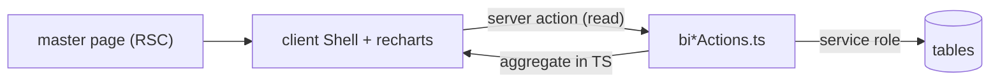

# Module: Master BI Dashboards, Reports and Finance

## 1. What it does
Read-mostly business intelligence for the super-admin: KPI ribbon, revenue trend, customer/rider/operations segments, growth (diet split, plan popularity, pause usage), logistics (pincode density, week-over-week deliveries, rider performance), kitchen ops (meal category distribution, cutoff metrics, automation health), inventory analytics, subscription/customer/network reports, audit log viewer, shared admin email setting, and the finance command centre (subscription revenue, rider payouts). Portal: **Master**; admin dashboard has an executive summary (`dashboardMetrics.ts`).

## 2. Entry points
| Route | Shell component | Actions |
|---|---|---|
| `/dashboard` | `OverviewShell`, `KPIRibbon`, `DashboardShell`, `segments/*`, `NetworkReportSection`, `DietitianActivitySection`, `LogAuditTrailViewer` | `biOverviewActions` (`getOverviewKPIs`, `getRevenueGrowthTrend`), `dashboardActions` (`getKPISummary`, segment data), `networkReportActions`, `logActions` |
| `/growth` | `GrowthShell` | `biGrowthActions` |
| `/logistics` | `LogisticsShell` | `biLogisticsActions` |
| `/kitchen-ops` | `KitchenOpsShell` | `biKitchenOpsActions` |
| `/inventory` | `InventoryIntelligenceShell`, `ShopProductsView` | `biInventoryActions` |
| `/reports` | `ReportEngineShell`, `SharedAdminEmailConfig` | `biReportActions.generateReport`, `notificationSettingsActions` |
| `/subscriptions`, `/customers` | `SubscriptionsClient`, `CustomersClient` (+ `loading.tsx`) | `subscriptionReportActions`, `customerReportActions` |
| `/finance` | `FinanceCommandCenter`, `SubscriptionRevenueView`, `RiderPayoutsView` | `admin-actions/financeActions.ts`, `financePayoutActions.ts` |
| `/logs` | audit viewer | `logActions.getAdminActivityLogs` |

## 3. Files
`src/actions/master-actions/bi*.ts`, `dashboardActions.ts`, `*ReportActions.ts`, `src/types/bi-dashboard.ts`, `src/shared/components/bi/*`, `src/services/dashboardMetrics.ts`, `src/lib/auth/dashboard-scope.ts`, `src/lib/csv/exportCsv.ts`. Charts: `recharts`.

## 4. Data flow
1. Master page (RSC, `revalidate = 0`) renders a client "Shell".
2. Shell calls BI actions (Server Actions used as read endpoints) with filters (date range, franchise).
3. Actions query with the service-role client, aggregate in TypeScript (sums, group-bys, series), and return typed DTOs from `src/types/bi-dashboard.ts`.
4. Shell renders charts/tables; CSV export via `exportCsv.ts`.

## 5. Reads
Nearly every table; writes only in finance (`rider_monthly_summaries`, adjustments, `system_settings`) and notification settings (`system_settings.shared_admin_email`, `scripts/add-shared-admin-email.sql`).

## 6. Source of truth
DTO types in `src/types/bi-dashboard.ts`; automation health from `automation_logs`.

## 7. RBAC
Master layout (MASTER_ADMIN). The BI action files contain no caller check (searched) ⚠ — reads of business data through service role. Finance writes have weak/no checks (see `rider-payouts.md`).

## 8. Diagram

## 9. Techniques
Server Actions used as typed RPC for reads (no API layer); `loading.tsx` files give streaming skeletons for heavy lists.

## 10. Gotchas
Aggregation in Node over full tables does not scale; SQL views or RPCs with `GROUP BY` would. No caching layer.

## 11. Interview questions
- *Why compute KPIs in actions rather than SQL views?* Faster to build with AI agents and TypeScript types; trade-off is performance on large data — next step would be materialised views or RPCs.
- *How are master reads protected?* Layout role check; actions themselves need explicit gates (known gap).

## 12. Trace it yourself
`master/(main)/dashboard/page.tsx` → `OverviewShell.tsx` → `biOverviewActions.ts getOverviewKPIs`.
