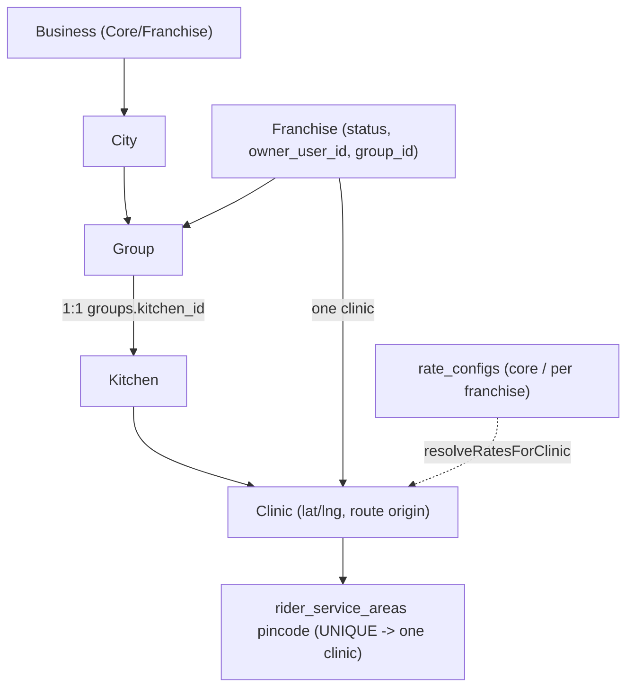

# Module: Master Hierarchy, Franchise Provisioning and Rate Configuration

## 1. What it does
The master portal builds the organisation tree and its money settings:
- **Hierarchy**: Business (Core/Franchise) → City → Group (owns exactly one Kitchen) → Kitchen → Clinic; Franchises belong to a Group and are wired to one Clinic.
- **Franchise lifecycle**: create (onboarding), activate, suspend, reactivate, move to another group, provision inventory, upload agreement documents, resolve pincode conflicts.
- **Rates**: delivery charge per km and rider payout per km, per business/franchise, with audit logs.
Portal: **Master** (`/hierarchy`, `/franchises`, `/franchises/[id]`, `/core-clinics`, `/rate-config`, `/system`).

## 2. Entry points
- `src/app/master/(main)/hierarchy/page.tsx` + `_components/HierarchyTree.tsx`, `BusinessFormDialog`, `CityFormDialog`, `GroupFormDialog`, `FranchiseFormDialog`, `ClinicWiringDialog`, `InterGroupMoveDialog`, `FranchiseStatusControls`, `FranchiseUsersPanel`, `AgreementDocsPanel`, `PincodeConflictBanner`
- `src/app/master/(main)/franchises/[id]/*` (`FranchiseAdminSection`, `FranchiseKitchenSection`, `PincodeConflictSection`)
- `src/app/master/(main)/rate-config/page.tsx` → `src/shared/components/master/rates/*`
- `src/app/master/(main)/core-clinics/page.tsx` → `shared/components/master/core-clinics/*`

## 3. Files
| Path | Role |
|---|---|
| `master-actions/businessActions.ts` | create/update/delete business (`assertCallerCanManageBusinesses`) |
| `master-actions/cityActions.ts` | core + franchise cities (`resolveScope`) |
| `master-actions/groupActions.ts` | `createGroup` (RPC `create_group_with_kitchen`), `updateGroup`, `deleteGroup` (RPC `delete_group_with_kitchen`) |
| `master-actions/kitchenActions.ts`, `clinicActions.ts` | kitchens, clinics, `reassignClinicKitchen` |
| `master-actions/franchiseActions.ts` | `createFranchise`, `updateFranchise`, `activate/suspend/reactivateFranchise`, `moveFranchiseToGroup` (RPC `move_franchise_to_group`), RPC `provision_franchise_inventory` |
| `master-actions/clinicWiringActions.ts` | `wireClinicToFranchise`, `updateFranchiseClinic`, `assignPincodeToFranchiseClinic` (RPC `move_pincode_and_reassign`) |
| `master-actions/agreementDocActions.ts` | Upload/replace/list documents in Storage; signed URLs |
| `master-actions/rateConfigActions.ts` | `getRateConfigsAction`, `upsertRateAction` (`assertMasterAdmin`) |
| `src/services/RateConfigService.ts` | `resolveRatesForClinic`: franchise → core → default, independently for delivery and payout rates |
| `src/lib/franchise/status-transitions.ts`, `constants.ts` | `VALID_STATUS_TRANSITIONS` |
| `src/lib/clinic/conflict.ts`, `reassignment.ts`, `validation.ts`, `visibility.ts` | pincode conflict detection, reassignment rules |
| `src/repositories/clinic/*`, `src/repositories/franchise/*` | data access |
| `src/validations/clinic.ts`, `franchise.ts` | zod |
| SQL | `create-clinic-hierarchy-tables.sql`, `create-groups-table.sql`, `add-group-id-to-franchises.sql`, `create-group-with-kitchen-rpc.sql`, `create-delete-group-with-kitchen-rpc.sql`, `create-move-franchise-to-group-rpc.sql`, `create-move-pincode-rpc.sql`, `create-provision-franchise-inventory-rpc.sql`, `enforce-one-clinic-per-franchise.sql`, `create-rate-configs-table.sql`, `create-rate-config-audit-logs.sql`, `create-franchise-agreement-documents-table.sql`, `create-franchise-hierarchy-rls-policies.sql` |

## 4. Data flow (create group with kitchen)
1. `GroupFormDialog` → `createGroup(input)`.
2. `resolveScope()` must be full-network; zod (`validations/franchise.ts`).
3. `createAdminClient().rpc("create_group_with_kitchen", ...)` inserts the kitchen and the group (1:1 via `groups.kitchen_id UNIQUE`) in one transaction.
4. `revalidatePath` for hierarchy.

Pincode move: `assignPincodeToFranchiseClinic` → `move_pincode_and_reassign` moves a pincode from one clinic/rider to another and reassigns affected rows atomically (the "one pincode → one clinic" rule is a UNIQUE constraint).

Rate resolution at runtime: `resolveRatesForClinic(admin, { id, franchise_id })` → franchise row if present else core row else `DEFAULT_*` constants; returns the source (`franchise|core|default`) so callers can log fallbacks.

## 5. Reads / writes
`businesses`, `cities`, `groups`, `kitchens`, `clinics`, `franchises`, `franchise_pincodes`, `rider_service_areas`, `franchise_agreement_documents` (+ Storage), `rate_configs`, `rate_config_audit_logs`, `franchise_inventories`.

## 6. Source of truth
Hierarchy rules in SQL constraints; franchise status transitions in `src/lib/franchise/constants.ts`; rate defaults in `src/lib/delivery/deliveryCharge.ts`; spec `.kiro/specs/core-clinic-architecture/`, `multi-tenant-franchise/`.

## 7. RBAC
MASTER_ADMIN portal; actions check `resolveScope()` = full_network or local `assertCallerCan*`/`assertMasterAdmin`. Note `full_network` also includes ADMIN; master-only operations rely on the local asserts.

## 8. Diagram

## 9. Techniques
Multi-row structural edits are RPCs (create/delete group with kitchen, move franchise, move pincode); derived business (clinic → kitchen → business) avoids duplicated foreign keys.

## 10. Gotchas
`franchises.kitchen_id` is deprecated (routing uses the wired clinic). Several RLS policy files exist for hierarchy tables but enabling is a separate script.

## 11. Interview questions
- *Why must a group own exactly one kitchen?* Each franchise group cooks from one kitchen; enforced with NOT NULL + UNIQUE on `groups.kitchen_id`.
- *How are rates chosen?* Franchise override → core → hard-coded default, logged when falling back.

## 12. Trace it yourself
`hierarchy/page.tsx` → `HierarchyTree.tsx` → `groupActions.ts createGroup` → `scripts/create-group-with-kitchen-rpc.sql`; then `RateConfigService.ts resolveRatesForClinic`.
