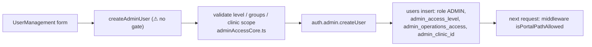

# Module: Master User Management and Access Levels

## 1. What it does
Master creates and manages staff accounts: core ADMIN users (with access level, per-group manage/view, optional clinic scope), dietitians (core), franchise users (FRANCHISE_ADMIN with franchise-safe levels/groups), franchise dietitians, and riders/customers indirectly. It also deactivates/deletes accounts (Supabase Auth + `users`). Portal: **Master** (`/user-management`, `/hierarchy` → `FranchiseUsersPanel`, franchise detail `FranchiseAdminSection`). Admin portal has a few franchise-user actions too.

## 2. Entry points
- `src/app/master/(main)/user-management/page.tsx` → `shared/components/master/UserManagement` → `master-actions/adminActions.ts` (`getAdminUsers`, `createAdminUser`, `updateAdminUser`, `deleteAdminUser`, `toggleAdminActive`)
- `FranchiseUsersPanel.tsx` → `master-actions/franchiseUserActions.ts` (`listFranchiseUsers`, `createFranchiseUser`, `createFranchiseDietitian`, `updateFranchiseUser`, `toggleFranchiseUserActive`, `deleteFranchiseUser`)
- `master-actions/franchiseAdminActions.ts` (franchise owner/admin creation, `assertMasterAdmin`)
- `master-actions/dietitianActions.ts` → `services/DietitianAccountService.ts` (`listDietitians`, `createDietitian`, `updateDietitian`, `toggleDietitianActive`, `deleteDietitian`)
- Admin: `admin-actions/franchiseUserActions.ts` (`assertCallerIsMasterAdmin`)

## 3. Files
| Path | Role |
|---|---|
| `src/lib/auth/adminAccessCore.ts` | `ADMIN_ACCESS_LEVELS`, `validateOperationsAccessInput`, `validateFranchiseOperationsAccessInput`, `FRANCHISE_USER_ACCESS_LEVELS`, `validateClinicScopeAssignment`, labels |
| `master-actions/adminActions.ts` | zod `z.enum(ADMIN_ACCESS_LEVELS)`; clinic scope resolution; `auth.admin.createUser` + `users` insert with ADMIN role; delete = auth delete; notification of level change |
| `master-actions/franchiseUserActions.ts` | flag + `resolveScope` full_network gate; franchise users may not get `dietitian` level via the generic path, nor the `franchises` group |
| `services/DietitianAccountService.ts` | dietitians = ADMIN/FRANCHISE_ADMIN with level `dietitian` |
| SQL | `add-admin-access-level-to-users.sql`, `add-admin-operations-access-to-users.sql`, `add-admin-clinic-id-to-users.sql` (trigger `enforce_admin_clinic_is_core`), `allow-multiple-franchise-dietitians.sql`, `create-dietitian-management.sql` |
| `emails/FranchiseWelcomeEmail.ts`, `AccountDeletedEmail.ts` | emails |

## 4. Data flow (create core admin)
1. Form → `createAdminUser({ email, fullName, accessLevel, operationsAccess, clinicAccess, clinicId, ... })`.
2. zod on access level; `validateOperationsAccessInput` (non-empty, known groups, manage/view) when level is `operations`; clinic scope validated (`validateClinicScopeAssignment` + one query that the clinic is core).
3. Reactivate if a deactivated user exists, else `auth.admin.createUser` → insert `users` (role ADMIN, level, JSONB groups, `admin_clinic_id`); on failure delete the auth user.
4. `logAdminAction`, `revalidatePath`.
The user's next request is gated by middleware using the new level/groups.

## 5. Reads / writes
`users`, `roles`, Supabase Auth users, `clinics`, `franchises`, `admin_activity_logs`, `notifications`.

## 6. Source of truth
`adminAccessCore.ts` constants; DB columns `users.admin_access_level`, `admin_operations_access` (jsonb), `admin_clinic_id`, `franchise_id`.

## 7. RBAC
- `franchiseUserActions.ts` (master): full_network scope + flag.
- `franchiseAdminActions.ts`, `rateConfigActions.ts`: `assertMasterAdmin`.
- ⚠ `master-actions/adminActions.ts`: no caller check found in the file (it relies on the master layout to show the page). The create/update/delete functions use the service-role client. If reachable as Server Actions, any user could create an ADMIN. Highest-priority fix in `16`.

## 8. Diagram

## 9. Techniques
Lenient read (`resolveAccessConfiguration`) vs strict write (`validate*Input`) — reading never locks people out because of bad data, writing never stores bad data.

## 10. Gotchas
`"use server"` files may export only async functions; constant arrays live in `adminAccessCore.ts` for that reason.

## 11. Interview questions
- *How is a view-only admin enforced?* `canManageGroup` false → actions return the read-only message; pages render read-only.
- *Why can't a franchise user get the `franchises` group?* It governs the network-wide franchise page; meaningless and dangerous for a single-tenant user. Enforced by `validateFranchiseOperationsAccessInput`.

## 12. Trace it yourself
`master/(main)/user-management/page.tsx` → `shared/components/master/UserManagement` → `adminActions.ts createAdminUser` → `adminAccessCore.ts validateOperationsAccessInput` → `src/middleware.ts` admin branch.
