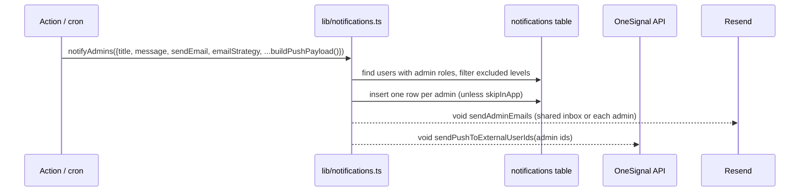

# Module: Notifications (in-app, push, email)

## 1. What it does
One helper library sends three kinds of notification: an **in-app row** (bell icon), a **push** via OneSignal (web push + Android FCM inside the WebView), and an **email** via Resend. Actions and cron routes call `notifyAdmins(...)` or `sendNotificationToUser(...)`. Portals: all.

## 2. Entry points
- Library: `src/lib/notifications.ts` (`notifyAdmins`, `sendNotificationToUser`, `buildPushPayload`)
- Push transport: `src/lib/onesignal/server.ts` (`sendPushToExternalUserIds`)
- Email transport: `src/services/emailService.ts` (Resend) + `src/emails/*`
- Bell data: `GET/POST /api/notifications` (`src/app/api/notifications/route.ts`, session client)
- Client: `src/shared/components/notifications/OneSignalProvider.tsx` (admin layout, customer deferred providers, rider layout client), bell components; `src/lib/notifications/popupPreference.ts`, `refresh.ts`
- Domain helpers: `src/lib/notifications/orderNotifications.ts`, `lookups.ts`; `src/lib/delivery/deliveryStatusNotifications.ts`; `src/lib/subscription/subscriptionNotifications.ts`; `src/lib/customer/customerProfileNotifications.ts`
- Settings: master `/reports` → `SharedAdminEmailConfig` → `notificationSettingsActions.ts` (`system_settings.shared_admin_email`)

## 3. Files
| Path | Role |
|---|---|
| `src/lib/notifications.ts` | Payload type (`title`, `message`, `actionUrl`, `sendEmail`, `sendPush`, `emailStrategy: shared|individual`, `skipInApp`, `excludeAccessLevels`, OneSignal headings/contents/topic); admin fan-out; shared inbox lookup |
| `src/lib/onesignal/server.ts` | Raw `fetch` to `https://api.onesignal.com/notifications` with `include_aliases.external_id` = our `users.id`, `target_channel: "push"`, optional `web_push_topic` (collapses duplicates) |
| `OneSignalProvider.tsx` | Loads OneSignal Web SDK, `OneSignal.login(userId)` so push targets the internal user id; native detection skips service-worker path |
| `supabase/migrations/20250605130000_notifications_table.sql`, `20250605140000_notifications_rls.sql` | `notifications` table + RLS (user reads own) |

## 4. Data flow

`sendNotificationToUser(userId, payload)` does the same for one user (email looked up from `users.email`).

## 5. Reads / writes
`roles`, `users`, `system_settings`, `notifications`. External: OneSignal REST, Resend.

## 6. Source of truth
Env names: `NEXT_PUBLIC_ONESIGNAL_APP_ID`, `ONESIGNAL_REST_API_KEY`, `NEXT_PUBLIC_APP_URL`, `RESEND_API_KEY` (name assumed from Resend convention — UNVERIFIED), `NEXT_PUBLIC_ONESIGNAL_SAFARI_ID`, `NEXT_PUBLIC_ONESIGNAL_ALLOWED_HOSTNAMES`.

## 7. RBAC
Server-only library using the service role. Bell route uses the session client so users only see their own rows (RLS migration).

## 8. Techniques
- External id aliasing: OneSignal is told "this device belongs to user X", so the server can push by our user id without storing device tokens.
- `web_push_topic` dedupes repeated pushes; `buildPushPayload(title, message, topic)` builds it.
- Fire-and-forget (`void ...`) so slow email/push does not block the action.

## 9. Gotchas
- Fire-and-forget promises in serverless functions can be cut off when the response finishes; Next's `after()` would be the safe way (used in cron routes, not here).
- `getSharedAdminInbox()` falls back to a hard-coded personal Gmail address when `system_settings.shared_admin_email` is empty — move to env/config.
- Package `@onesignal/node-onesignal` is installed but the server code uses raw `fetch`.
- In-memory dedupe maps (e.g. `manageMealActions.ts`) do not work across serverless instances.

## 10. Interview questions
- *How do you push to a specific user?* `OneSignal.login(users.id)` on the client; server targets `include_aliases.external_id`.
- *Why three channels?* In-app for history, push for immediacy, email for records (invoices, shared admin inbox).

## 11. Trace it yourself
`checkoutActions.ts` (search `notifyAdmins`) → `src/lib/notifications.ts` → `src/lib/onesignal/server.ts` → `OneSignalProvider.tsx`.

## 12. Template note
Sections 1–11 above cover the module template; RBAC and source of truth are short because the module is infrastructure.
