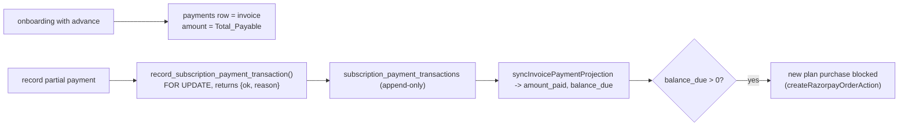

# Module: Partial Payments, Invoices, Coupons and Delivery Charges

## 1. What it does
Billing for MEAL (and the same idea for stays):
- **Invoices**: there is no invoices table; a `payments` row *is* the invoice (`invoice_type` SUBSCRIPTION / ADDON / ACCOMMODATION_STAY / _EXTENSION / _FINAL_INVOICE / _REFUND_INVOICE). Invoice number is derived at render (`INV-` + first block of the payment uuid) by `generateInvoiceData` in `src/lib/invoices/index.ts`.
- **Partial payments**: staff can onboard a MEAL customer with an advance; further payments are appended to a ledger; balance is derived, never stored; a customer with an outstanding balance cannot buy a new plan.
- **Coupons**: per-customer coupons (flat/percent, per-plan discounts, max uses, expiry) and franchise global coupons.
- **Delivery charges**: per-km rate by clinic/franchise added to the plan total.
Portals: **Admin** (Customer 360 billing, partial payment board, coupons, delivery charge settings), **Franchise** (same with scope), **Customer** (billing list, invoice page, checkout gate).

## 2. Entry points
- Customer: `subscription/manage/billing/page.tsx`, `billing/invoice/[id]/page.tsx`
- Admin: `customers/[id]/billing/invoice/[paymentId]/page.tsx`, `PartialPaymentSection.tsx`, `RecordSubscriptionPaymentForm.tsx`, `RecordSubscriptionRefundForm.tsx`, `AdminCouponsTab.tsx`
- Actions: `admin-actions/subscriptionPaymentActions.ts`, `partialPaymentActions.ts` (`getPartialPaymentBalancesAction`), `adminCouponActions.ts`, `deliveryChargeActions.ts`; franchise `franchisePartialPaymentActions.ts`, `franchiseMarketingActions.ts`
- Checkout gate: `createRazorpayOrderAction` and checkout page (`getOutstandingBalanceForCustomer`)

## 3. Files
| Path | Role |
|---|---|
| `src/services/SubscriptionPaymentService.ts` | `deriveSubscriptionBalance`, `getSubscriptionBalance`, `getOutstandingBalanceForCustomer`, `syncInvoicePaymentProjection`, `getSubscriptionPaymentOverview` |
| `src/repositories/subscriptionPaymentRepository.ts` | ledger reads/writes |
| `src/lib/payments/partialPaymentBreakup.ts` | Pure summary helpers shared by admin + franchise boards (moved out so they cannot drift) |
| `src/lib/invoices/index.ts` (+ README, example) | Invoice data builder |
| `src/shared/components/shared/invoice/*` | `InvoiceDocument` etc. |
| `src/services/customerCouponCore.ts`, `src/lib/coupons/*` | Coupon rules |
| `src/services/DeliveryChargeService.ts`, `src/lib/delivery/deliveryCharge.ts`, `src/lib/onboarding/miscCharge.ts`, `discount.ts`, `src/lib/pricing/inclusive-tax.ts` | Charges and tax |
| `src/types/subscriptionPayment.ts`, `partialPayment.ts`, `src/validations/subscriptionPaymentSchema.ts` | Types + zod |
| SQL | `create-subscription-payment-lifecycle.sql` (`subscription_payment_transactions`, `record_subscription_payment_transaction` RPC returning `{ok, reason}`), `create-subscription-early-closure-recalculation.sql`, `add-discount-clearing-to-recalculation.sql`, `backfill-subscription-payment-amounts.sql`, `add-delivery-charge-to-*.sql`, `add-misc-charge-columns.sql`, `add-discount-to-subscriptions-and-payments.sql`, `supabase/migrations/2025060814*_coupons_*.sql` |
| Plan doc | `docs/meal-partial-payment-plan.md` (header says "Status: PLAN (not yet executed)" — but code and SQL exist; doc is stale) |

## 4. Data flow (record a partial payment)
1. Admin form → `subscriptionPaymentActions.ts` → `checkGroupManage("customers")` + zod.
2. RPC `record_subscription_payment_transaction(...)`: `SELECT ... FOR UPDATE` on the parent payment/subscription to serialise concurrent appends, append ledger row, return `{ ok: true }` or `{ ok: false, reason }` (no RAISE), so the action maps each reason to a fixed message.
3. `syncInvoicePaymentProjection` updates `payments.amount_paid` / `balance_due` (projection of the ledger) so invoices render without recomputing.
4. "Final invoice" = derived label when `balance_due <= 0`.

## 5. Reads / writes
`payments`, `subscription_payment_transactions`, `subscriptions` (`total_payable`, discount/charge columns), `coupons`, `rate_configs`.

## 6. Source of truth
The ledger; `payments.amount` = Total_Payable; balance derived. Design decisions D1–D3 in `docs/meal-partial-payment-plan.md` and the SQL header.

## 7. RBAC
Admin `checkGroupManage`/`guardCustomersWorkspace`; franchise `checkFranchiseCustomersRead` + tenancy; customer reads own payments via session client.

## 8. Diagram

## 9. Techniques
Ledger + derived balance (no second source of truth), RPC result objects instead of exceptions, pure shared helpers to keep two portals consistent.

## 10. Gotchas
`payments.status` has no CHECK and holds `SUCCESS`, `PAID`, `PENDING` (and `PARTIALLY_PAID` per plan); reports must normalise. "Subscription recalculate - not tested" commit message for early-closure recalculation.

## 11. Interview questions
- *Why not store the balance?* It can drift from the ledger; derive it, and keep only a projection updated in the same flow.
- *How do you block purchases with dues?* Server check before creating a Razorpay order; UI disables buttons as a courtesy.

## 12. Trace it yourself
`PartialPaymentSection.tsx` → `subscriptionPaymentActions.ts` → `SubscriptionPaymentService.ts` → `scripts/create-subscription-payment-lifecycle.sql` → `src/lib/invoices/index.ts`.
