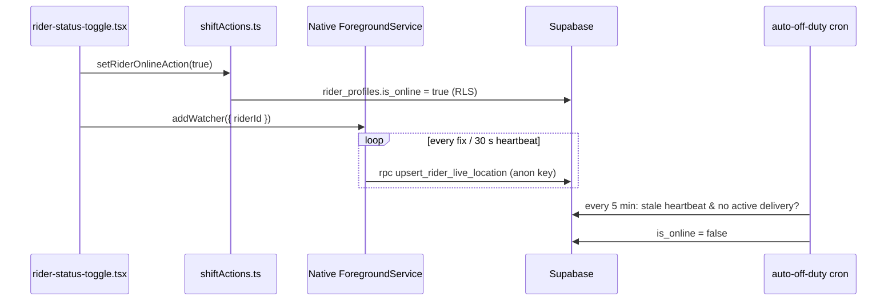

# Module: Rider Duty Toggle and Background GPS

## 1. What it does
A rider taps "On Duty" in the Android app. The server marks them online, the native foreground service starts recording GPS and uploading it every fix (10 m filter) plus a 30-second heartbeat, even with the screen locked. Admins see riders on a live map; customers see their rider. A cron flips riders off duty when their heartbeat goes stale. Portals: **Rider** (toggle), **Admin** (live map, force off-duty), **Customer** (tracking), system cron.

## 2. Entry points
- `deliverypartner.*/dashboard` → `src/app/rider/(main)/dashboard/dashboard-content.tsx` renders `BatteryPermissionOnboarding` + `RiderStatusToggle`.
- Server action `setRiderOnlineAction(isOnline)` (`src/actions/rider-actions/shiftActions.ts`).
- Cron `/api/cron/auto-off-duty` every 5 minutes (`scripts/add-supabase-cron-jobs.sql`).
- Native upload → RPC `upsert_rider_live_location` (anon key).
- Admin `adminSetRiderOffDutyAction` (`liveTrackingActions.ts`).

## 3. Files
| Path | Type | Role |
|---|---|---|
| `src/shared/components/rider/rider-status-toggle.tsx` | client | Switch; `BackgroundGeolocation.addWatcher({ riderId, requestPermissions, ... })`, keep-awake, fatal-error teardown |
| `src/shared/components/rider/BatteryPermissionOnboarding.tsx` | client | Banner + dialog for battery optimisation exemption and OEM steps |
| `src/lib/capacitor/background-geolocation-stub.ts` | lib | JS shim that delegates to `registerPlugin("BackgroundGeolocation")`; web build alias target (`next.config.ts`) |
| `src/lib/capacitor/keep-awake.ts`, `oem-battery-instructions.ts`, `tracking-permissions.ts` | lib | Screen wake, manufacturer instructions, permission checks |
| `src/shared/hooks/useAutoOffDutyTimer.ts`, `useOffDutyReconcile.ts` | hooks | Client-side auto-off timer and reconcile when the server already flipped the rider off |
| `src/actions/rider-actions/shiftActions.ts` | action | `rider_profiles.is_online`, `last_online_at`/`last_offline_at` (session client) |
| `src/app/api/cron/auto-off-duty/route.ts` → `src/lib/delivery/auto-off-duty-sweep.ts` | cron + lib | Heartbeat staleness sweep |
| `src/lib/delivery/duty-lifecycle.ts` | lib | `getRiderHeartbeatStaleMinutes` (env `RIDER_HEARTBEAT_STALE_MINUTES`, default 10), `ACTIVE_DELIVERY_STATUSES`, grace minutes (`RIDER_AUTO_OFF_DUTY_GRACE_MINUTES`, default 10) |
| `src/shared/components/rider/LiveLocationTracker.tsx`, `RouteGpsIndicator.tsx` | client | Route-page GPS indicator (was a second conflicting watcher; fixed per steering doc §9) |
| `native/plugins/background-geolocation/**` | Java | Foreground service, queue, uploader (see `11`) |
| `scripts/create-rider-live-location-upsert-rpc.sql` | SQL | `upsert_rider_live_location(p_rider_id, p_lat, p_lng)` |

## 4. Data flow
1. Rider toggles on → `setRiderOnlineAction(true)`: session user → `users.id` → update own `rider_profiles` (RLS) → `users.last_login_at` → `revalidatePath` for rider and admin pages.
2. On native (`Capacitor.isNativePlatform()`), `addWatcher` passes the real rider UUID; the native bridge starts `LocationForegroundService` with a persistent notification ("Active Delivery Route").
3. Native: each fix → SQLite `LocationQueue` → `SyncWorker` drains → `SupabaseUploader` POSTs to `/rest/v1/rpc/upsert_rider_live_location` with the anon key. 30 s heartbeat re-uploads the last fix.
4. The JS watcher callback is only used for fatal errors (location off, permission denied) → remove watcher, flip off-duty server-side, toast.
5. Admin map reads `rider_live_locations` (`liveTrackingActions.ts`); staleness threshold ~90 s per steering doc. Customer map subscribes via Supabase Realtime (`LiveTrackingMap.tsx`, channel on `rider_live_locations:rider_id=eq.<id>`).
6. Every 5 min: sweep online riders; if `max(rider_live_locations.updated_at, last_online_at)` older than stale minutes and no order in `OUT_FOR_DELIVERY/ON_THE_WAY/REACHING_TO_LOCATION/PICKED` → set `is_online=false`.
7. Rider toggles off → `removeWatcher`, keep-awake released, `setRiderOnlineAction(false)`.

## 5. Reads / writes
`rider_profiles.is_online/last_online_at/last_offline_at`, `users.last_login_at`, `rider_live_locations` (one row per rider), `delivery_orders.status` (sweep guard).

## 6. Source of truth
Env: `RIDER_HEARTBEAT_STALE_MINUTES`, `RIDER_AUTO_OFF_DUTY_GRACE_MINUTES`. Native constants: `LocationConstants.java`, `LocationEngineConfig.java` (10 m filter). Plugin config text: `capacitor.config.json`.

## 7. RBAC / scoping
- Toggle uses the session client; RLS on `rider_profiles` restricts to own row (policy `is_own_rider_profile`, referenced in the RPC script header).
- GPS upload uses anon key via SECURITY DEFINER RPC granted to `anon, authenticated`. Anyone with the public anon key and a rider UUID can overwrite that rider's location (accepted trade-off, documented in the SQL header).

## 8. Diagram

## 9. Non-obvious techniques
- Upload moved from WebView JS to native code because Android throttles WebView timers in the background (root cause in `.kiro/steering/rider-gps-tracking.md` §2).
- Heartbeat while stationary keeps `updated_at` fresh below the distance filter.
- The "stub" is a real shim, not a no-op: the remotely-loaded web bundle must call the native plugin through `registerPlugin`.

## 10. Gotchas
- OEM battery killers (Vivo iManager, MIUI…) can still kill the service; only manual settings fix it (tested on one Vivo device only).
- `tracker_session_id` did not rotate per shift in testing.
- `ShiftAuthorityCallback.checkAuthoritativeShiftState()` is a stub returning UNKNOWN (server-authoritative shift check not wired).
- Duty-lifecycle comment says fallback 5 minutes; code default is 10.

## 11. Interview questions
- *Why does tracking keep working with the screen off?* Foreground service with `foregroundServiceType="location"`, START_STICKY, wake lock, native HTTP upload, durable queue.
- *How does a server know a rider closed the app?* Heartbeat staleness sweep every 5 min.
- *Why is the location RPC callable by anon?* The native service has no user session; the function writes only three columns after validation.

## 12. Trace it yourself
1. `src/app/rider/(main)/dashboard/dashboard-content.tsx`
2. `src/shared/components/rider/rider-status-toggle.tsx`
3. `src/actions/rider-actions/shiftActions.ts`
4. `scripts/create-rider-live-location-upsert-rpc.sql`
5. `src/lib/delivery/auto-off-duty-sweep.ts`
6. `native/.../LocationForegroundService.java` (skim `onStartCommand`)
