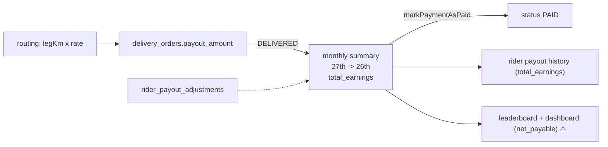

# Module: Rider Payouts

## 1. What it does
Riders earn per kilometre. The per-stop payout is calculated at routing time and stored on each `delivery_orders` row. Monthly (27th → 26th cycle) the system or a master/admin user rolls DELIVERED orders into `rider_monthly_summaries`, adds adjustments, and marks them PAID. Riders see daily/monthly earnings and a leaderboard. Portals: **Rider** (`/payout`, dashboard card), **Master** (`/finance` → `RiderPayoutsView.tsx`), **Admin** (finance actions), system cron.

## 2. Entry points
- Rider: `src/app/rider/(main)/payout/page.tsx`, `dashboard/dashboard-content.tsx`
- Master: `src/app/master/(main)/finance/RiderPayoutsView.tsx`
- Actions: `src/actions/admin-actions/financeActions.ts` (`getAllRidersWithEarnings`, `generateMonthlyPayment`, `createCustomPayment`, `markPaymentAsPaid`, `getSystemSettings`, `updateSystemSettings`), `financePayoutActions.ts` (`addPayoutAdjustment`, `getPayoutAdjustments`)
- Cron: `/api/cron/generate-rider-payments` (**not scheduled** in `scripts/add-supabase-cron-jobs.sql`)
- Email: `src/emails/RiderPaymentEmail.ts`

## 3. Files
| Path | Type | Role |
|---|---|---|
| `src/actions/system-actions/routeEngine.ts` | engine | Writes `delivery_orders.payout_amount`, `delivery_batches.expected_payout`, `total_distance_km` |
| `src/services/RateConfigService.ts` | service | ₹/km per clinic (core vs franchise rate, fallback default) |
| `src/lib/delivery/deliveryCharge.ts` | lib | `DEFAULT_RIDER_PAYOUT_RATE_PER_KM` |
| `src/app/api/cron/generate-rider-payments/route.ts` | cron | Monthly summary per active rider |
| `src/actions/admin-actions/financeActions.ts` | actions | Same summary logic + custom periods + mark paid |
| `src/actions/admin-actions/financePayoutActions.ts` | actions | Adjustments (`rider_payout_adjustments`) |
| `src/lib/delivery/riderPaidMonthsWindow.ts` | lib | Last 3 paid months window for leaderboard |
| `src/app/rider/(main)/payout/page.tsx` | RSC | Earnings, history, leaderboard |
| `scripts/create-rider-payout-adjustments-table.sql`, `create-rate-configs-table.sql` | SQL | Tables |

## 4. Data flow
1. **Routing**: per leg `payoutAmount = legKm × ratePerKm` (Google distance, or Haversine × 1.3). Stored on the order.
2. **Delivered**: order becomes `DELIVERED` (rider action).
3. **Monthly summary** (`generateMonthlyPayment(riderId, month, year)` or the cron): period = 27th of previous month → 26th of this month; skip dates already covered by custom summaries; sum `payout_amount` of DELIVERED orders; sum batch distance; insert `rider_monthly_summaries` with `total_earnings`, `total_distance_km`, `total_deliveries`, `status: GENERATED`.
4. **Adjustments**: `addPayoutAdjustment` adds bonus/deduction rows.
5. **Mark paid**: `markPaymentAsPaid(summaryId, notes)` → status `PAID`, `paid_at`, notes; optional email.
6. **Rider view**: today/month/total from DELIVERED orders' `payout_amount`; history from summaries (`total_earnings`); leaderboard and dashboard card from summaries' **`net_payable`**.

## 5. Reads / writes
`delivery_orders`, `delivery_batches`, `rider_profiles`, `rider_monthly_summaries`, `rider_payout_adjustments`, `rate_configs`, `system_settings`.

## 6. Source of truth
- Rate: `rate_configs` via `RateConfigService` (fallback constant). Older docs mention `system_settings.rider_payout_per_km`; routing now uses `RateConfigService`.
- Summary status CHECK: `GENERATED` / `PAID`.

## 7. RBAC / scoping
- Rider page uses the service-role client for summaries (to build the fleet leaderboard), filtered by rider id for the personal history.
- `financeActions.ts`: `markPaymentAsPaid` only checks that someone is logged in; `generateMonthlyPayment`, `createCustomPayment`, `updateSystemSettings` have no caller check in the file. Called from master finance UI. ⚠ See `16`.

## 8. Diagram

## 9. Non-obvious techniques
Coverage sets: a custom (date-range) summary marks its dates as covered so the regular monthly summary does not pay them twice.

## 10. Gotchas (important)
- **Column mismatch**: no code or SQL in the repo writes `net_payable` (searched both). Leaderboard and dashboard totals read it, so they show ₹0 unless the DB has a generated column/trigger outside the repo — UNVERIFIED.
- Cron route has a literal fallback secret and is not scheduled; monthly generation is manual in practice.
- Adjustments are not visibly folded into `total_earnings`.

## 11. Interview questions
- *How is a rider paid?* Distance-based per stop at routing time, rolled into a monthly 27→26 summary, adjusted, marked paid by finance.
- *Why compute payout at routing time?* The route distance is known then; storing it per order makes the summary a simple sum and auditable.

## 12. Trace it yourself
`routeEngine.ts commitRiderBatch` → `routeActions.ts` delivered → `financeActions.ts generateMonthlyPayment` → `rider/(main)/payout/page.tsx` (compare the two columns).
