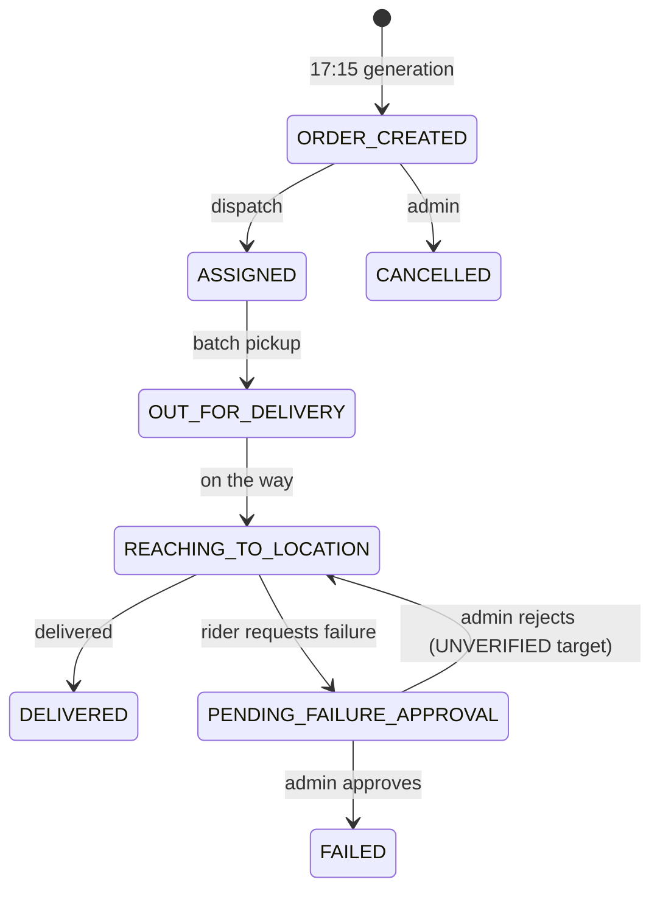

# Module: Rider Route and Delivery Status

## 1. What it does
The rider sees today's batch (or tomorrow's after 5 PM IST), picks it up at the clinic, works through stops in `route_sequence` order, marks each "on the way" and "delivered", or requests a failed-delivery approval with a reason. Every change is written to an audit timeline that customers and admins see. Portals: **Rider**, **Admin** (operations board approves failures), **Customer** (status + tracking).

## 2. Entry points
- `deliverypartner.*/route` → `src/app/rider/(main)/route/page.tsx`
- `deliverypartner.*/route/[orderId]` → `src/app/rider/(main)/route/[orderId]/page.tsx`
- Actions in `src/actions/rider-actions/routeActions.ts`
- Admin approval: `src/actions/admin-actions/operationsActions.ts` / `adminDeliveryActions.ts` (`src/lib/delivery/failureApproval.ts`, `adminOrderStatusTransitions.ts`)

## 3. Files
| Path | Type | Role |
|---|---|---|
| `route/page.tsx` | RSC | Batch + ordered stops for `getRiderOperationalDeliveryDate()` |
| `route/[orderId]/page.tsx` | RSC | Stop detail, map, GPS indicator, actions |
| `src/actions/rider-actions/routeActions.ts` | actions | `markBatchPickedUpAction`, `markOrderOnTheWayAction`, `markOrderDeliveredAction`, `requestFailedDeliveryAction`, `updateDeliveryStatusAction`, `getRiderDeliveryOrderStatusAction` |
| `src/lib/delivery/orderStatuses.ts`, `failedDeliveryReasons.ts`, `riderChecklist.ts`, `batchCompletion.ts` | lib | Status sets, reason list, checklist, batch completion |
| `src/lib/delivery/deliveryStatusNotifications.ts` | lib | Customer push on "reaching", delivered, etc. |
| `src/lib/dates/ist.ts` | lib | 17:00 IST rollover: `getRiderOperationalDeliveryDate`, headings |
| `src/shared/components/rider/*` | UI | Stop cards, GPS indicator |

## 4. Data flow
1. Route page loads batch for the operational date (`isRiderEveningPreviewIST()` → tomorrow after 17:00).
2. **Pickup**: `markBatchPickedUpAction` → orders → `OUT_FOR_DELIVERY` + `delivery_status_logs` rows, batch → `IN_TRANSIT`, revalidate rider/admin paths.
3. **On the way**: `updateRiderOrderStatus(orderId, "REACHING_TO_LOCATION")` → order update scoped by rider, log, customer notification.
4. **Delivered**: same helper with `DELIVERED` and `delivered_at`. Payout already sits on `delivery_orders.payout_amount` from routing; monthly summaries sum DELIVERED orders.
5. **Failed**: `requestFailedDeliveryAction(orderId, reason, remark)` validates reason ∈ `FAILED_DELIVERY_REASONS`, requires current status `REACHING_TO_LOCATION`, updates to `PENDING_FAILURE_APPROVAL` (filtered by `assigned_rider_id`), logs, notifies admins (push + individual email). Admin later approves/rejects.

## 5. Reads / writes
`delivery_batches`, `delivery_orders`, `delivery_status_logs`, `addon_orders` (shown with the stop), `notifications`.

## 6. Source of truth
Status names in `src/lib/delivery/orderStatuses.ts`; DB enum includes `PENDING_FAILURE_APPROVAL` (`supabase/migrations/20250602140000_*`). Reasons in `failedDeliveryReasons.ts`.

## 7. RBAC / scoping
Middleware: `RIDER` on `deliverypartner.*`. Actions use the **session client** and `getCurrentRiderProfileId()`; the main helpers add `.eq("assigned_rider_id", riderProfileId)`. Exception: `updateDeliveryStatusAction(orderId, newStatus, note)` accepts any status string and has no rider filter — it relies entirely on RLS for `delivery_orders` (policy details UNVERIFIED).

## 8. Diagram

## 9. Non-obvious techniques
- Two-step failure (request → approve) prevents riders from skipping deliveries unilaterally and keeps a reason in the audit log.
- Evening preview: the same pages show tomorrow's work after 17:00 IST without a separate route.

## 10. Gotchas
- Status writes are separate from log writes (no transaction).
- Many `revalidatePath` calls for both public and rewritten paths.

## 11. Interview questions
- *How is a rider stopped from updating another rider's order?* `assigned_rider_id = own profile` in the update filter, plus RLS.
- *Where does the payout come from?* Calculated at routing time per leg and stored on the order; summed monthly.

## 12. Trace it yourself
`route/page.tsx` → `route/[orderId]/page.tsx` → `routeActions.ts` (`updateRiderOrderStatus`, `requestFailedDeliveryAction`, `markBatchPickedUpAction`) → `src/lib/delivery/deliveryStatusNotifications.ts`.
