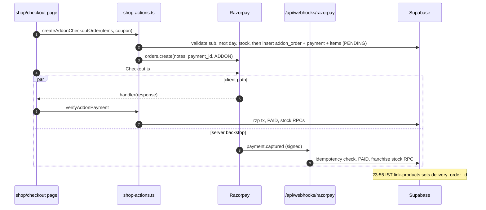

# Module: Shop Products and Add-on Orders

## 1. What it does
Customers with an active MEAL subscription buy add-on products (oils, powders, snacks) in the app. Each order rides along with the customer's next delivery. Stock comes from the customer's clinic (core) or franchise. Staff can also place an order for a customer ("assisted order"), including walk-in sales. Portals: **Customer** (buy), **Admin** (assisted orders, shop orders list, clinic stock), **Franchise** (own catalog, assisted orders, shop orders), **Master** (shop product BI + warehouse shop products).

## 2. Entry points
- `customer.*/shop`, `/shop/checkout`, `/shop/orders` (`src/app/customer/(main)/shop/**`)
- Admin: `/customers/assisted-order`, `/customers/shop-orders`, `/kitchen-shop/inventory`, `/inventory/shop-products`
- Franchise: `/shop-products`, `/shop-products/assisted-order`, `/customers/shop-orders`
- Webhook: `POST /api/webhooks/razorpay` (ADDON only)
- Cron: `/api/cron/link-products` (23:55 IST per SQL) links paid orders to deliveries
- Receipt PDF: `GET /api/shop-receipt/[orderId]`

## 3. Files
| Path | Type | Role |
|---|---|---|
| `src/app/customer/(main)/shop/layout.tsx` | RSC layout | Category guard for shop |
| `src/app/customer/(main)/shop/page.tsx` | RSC | Catalog (via `src/lib/products/catalog-queries.ts`) |
| `src/app/customer/(main)/shop/checkout/page.tsx` | client page (22 KB) | Cart → `createAddonCheckoutOrder` → Checkout.js → `verifyAddonPayment`; resume → `checkAndReconcileAddonPaymentAction` |
| `src/store/useCartStore.ts` | zustand + `persist` | Cart in localStorage; ignores out-of-stock items |
| `src/shared/hooks/use-sync-cart-stock.ts`, `src/lib/cart/sync-cart-stock.ts` | hook | Removes items that went out of stock |
| `src/actions/shop-actions.ts` | actions | Checkout, verification, reconcile, coupons, delivery-date change, standalone checkout |
| `src/app/api/webhooks/razorpay/route.ts` | route | HMAC-verified backstop |
| `src/lib/shop/clinicStock.ts` | lib (36 KB) | Effective clinic stock overlay, sale/stock-in helpers |
| `src/lib/shop/franchiseStockFailsafe.ts` | lib | `evaluateFranchiseStockOutcome` → unfulfillable flag |
| `src/lib/shop/retargetUnlinkedAddonOrders.ts` | lib | Re-target orders when a day is paused |
| `src/services/AssistedOrderService.ts` + `src/lib/shop/assisted-order/*` | service | Staff-placed orders; RPC `place_assisted_addon_order` |
| `src/services/addonOrderCore.ts` | core | Shared ungated order ops wrapped by admin/franchise actions |
| `src/actions/admin-actions/assistedOrderActions.ts`, `franchise-actions/franchiseAssistedOrderActions.ts`, `franchiseShopOrderActions.ts` | actions | Portal wrappers with gates |
| `src/actions/admin-actions/systemActions.ts` | action | `runProductLinkingAction` (link + roll-forward) |
| `src/services/ShopReceiptService.ts`, `ShopReceiptTemplate.tsx` | PDF | Receipt |
| SQL: `create-clinic-shop-apply-sale-rpc.sql`, `create-clinic-shop-stock-in-rpc.sql`, `franchise-product-settings.sql` (`decrement_franchise_product_stock`), `create-place-assisted-addon-order-rpc.sql`, `extend-place-assisted-addon-order-for-clinic.sql`, `add-walkin-shop-orders.sql`, `create-clinic-product-ledger-table.sql` | SQL | Stock and order functions |

## 4. Data flow (customer purchase)
1. Cart lives in zustand (`useCartStore`, persisted).
2. `createAddonCheckoutOrder(items, coupon)` with the **session client**:
   - session → `users` → `customer_profiles(id, franchise_id, clinic_id)`; reject if neither franchise nor clinic;
   - require an ACTIVE subscription and a next non-paused day after today (`target_delivery_date`);
   - for each item: product available; franchise customer → `franchise_product_settings` visible + stock; core → `clinic_product_settings` via `resolveEffectiveOverlay`;
   - coupon (customer-specific `coupons` row, limits, expiry);
   - `calculateShopOrderBreakdown` (inclusive tax, discount);
   - insert `addon_orders` (PENDING) → `payments` (PENDING, ADDON) → link → `addon_order_items`;
   - `razorpay.orders.create({ notes: { payment_id, checkout_type: "ADDON" } })`.
3. Checkout.js handler → `verifyAddonPayment(paymentId, response)`:
   - HMAC check (skipped for the reconcile marker);
   - insert `razorpay_transactions`; payments → PAID; addon_orders → PAID;
   - franchise order: RPC `decrement_franchise_product_stock` per item; if any returns false → `fulfillment_status = UNFULFILLABLE_STOCK_STATUS` + admin alert;
   - core clinic order: RPC `clinic_shop_apply_sale` (check-and-decrement + ledger), shortfall also flags fulfillment.
4. App-switch case: `checkAndReconcileAddonPaymentAction` asks Razorpay, then calls `verifyAddonPayment` with the marker.
5. Webhook case: Razorpay POSTs `payment.captured`/`order.paid`; route verifies `x-razorpay-signature` = HMAC(raw body, `RAZORPAY_WEBHOOK_SECRET`), checks idempotency on `razorpay_payment_id`, marks PAID, decrements **franchise** stock, notifies.
6. Nightly `runProductLinkingAction(today)`: sets `addon_orders.delivery_order_id` for each customer's PAID unlinked orders on that date; "roll-forward" moves stranded orders (paused/ended days) to the next non-terminal delivery; snapshot refresh.
7. Rider delivers the meal + add-on; kitchen counts come from `workload_snapshots.shop_product_counts`.

## 5. Reads / writes
`products`, `franchise_product_settings`, `clinic_product_settings`, `clinic_product_ledger`, `coupons`, `subscriptions`, `subscription_daily_preferences`, `addresses`, `addon_orders`, `addon_order_items`, `payments`, `razorpay_transactions`, `delivery_orders`. External: Razorpay.

## 6. Source of truth
- Price: `products.sale_price ?? original_price`, `tax_percent`.
- Stock: `clinic_product_settings.stock_quantity` (core, per clinic, ledger-backed) and `franchise_product_settings.stock_quantity` (franchise).
- Statuses: `addon_orders.status` (PENDING/PAID/DELIVERED/COMPLETED/CANCELLED…), `fulfillment_status` (unfulfillable, walk-in/clinic pickup — `add-walkin-shop-orders.sql`).
- Types: `src/types/product.ts`, `src/types/clinicShop.ts`.

## 7. RBAC / scoping
- Customer: session client → RLS applies to `addon_orders`/`payments` inserts (relies on customer self-service policies — exact policies UNVERIFIED). Customer id is derived from the session, not the request.
- Staff: `assistedOrderActions.ts` → `checkGroupManage` + `checkClinicScope`; franchise wrappers → `checkFranchiseGroupManage`, `guardOrder`. `AssistedOrderService` takes a server-resolved `OperatorContext`.
- Clinic stock reads for clinic-scoped admins: `resolveReadableClinicId`.

## 8. Diagram

## 9. Non-obvious techniques
- **Create records before payment** so the webhook can find them by `notes.payment_id` — this is exactly what the subscription flow lacks.
- **Atomic decrement RPC** returning boolean avoids read-then-write oversell.
- **Roll-forward** keeps paid orders from being orphaned when a customer pauses.
- **Ledger + parity check** (`verify_clinic_stock_ledger_parity`) for clinic stock.

## 10. Gotchas
- Webhook handles only franchise stock; a core-clinic order completed **only** by the webhook does not run `clinic_shop_apply_sale` → clinic stock not decremented.
- Client path and webhook can race; the webhook checks by `razorpay_payment_id`, the client path inserts `razorpay_transactions` first and would error on a duplicate if a UNIQUE constraint exists (UNVERIFIED).
- Signature compare uses `!==`, not `crypto.timingSafeEqual`.
- Customer must have an active MEAL subscription to buy.

## 11. Interview questions
- *How do you avoid overselling?* Pre-check at checkout, then an atomic DB decrement after payment; if it fails, flag `fulfillment_status` and alert admins (payment already captured, so refund manually).
- *Why a webhook?* Android UPI app-switch can kill the WebView before the client callback; the webhook is the server-side guarantee.
- *How do add-ons reach the customer?* Linked to the next delivery order at night; same rider, same route.

## 12. Trace it yourself
1. `src/store/useCartStore.ts`
2. `src/app/customer/(main)/shop/checkout/page.tsx`
3. `src/actions/shop-actions.ts` `createAddonCheckoutOrder` → `verifyAddonPayment`
4. `src/app/api/webhooks/razorpay/route.ts`
5. `src/actions/admin-actions/systemActions.ts` `runProductLinkingAction`
6. `scripts/franchise-product-settings.sql` (decrement function)
